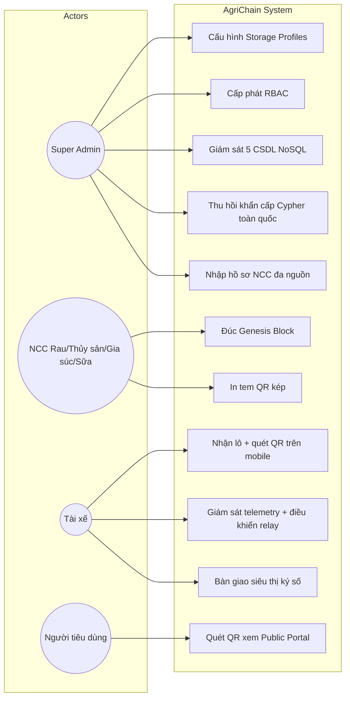
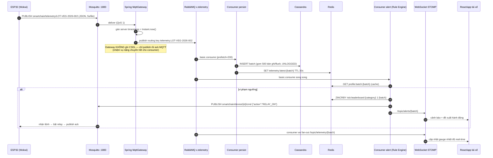
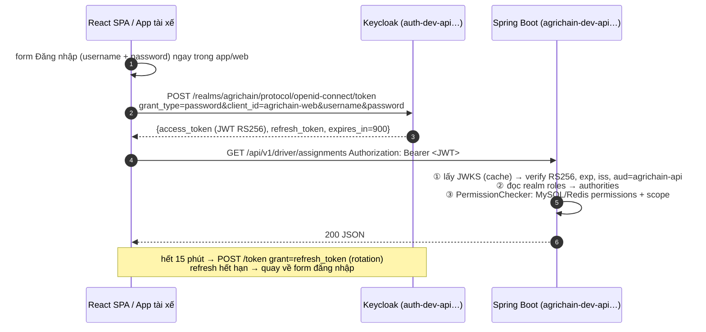
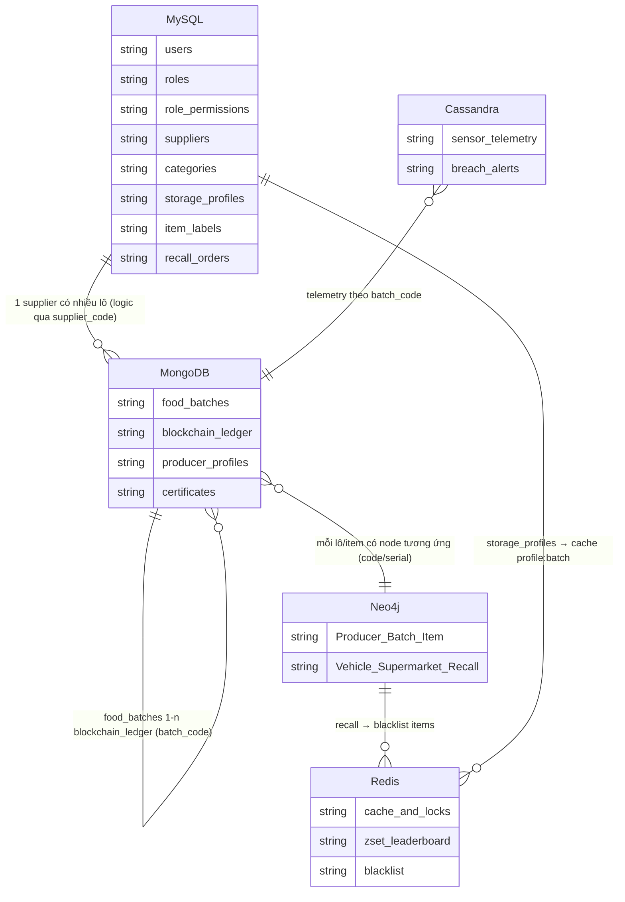

# AgriChain — Kiến trúc Hệ thống Truy xuất Nguồn gốc Thực phẩm Đa Ngành hàng Siêu thị

## Use Case từng Role · Kiến trúc · Schema 5 CSDL · Blockchain · IoT Wokwi · RabbitMQ · JWT (Direct Access Grants) · Clean Architecture (Hexagonal) · Triển khai Ansible + Cloudflare + GitHub Actions

> **Mã tài liệu:** AGRICHAIN-MASTER-ARCH-DEPLOY-2026
> **Ngày phát hành:** 08/11/2026
> **Kế thừa trực tiếp:**
> - `KE_HOACH_KIEN_TRUC_HE_THONG_BLOCKCHAIN_IOT_NOSQL.md` — Bản kế hoạch tham khảo (5 ngành hàng, 5 CSDL NoSQL, IoT Wokwi, Storage Profiles, TTI, Neo4j Recall).
> - `DEPLOYMENT_AND_GITHUB_ACTIONS.md` — Toàn bộ mô hình CI/CD + Ansible + Dockerfile của dự án LMS trước đó (được "khử" sang stack Java/AgriChain).
> - Cấu hình thực tế server `agrichain-dev-server` (ảnh chụp `bootstrap.yml` + bảng thông số): Oracle Cloud Free Tier, ARM64 Ampere A1, 4 OCPU, 24 GB RAM, IP công `140.245.54.161`, user SSH `ubuntu`, key `~/.ssh/id_deploy` (Ed25519), Nginx + Certbot + Keycloak đã bootstrap với 4 tên miền (`lms-dev-api:8081`, `agrichain-dev-api:8082`, `auth-dev-api:8080`, `ogani-demo-hosting:8083`).

---

## MỤC LỤC

- [PHẦN 0: BẢNG QUYẾT ĐỊNH KIẾN TRÚC (TÓM TẮT ĐỌC NHANH)](#phần-0-bảng-quyết-định-kiến-trúc-tóm-tắt-đọc-nhanh)
- [PHẦN 1: VAI TRÒ TỪNG CSDL & HẠ TẦNG TRUNG GIAN (MỖI DATABASE ĐÓNG VAI TRÒ GÌ)](#phần-1-vai-trò-từng-csdl--hạ-tầng-trung-gian-mỗi-database-đóng-vai-trò-gì)
- [PHẦN 2: USE CASE CHI TIẾT TỪNG ROLE (7 VAI TRÒ, 42 USE CASE)](#phần-2-use-case-chi-tiết-từng-role-7-vai-trò-42-use-case)
- [PHẦN 3: KIẾN TRÚC HỆ THỐNG TỔNG THỂ & LUỒNG DỮ LIỆU](#phần-3-kiến-trúc-hệ-thống-tổng-thể--luồng-dữ-liệu)
- [PHẦN 4: XÁC THỰC JWT — ĐĂNG NHẬP TRỰC TIẾP BẰNG DIRECT ACCESS GRANTS (KEYCLOAK)](#phần-4-xác-thực-jwt--đăng-nhập-trực-tiếp-bằng-direct-access-grants-keycloak)
- [PHẦN 5: DATABASE SCHEMA ĐẦY ĐỦ 5 CSDL](#phần-5-database-schema-đầy-đủ-5-csdl)
- [PHẦN 6: MIGRATION DATABASE BẰNG GÌ?](#phần-6-migration-database-bằng-gì)
- [PHẦN 7: BLOCKCHAIN — DÙNG SERVICE, TỰ HOST HAY TỰ GIẢ LẬP?](#phần-7-blockchain--dùng-service-tự-host-hay-tự-giả-lập)
- [PHẦN 8: MOBILE APP TÀI XẾ (REACT NATIVE)](#phần-8-mobile-app-tài-xế-react-native)
- [PHẦN 9: TRIỂN KHAI — ANSIBLE, DOCKER, CLOUDFLARE PAGES, R2, KẾT NỐI CSDL TỪ XA QUA IP](#phần-9-triển-khai--ansible-docker-cloudflare-pages-r2-kết-nối-csdl-từ-xa-qua-ip)
- [PHẦN 10: GITHUB ACTIONS — BUILD PULL REQUEST & DEPLOY](#phần-10-github-actions--build-pull-request--deploy)
- [PHẦN 11: VÍ DỤ THỰC THI TOÀN BỘ HỆ THỐNG (END-TO-END)](#phần-11-ví-dụ-thực-thi-toàn-bộ-hệ-thống-end-to-end)
- [PHẦN 12: CLEAN ARCHITECTURE & CẤU TRÚC MÃ NGUỒN BACKEND](#phần-12-clean-architecture--cấu-trúc-mã-nguồn-backend)
- [PHẦN 13: PHỤ LỤC (FREE TIER, TOPIC MQTT, REDIS KEYS, VẬN HÀNH)](#phần-13-phụ-lục-free-tier-topic-mqtt-redis-keys-vận-hành)

---

# PHẦN 0: BẢNG QUYẾT ĐỊNH KIẾN TRÚC (TÓM TẮT ĐỌC NHANH)

Toàn bộ câu hỏi đặt ra trong yêu cầu được trả lời tóm tắt tại đây; mục chi tiết tương ứng nằm ở cột cuối.

| # | Câu hỏi | Quyết định thiết kế | Chi tiết |
|---|---------|--------------------|----------|
| 1 | Kiến trúc hệ thống? | Kiến trúc 6 tầng: IoT (Wokwi/ESP32) → Mosquitto MQTT → Spring Boot Ingestion → RabbitMQ (queue giảm tải) → 5 CSDL Polyglot → Frontend (React Web + React Native + Public Portal) | Phần 3 |
| 2 | Use case từng role? | 7 vai trò, 42 use case được đặc tả đầy đủ (tiền điều kiện, luồng chính, luồng thay thế, API, CSDL chạm vào) | Phần 2 |
| 3 | End user quét QR thấy gì? | URL trong QR trỏ thẳng tới **Public Web Portal** (`https://agrichain.pages.dev/t/{itemCode}`), không cần đăng nhập, xem hành trình + ảnh nông trại (R2) + chứng chỉ + đồ thị nhiệt + điểm TTI + bằng chứng blockchain | Phần 2.7, 2.9 |
| 4 | Super Admin Dashboard? | React (Vite) module `admin`: cấu hình Storage Profiles toàn danh mục, RBAC, giám sát sức khỏe 5 CSDL NoSQL + RabbitMQ/Mosquitto, nút **Thu hồi khẩn cấp Cypher toàn quốc**, nhập/duyệt NCC đa nguồn | Phần 2.1 |
| 5 | Tài xế dùng gì? | Mobile app **React Native (Expo)** `agrichain-driver`: 10 use case (nhận lô, quét QR, xem telemetry real-time, nhận cảnh báo, điều khiển relay, bàn giao ký số, offline sync…) | Phần 2.6, Phần 8 |
| 6 | Mosquitto + Wokwi? | Mosquitto 2.0 trên VPS, port `1883` (TCP) + `9001` (WebSocket), có tài khoản IoT; Wokwi (VSCode extension hoặc cloud) nối thẳng tới `140.245.54.161:1883`; topic tree chuẩn hóa | Phần 3.4 |
| 7 | RabbitMQ? | Topology 7 exchange/queue: `q.telemetry.persist` (ghi Cassandra), `q.telemetry.alert` (Rule Engine), `q.telemetry.ws` (WebSocket) + `q.recall.broadcast` + DLQ. Ingestion chỉ publish rồi return — consumer tự điều tốc | Phần 3.3 |
| 8 | Backend? | Java 25 LTS + Spring Boot 4.1.2 (Maven), module hóa theo package, Spring Data cho 5 CSDL + Eclipse Paho MQTT + spring-amqp | Phần 3.6 + Phần 12 |
| 9 | Migration DB bằng gì? | **Flyway** cho MySQL (chạy tự động khi start); **Mongock** cho MongoDB; **neo4j-migrations** cho Neo4j; **CQL runner có version** cho Cassandra (job 1 lần khi deploy); Redis seed bằng script | Phần 6 |
| 10 | Xác thực? | **Keycloak 26** (đã chạy tại `auth-dev-api.duckdns.org`), realm `agrichain` **import từ file `agrichain-realm-export.json` (4.2.1)**; **Direct Access Grants (password grant)** — form đăng nhập ngay trong app/web, không chuyển sang trang login Keycloak; backend là Resource Server xác thực JWT qua JWKS | Phần 4 |
| 11 | Deploy + tên miền? | **Ansible playbook `agrichain.yml`** deploy lên VPS Oracle ARM: pull image từ GHCR → `docker compose up -d --wait` → Flyway migrate → healthcheck. Backend chạy tại **`https://agrichain-dev-api.duckdns.org`** (Nginx TLS → 127.0.0.1:8082) | Phần 9.7 |
| 12 | Frontend hosting? | **Cloudflare Pages Free Tier**: `https://agrichain.pages.dev`, deploy bằng `wrangler-action` trong GitHub Actions, PR có preview URL | Phần 9.9 |
| 13 | Ảnh + backup để đâu? | **Cloudflare R2** bucket `agrichain-assets`: ảnh QR, ảnh nông trại, chứng chỉ VietGAP/HACCP, backup JSON (mongodump/mongoexport), CSV telemetry (cqlsh COPY) — presigned URL từ backend | Phần 9.10 |
| 14 | R2 có tốn phí bandwidth? | **Không**. R2 miễn phí hoàn toàn egress (khác AWS S3). Người tiêu dùng tải ảnh trực tiếp từ R2 qua presigned URL/custom domain — vài triệu lượt quét vẫn 0 đồng bandwidth; VPS chỉ trả JSON nhẹ | Phần 9.10.5 |
| 15 | Blockchain? | **Khuyến nghị: tự giả lập private hash-chain lưu MongoDB** (0 phí, khớp kế hoạch, có ký số Ed25519 + verify API + anchoring hàng ngày). Kèm hướng dẫn đầy đủ **tự host Hyperledger Besu** (4 validator QBFT, docker-compose) nếu muốn chuỗi "thật" | Phần 7 |
| 16 | Tham khảo LMS? | Giữ nguyên mô hình CI/CD 5 workflow + Ansible + GHCR của repo LMS, thay: Pest→Maven Surefire, Netlify→Cloudflare Pages, Postgres→5 CSDL, `php artisan migrate`→Flyway | Phần 0.4 |
| 17 | Schema? | MySQL (RBAC + Storage Profiles + tem + thu hồi), MongoDB (lô đa hình + blockchain ledger), Redis (cache/lock/leaderboard/blacklist), Cassandra (telemetry time-series + alerts), Neo4j (đồ thị chuỗi cung ứng + recall 0.02s) | Phần 5 |
| 18 | Ví dụ thực thi? | Kịch bản trọn vòng đời lô `LOT-VEG-2026-001` từ khâu admin cấu hình → HTX đúc Genesis → xe lạnh → bàn giao siêu thị → người tiêu dùng quét QR → thu hồi khẩn cấp, kèm lệnh thật + output thật | Phần 11 |
| 19 | GitHub Actions? | PR: `ci-backend` / `ci-frontend` / `ci-mobile` (required checks, chỉ build + test). Merge `main`: build ARM64 → push GHCR → `backend-deploy` (Ansible) → Cloudflare Pages → EAS APK | Phần 10 |
| 20 | DB truy cập từ xa? | 5 CSDL + RabbitMQ + Mosquitto mở port ra IP công `140.245.54.161`, giới hạn bằng **OCI Security List + UFW whitelist IP văn phòng**, user riêng cho remote, mật khẩu mạnh; khuyến nghị thêm lớp SSH tunnel | Phần 9.8 |
| 21 | Kiến trúc mã nguồn backend? | **Modular Monolith + Hexagonal/Clean "pragmatic"** trong từng module nghiệp vụ: `domain / application (port + use case) / infrastructure / ingest|web` — domain KHÔNG import Spring/Cassandra/RabbitMQ (ép bằng ArchUnit trong CI); code khuôn telemetry/ledger/batch | Phần 12 |

---

## 0.1 Bản đồ hạ tầng & tên miền (phát sinh từ ảnh `bootstrap.yml` và bảng thông số server)

| Thành phần | Địa chỉ truy cập | Nơi thực thi | Ghi chú |
|---|---|---|---|
| Web Public Portal (người tiêu dùng) | `https://agrichain.pages.dev` | Cloudflare Pages (Free) | Quét QR mở URL dạng `/t/{itemCode}` |
| Web Admin / Supplier | `https://agrichain.pages.dev/admin` … | Cloudflare Pages (Free) | 1 project React Vite, routing theo phân hệ |
| Backend API (Java) | `https://agrichain-dev-api.duckdns.org` | VPS Oracle ARM64 | Nginx TLS (Certbot) → `127.0.0.1:8082` → container `agrichain_web` → `backend:8080` |
| Keycloak (OIDC) | `https://auth-dev-api.duckdns.org` | VPS Oracle ARM64 | Đã bootstrap từ `bootstrap.yml`, port nội bộ 8080 |
| Mosquitto MQTT | `140.245.54.161:1883` (TCP), `:9001` (WSS) | VPS (Docker) | Wokwi + firmware ESP32 nối vào đây |
| RabbitMQ | `140.245.54.161:5672` (AMQP), `:15672` (Management UI) | VPS (Docker) | Queue giảm tải ingestion |
| MySQL 8.0 | `140.245.54.161:3306` | VPS (Docker) | RBAC, Storage Profiles, tem, thu hồi |
| MongoDB 6.0 | `140.245.54.161:27017` | VPS (Docker) | Lô đa hình + blockchain ledger |
| Redis 7.0 | `140.245.54.161:6379` | VPS (Docker) | Cache, lock đúc block, leaderboard, blacklist |
| Cassandra 4.1 | `140.245.54.161:9042` | VPS (Docker) | Telemetry big data time-series |
| Neo4j 5.x | `140.245.54.161:7474` (HTTP), `:7687` (Bolt) | VPS (Docker) | Đồ thị chuỗi cung ứng + recall |
| Cloudflare R2 | `https://<ACCOUNT_ID>.r2.cloudflarestorage.com/agrichain-assets` | Cloudflare | Ảnh QR, chứng chỉ, backup JSON/CSV — egress 0đ |

> **Lưu ý RAM:** VPS 24 GB (4 OCPU ARM64) đã chạy Keycloak (~1.5 GB) + LMS + Ogani. Phân bổ cho AgriChain ~10–12 GB (chi tiết bảng phân bổ RAM tại Phụ lục E). Nếu thiếu, giảm heap Cassandra/Neo4j hoặc tạm dừng stack LMS (`docker compose -f /opt/lms/backend/docker-compose.yml stop`).

---

## 0.2 Sơ đồ hạ tầng triển khai (Deployment View)

```text
                         ┌────────────────────────────┐
                         │   NGƯỜI TIÊU DÙNG / QUÉT QR │
                         └─────────────┬──────────────┘
                                       │ HTTPS (JSON + ảnh từ R2)
                 ┌─────────────────────▼──────────────────────────┐
                 │        CLOUDFLARE (Free Tier)                  │
                 │  • Pages: agrichain.pages.dev (React Vite)      │
                 │  • R2: bucket agrichain-assets                  │
                 │    - /qr/{batch}.png  (ảnh mã QR)               │
                 │    - /certificates/{supplier}/VietGAP.pdf       │
                 │    - /farm-photos/{batch}/*.jpg                 │
                 │    - /backups/mongo/*.json.gz, /cassandra/*.csv │
                 │    → EGRESS 0 ĐỒNG (không tính bandwidth)       │
                 └───────┬───────────────────────────┬────────────┘
                         │ API (JSON)                 │ ảnh/CSV (trực tiếp)
                         ▼                            ▼
┌────────────────────────────────────────┐   (client tải ảnh thẳng từ R2
│  VPS ORACLE ARM64 140.245.54.161       │    bằng presigned URL —
│  agrichain-dev-server (Ubuntu)         │    không qua VPS)
│                                        │
│  Nginx (443, Let's Encrypt)            │
│   ├─ agrichain-dev-api.duckdns.org ────┼──► 127.0.0.1:8082
│   └─ auth-dev-api.duckdns.org    ──────┼──► Keycloak:8080
│                                        │
│  Docker network: agrichain_net          │
│   ┌──────────────────────────────────┐ │
│   │ agrichain_web (Nginx)  :80→8082  │ │
│   │ backend (Spring Boot)  :8080     │ │
│   │ mosquitto  :1883 / :9001         │ │◄──── Wokwi ESP32 (mô phỏng IoT)
│   │ rabbitmq   :5672 / :15672        │ │
│   │ mysql :3306  mongodb :27017      │ │
│   │ redis :6379  cassandra :9042     │ │
│   │ neo4j :7474/:7687                │ │
│   └──────────────────────────────────┘ │
└────────────────────────────────────────┘
          ▲                                    ▲
          │ SSH (id_deploy, Ed25519)           │ AMQP/MQTT/Bolt… (whitelist IP)
   GitHub Actions                        Laptop dev / DB client
   (Ansible playbook agrichain.yml)      (kết nối CSDL từ xa qua IP)
```

---

## 0.3 Cấu trúc Monorepo (đối chiếu 1-1 với mô hình repo LMS)

```text
agrichain/
├── .github/
│   └── workflows/
│       ├── ci-backend.yml              # (≈ ci-backend.yml của LMS) PR + main
│       ├── backend-build-and-push.yml  # build ARM64 → GHCR
│       ├── backend-deploy.yml          # workflow_run → Ansible → VPS
│       ├── ci-frontend.yml             # build + deploy Cloudflare Pages
│       └── ci-mobile.yml               # lint/tsc/jest + EAS build APK
├── agrichain-be/                        # (≈ lms-be) Spring Boot 4.1.2, Java 25 LTS
│   ├── src/main/java/vn/agrichain/
│   ├── src/main/resources/
│   │   ├── application.yml
│   │   ├── db/migration/               # Flyway (MySQL) V1__…V7__…
│   │   ├── db/mongock/                 # Mongock change units (MongoDB)
│   │   ├── db/cassandra/               # V001_*.cql, V002_*.cql
│   │   └── db/neo4j-migrations/        # V001__constraints.cypher
│   ├── Dockerfile                      # multi-stage ARM64
│   ├── docker-compose.yml              # 10 services production
│   ├── docker/nginx.conf               # reverse proxy nội bộ
│   ├── docker/mosquitto/mosquitto.conf
│   ├── docker/mysql/init.sql
│   ├── docker/mongo/init-indexes.js
│   └── deploy/
│       ├── hosts.ini
│       ├── agrichain.yml                # (≈ lms.yml) Ansible playbook
│       └── templates/agrichain.env.j2   # (≈ lms.env.j2)
├── agrichain-fe/                        # (≈ lms-fe) React 18 + Vite + Tailwind
│   └── src/pages/{admin,supplier,qc,pos,public}/
├── agrichain-native/                    # (≈ lms-native) Expo React Native — app tài xế
│   └── eas.json
├── firmware/                            # PlatformIO + Wokwi (ESP32)
│   ├── diagram.json
│   ├── platformio.ini
│   ├── wokwi.toml
│   └── src/main.cpp
└── docs/                                # tài liệu kiến trúc này
```

---

## 0.4 Bảng ánh xạ "mượn" từ dự án LMS (giữ tinh thần, đổi công nghệ)

| Thành phần trong repo LMS | Tương ứng trong AgriChain | Ghi chú thay đổi |
|---|---|---|
| `ci-backend.yml` (PHP 8.4 + Pest + PHPStan, Postgres 16 service) | `ci-backend.yml` (Java 25 + Maven + Surefire/Failsafe, Testcontainers MySQL/Mongo/Redis/Cassandra/Neo4j) | service container → Testcontainers |
| `backend-build-and-push.yml` (arm64, GHCR `lms-backend`) | idem, image `ghcr.io/<owner>/agrichain-backend` | giữ nguyên QEMU + buildx |
| `backend-deploy.yml` (workflow_run → Ansible `lms.yml`) | idem → Ansible `agrichain.yml` | thêm biến R2, Keycloak, RabbitMQ |
| `ci-frontend.yml` → Netlify | `ci-frontend.yml` → **Cloudflare Pages** (wrangler-action) | đổi action deploy |
| `ci-mobile.yml` → EAS build `--local` | idem, project `agrichain-native` | giữ nguyên |
| `Dockerfile` PHP-FPM multi-stage | `Dockerfile` Java multi-stage (builder mvn → jre) | đổi base image |
| `docker-compose.yml` (lms_db + lms_backend + lms_web) | 10 services (5 DB + mosquitto + rabbitmq + backend + web) | mở rộng |
| `deploy/lms.yml` (assert vars → template .env → GHCR login → pull → up --wait → migrate → /up → cron backup) | `agrichain.yml` y hệt bước, migrate = Flyway auto-run + job CQL, healthcheck `/actuator/health` | thêm cron backup lên R2 |
| `templates/lms.env.j2` | `templates/agrichain.env.j2` | thêm R2/Keycloak/MQTT/AMQP |
| Secrets `SERVER_IP`, `SSH_PRIVATE_KEY`, `GHCR_PAT` | idem + `CLOUDFLARE_API_TOKEN`, `R2_*` | mở rộng |

---

# PHẦN 1: VAI TRÒ TỪNG CSDL & HẠ TẦNG TRUNG GIAN (MỖI DATABASE ĐÓNG VAI TRÒ GÌ)

## 1.1 Nguyên lý Polyglot Persistence

Mỗi nghiệp vụ của AgriChain có "hình dạng dữ liệu" và "tải" khác nhau, không có một CSDL nào xuất sắc mọi mặt:

- **RBAC + Storage Profiles** cần quan hệ, ràng buộc, giao dịch ACID, Version khóa ngoại → quan hệ.
- **Hồ sơ lô hàng 4 ngành hàng** khác nhau hoàn toàn trường dữ liệu (rau có PHI, cá có ao/bể, sữa có lô thanh trùng) → document schemaless.
- **Trạng thái tem, cache profile, khóa phân tán** cần độ trễ < 1 ms, TTL tự động → in-memory.
- **Telemetry 5 giây/lần × hàng trăm thiết bị** cần ghi hàng triệu dòng廉价, đọc theo chuỗi thời gian → wide-column.
- **Truy vết & thu hồi khẩn cấp toàn quốc** cần duyệt quan hệ nhiều tầng trong 1 truy vấn → graph.

## 1.2 Bảng vai trò tổng hợp (8 thành phần lưu trữ/nhắn tin)

| # | Thành phần | Mô hình dữ liệu | Vai trò nghiệp vụ trong AgriChain | Vì sao chọn | Dữ liệu tiêu biểu |
|---|---|---|---|---|---|
| 1 | **MySQL 8.0** | Quan hệ ACID | "Bộ não quy chuẩn": RBAC (user/role/permission), danh mục ngành hàng, **bảng `storage_profiles`** (ngưỡng nhiệt/khí/TTI từng ngành), nhà cung cấp, xe/thiết bị, **trạng thái tem `item_labels`**, lệnh thu hồi `recall_orders`, audit log | Cần FK, transaction, version profile, báo cáo SQL join | 1 row profile = `VEG_FRUIT 8–12°C, C2H4 ≤ 30ppm, Ea=50` |
| 2 | **MongoDB 6.0** | Document BSON | "Hồ sơ + sổ cái": collection `food_batches` đa hình (mỗi ngành hàng một nhánh JSON riêng), `blockchain_ledger` (hash-chain tự giả lập), `producer_profiles`, `certificates` (metadata file R2), `recall_events` | Schemaless — HTX rau và nhà máy sữa lưu cùng collection mà không phải ALTER TABLE | 1 doc lô cá hồi chứa `aquaculture_details.pond_id`, `withdrawal_period_days` |
| 3 | **Redis 7.0** | In-memory KV/ZSET | "Tốc độ nóng": cache `profile:batch:*`, `telemetry:latest:*` (TTL 30s), **blacklist tem khi thu hồi (banner đỏ portal)**, `risk:leaderboard:{category}` ZSET, rate-limit Public Portal, cache JSON trace cho hàng triệu lượt quét | Độ trễ sub-ms, TTL native, ZSET xếp hạng | `SADD blacklist:items QR-ITEM-VEG-001-015` |
| 4 | **Cassandra 4.1** | Wide-column time-series | "Đĩa ghi dữ liệu lớn": bảng `sensor_telemetry` partition theo `(batch_code, year_month)` — chịu tải ghi 5 msg/s/thiết bị × N thiết bị không rớt; `breach_alerts` lưu sự kiện vi phạm; TTL 180 ngày tự dọn | Ghi append-only cực nhanh, đọc theo partition key | `INSERT … ('LOT-VEG-2026-001','2026-11',now(),'ESP32-MULTI-01','VEG_FRUIT',9.5,90,15,'C2H4',150,false,false)` |
| 5 | **Neo4j 5.x** | Graph (LPG) | "Bản đồ quan hệ": `Producer→Batch→Item→Supermarket`, `Vehicle`, `Recall`; truy vết hành trình 1 truy vấn; **thu hồi khẩn cấp toàn quốc 0.02s** (duyệt đồ thị thay vì JOIN nhiều tầng) | Độ sâu quan hệ không đổi chi phí duyệt | `MATCH (b:Batch {code:'LOT-VEG-2026-001'})-[:CONTAINS]->(i:Item) WHERE i.status IN ['PACKED','DELIVERED'] RETURN …` |
| 6 | **RabbitMQ 3.12** | Message queue | "Bộ đệm giảm tải": tách ingestion MQTT khỏi việc ghi CSDL; consumer tự điều tốc; DLQ giữ tin lỗi; broadcast lệnh thu hồi tới mọi instance backend | Backpressure, retry, routing linh hoạt | exchange `x.telemetry` → queue `q.telemetry.persist` |
| 7 | **Mosquitto 2.0** | MQTT broker | "Cầu nối IoT": nhận telemetry từ ESP32 (Wokwi), gửi lệnh OTA config profile + lệnh relay ON/OFF xuống thiết bị | Nhẹ (<10 MB RAM), QoS 0/1, retained message | topic `smartchain/telemetry/LOT-VEG-2026-001` |
| 8 | **Cloudflare R2** | Object storage S3-compatible | "Kho file": ảnh QR in tem, ảnh nông trại/ao nuôi, chứng chỉ VietGAP/HACCP/GlobalGAP (PDF), backup JSON (mongodump/mongoexport), CSV telemetry (cqlsh COPY) | **Egress 0đ** — phục vụ triệu lượt quét QR | `certificates/PROD-DALAT-01/VietGAP-VG-2026-8899.pdf` |

## 1.3 Bốn luồng dữ liệu chủ đạo

```text
(1) LUỒNG TELEMETRY (vi khí hậu 5 giây/lần)
 ESP32 Wokwi → MQTT(1883) → Mosquitto → Spring MqttIngestionGateway
   → publish RabbitMQ x.telemetry → 3 consumer song song:
      • q.telemetry.persist → batch-write Cassandra (500 bản/flush)
      • q.telemetry.alert  → Rule Engine so Storage Profile → Redis ZSET + MQTT downlink RELAY_ON
      • q.telemetry.ws     → WebSocket STOMP → React Dashboard / app tài xế
   → Redis telemetry:latest:{batch} (TTL 30s)

(2) LUỒNG BLOCKCHAIN (mỗi sự kiện chuỗi cung ứng)
 React (Supplier/Admin) → POST /api/v1/... → Spring BlockchainService
   → chuẩn hóa payload JSON → SHA-256(prevHash + payload + ts)
   → ký số Ed25519 (private key cấp cho tổ chức) → INSERT MongoDB blockchain_ledger
   → song song: MERGE node/quan hệ vào Neo4j

(3) LUỒNG QUÉT QR CỦA NGƯỜI TIÊU DÙNG (hàng triệu lượt)
 Camera điện thoại → https://agrch.pages.dev/t/{itemCode} (Cloudflare Pages)
   → GET /api/v1/public/trace/{itemCode} (JWT KHÔNG cần, rate-limit Redis)
   → 1) Redis cache:public:trace:* (TTL 5 phút, hit ~95%)
     2) MISS → MongoDB food_batches + blockchain_ledger (verify hash)
     3) Neo4j: hành trình Producer→Batch→Item→Supermarket
     4) Cassandra: chuỗi nhiệt độ → tính TTI freshness
     5) Trả JSON + danh sách presigned URL ảnh R2 → client tải ảnh trực tiếp từ R2

(4) LUỒNG THU HỒI KHẨN CẤP (emergency recall)
 Admin nhấn nút → POST /api/v1/admin/recalls
   → Cypher (Neo4j): quét đồ thị toàn quốc trả siêu thị + tem chưa bán (≈0.02s)
   → Redis: SET recall:lock:{batch} + SADD blacklist:items …
   → RabbitMQ x.recall → mọi instance → invalidate cache Public Portal (tem thuộc lô hiện banner thu hồi)
   → MongoDB: đúc Block RECALLED + Neo4j (:Recall)-[:QUARANTINES]->(:Item)
   → App tài xế: push FCM thu hồi lô đang trên đường
```

## 1.4 Nếu chỉ dùng một CSDL duy nhất sẽ sao?

| Yêu cầu | Dùng 1 CSDL quan hệ truyền thống | AgriChain dùng |
|---|---|---|
| 4 ngành hàng, trường dữ liệu khác nhau | ALTER TABLE liên tục, bảng rỗng nhiều cột | MongoDB đa hình |
| 1000 telemetry/giây đỉnh | INSERT row-lock, index phình, chậm dần | Cassandra append + TTL tự dọn |
| Kiểm tra tem khi quét QR / bàn giao < 10 ms | Query qua mạng đĩa ~50 ms+ | Redis sub-ms |
| Truy vết 3 tầng quan hệ toàn quốc | JOIN 5 bảng, quét toàn bảng, chậm | Neo4j duyệt con trỏ 0.02s |
| Hàng triệu lượt quét QR đọc ảnh | Bandwidth server tốn hàng trăm $/tháng | R2 egress 0đ |
| Sổ cái bất biến chống gian lận | Bảng thường có thể UPDATE/SILENT edit | Hash-chain append-only + verify API |

---
# PHẦN 2: USE CASE CHI TIẾT TỪNG ROLE (7 VAI TRÒ, 42 USE CASE)

## 2.0 Tổng quan tác nhân, nền tảng và vai trò Keycloak

| Mã vai trò (Keycloak realm role) | Tác nhân thực tế | Nền tảng | Phân hệ | Ghi chú |
|---|---|---|---|---|
| `SUPER_ADMIN` | Quản trị viên hệ thống siêu thị | React Web (Desktop) | `/admin/*` | Toàn quyền, gồm cả nút thu hồi khẩn cấp |
| `SUPPLIER_VEGETABLE` | Hợp tác xã Rau củ quả | React Web | `/supplier/*` | Form đặc thù: phân bón, BVTV, PHI |
| `SUPPLIER_SEAFOOD` | Cơ sở nuôi trồng thủy sản | React Web | `/supplier/*` | Form: vùng nuôi, ao/bể, thức ăn, kháng sinh, tồn dư |
| `SUPPLIER_LIVESTOCK` | Trang trại gia súc/gia cầm | React Web | `/supplier/*` | Form: vaccine, kiểm dịch, giết mổ mát |
| `SUPPLIER_DAIRY` | Nhà máy chế biến sữa/đồ hộp | React Web | `/supplier/*` | Form: lô Pasteur/UHT, vi sinh |
| `DRIVER` | Tài xế xe lạnh đa khoang | **React Native (Expo)** | app `agrichain-driver` | 10 use case thiết kế riêng, xem Phần 8 |
| `CONSUMER` | Người tiêu dùng cuối | **Public Web Portal (không đăng nhập)** | `/t/{itemCode}` | Quét QR bằng camera điện thoại |

Sơ đồ use case tổng quát (Mermaid — render trực tiếp trên GitHub):



---

## 2.1 SUPER_ADMIN — React Admin Dashboard (`agrichain-fe/src/pages/admin/`)

Cấu trúc màn hình của dashboard:

```text
AdminLayout (Sidebar + Topbar hiển thị JWT claims: tên, vai trò, realm)
├── StorageProfilesPage      — UC-A-01: bảng 5 ngành hàng, CRUD có version + diff
├── RbacPage                 — UC-A-02: Users / Roles / Permissions / gán scope NCC
├── SuppliersPage            — UC-A-03: onboarding NCC 4 loại, duyệt chứng chỉ
├── InfraMonitorPage         — UC-A-04: 5 card CSDL + RabbitMQ + Mosquitto (poll 5s)
├── EmergencyRecallPage      — UC-A-05/06: nút đỏ + bản đồ tiến độ thu hồi
├── LedgerVerifyPage         — UC-A-07: verify hash-chain, xuất bằng chứng
├── BackupPage               — UC-A-08: lịch backup lên R2, nút export ngay
├── RiskBoardPage            — UC-A-09: leaderboard rủi ro Redis theo ngành
└── IoTAssignmentsPage       — UC-A-10: gán batch ↔ thiết bị, nút đồng bộ OTA
```

### UC-A-01: Cấu hình bảng Storage Profiles cho toàn bộ danh mục thực phẩm

- **Actor:** Super Admin — **Nền tảng:** Web `/admin/storage-profiles` — **Phân hệ:** `SUPER_ADMIN`
- **Tiền điều kiện:** đã đăng nhập bằng Direct Access Grants (form trong SPA); tồn tại ít nhất 5 danh mục ngành hàng (`categories`).
- **Luồng chính:**
  1. Admin mở trang, React gọi `GET /api/v1/admin/storage-profiles?activeOnly=false` (JWT Bearer).
  2. Backend đọc **MySQL** `storage_profiles` join `categories`, trả 5 profile chuẩn: `CHILLED_MEAT (0–4°C, NH3≤40ppm)`, `FRESH_SEAFOOD (0–2°C, TMA≤25ppm)`, `VEG_FRUIT (8–12°C, C2H4≤30ppm)`, `DAIRY (2–6°C, NONE)`, `DEEP_FROZEN (-30…-18°C, NONE)`.
  3. Admin sửa một dòng, ví dụ kéo `VEG_FRUIT.max_temp` từ `12.0` → `10.0` (mùa hè thấp hơn) và thêm `max_door_open_sec = 180`.
  4. Nhấn **Lưu** → `PUT /api/v1/admin/storage-profiles/{profileId}` kèm `version` hiện tại (optimistic locking).
  5. Backend trong 1 transaction (ACID MySQL):
     - `UPDATE storage_profiles SET max_temp=10.0, version=version+1, updated_by=? WHERE profile_id=? AND version=?` — nếu `version` cũ → trả `409 CONFLICT` yêu cầu reload;
     - `INSERT INTO storage_profile_history (…snapshot cũ…)`.
  6. Backend **xóa cache Redis** `profile:{categoryCode}` và `profile:batch:*` của ngành đó (`SCAN + DEL`), để lần telemetry kế tiếp nạp lại ngưỡng mới.
  7. Backend ghi `audit_logs` (actor, before, after, IP).
- **Luồng thay thế:** 4a. Cấu hình vi phạm logic (`min_temp ≥ max_temp`, `gas_type='NONE'` nhưng `max_gas>0`) → `400 VALIDATION_ERROR`, hiển thị lỗi cạnh trường tương ứng. 5a. Conflict version → toast "Dữ liệu vừa bị admin khác sửa", reload diff.
- **Hậu điều kiện:** profile mới có hiệu lực cho **mọi lô hàng tiếp theo**; các lô đang chạy giữ snapshot tại thời điểm tạo (trường `profile_snapshot` nhúng trong document MongoDB lô) — bảo đảm tranh chấp pháp lý có bằng chứng theo đúng quy chuẩn thời điểm đó.
- **API:** `GET/PUT /api/v1/admin/storage-profiles`, `POST` (tạo ngành mới), `GET /api/v1/admin/storage-profiles/{id}/history`.

### UC-A-02: Cấp phát quyền RBAC

- **Actor:** Super Admin — `/admin/rbac`
- **Tiền điều kiện:** danh sách realm roles đã sync từ Keycloak.
- **Luồng chính:**
  1. `GET /api/v1/admin/users` → MySQL `users` + `user_roles` (username mirror từ Keycloak qua `keycloak_uuid` sau mỗi lần login — không lưu password phía AgriChain).
  2. Admin tạo user mới: chọn username, họ tên, gán vai trò (`DRIVER`), gán **scope** (thuộc supplier nào / xe nào — cột `supplier_id`, `vehicle_id` trong `users`).
  3. `POST /api/v1/admin/users` → backend gọi **Keycloak Admin API** (`POST /admin/realms/agrichain/users`, client `admin-cli`) tạo user thật, rồi `INSERT users` + `user_roles` trong MySQL.
  4. Admin tinh chỉnh permission: `POST /api/v1/admin/roles/{role}/permissions` cập nhật `role_permissions` (ví dụ cho `DRIVER` thêm `telemetry:read` nhưng không cho `ledger:write`).
  5. Mọi request kế tiếp đến API đều được `@PreAuthorize("hasRole('DRIVER') and @permissionChecker.has('telemetry:read')")` kiểm kép: **role trong JWT + permission trong MySQL cache Redis** (`rbac:perm:{role}` TTL 10 phút).
- **Luồng thay thế:** 3a. Keycloak trả 409 (username trùng) → rollback, không ghi MySQL. 5a. Role bị thu hồi giữa phiên → JWT chưa hết hạn vẫn hợp lệ ≤ 5 phút (access token ngắn); các quyền nhạy cảm (recall) luôn kiểm MySQL/Redis real-time.
- **Hậu điều kiện:** bảng `users`/`user_roles`/`role_permissions` khớp 1-1 Keycloak; audit log ghi đầy đủ.
- **API:** `GET/POST /api/v1/admin/users`, `PUT /api/v1/admin/users/{id}/roles`, `GET/PUT /api/v1/admin/roles/{role}/permissions`.

### UC-A-03: Nhập các thông tin Nhà Cung Cấp Đa Nguồn (Multi-Category Producers)

- **Actor:** Super Admin — `/admin/suppliers`
- **Luồng chính:**
  1. `GET /api/v1/admin/suppliers?status=PENDING` — danh sách tổ chức vừa tự đăng ký hoặc admin tự nhập.
  2. Admin chọn **loại tổ chức** trong dropdown 4 loại, form đổi tương ứng:
     - **Hợp tác xã rau củ quả:** mã số thuế, chứng chỉ VietGAP Trồng trọt (số hiệu + ngày hết hạn), danh sách thửa đất/nhà kính, danh mục giống cây.
     - **Cơ sở nuôi trồng thủy sản:** mã vùng nuôi (URI mã vùng conform VietGAP Thủy sản), danh sách ao/bể (kí hiệu + diện tích + hệ thống RAS/ao đất), giấy phép tương đương BAP, lab kiểm định ký hợp đồng.
     - **Trang trại gia súc/gia cầm:** mã trại chăn nuôi, số đăng ký thú y, giống vật nuôi, công suất, cơ sở giết mổ liên kết.
     - **Nhà máy chế biến sữa/đồ hộp:** số GMP/HACCP/ISO 22000, dây chuyền Pasteur/UHT, công suất mỗi lô.
  3. Admin tải lên chứng chỉ: React gọi `POST /api/v1/files/presign?folder=certificates/PROD-DALAT-01` → backend trả **presigned PUT URL của R2** → client upload thẳng lên R2 (không qua VPS) → lưu metadata `certificates` vào **MongoDB** `{supplier_id, type:'VietGAP', r2_key, valid_until}`.
  4. Nhấn **Duyệt hoạt động** → `PATCH /api/v1/admin/suppliers/{id}/status` `PENDING → ACTIVE`; MySQL `suppliers.status` cập nhật; Neo4j `MERGE (p:Producer {id, name, type})`.
  5. Backend cấp cho tổ chức một **cặp khóa Ed25519** (ký block): private key được sinh trong `BlockchainKeyService`, trả về file `.pem` cho NCC tải về bảo quản (backend chỉ lưu public key trong MySQL `suppliers.public_key`).
- **Luồng thay thế:** 4a. Chứng chỉ hết hạn > 6 tháng → cảnh báo nhưng vẫn cho ACTIVE với cờ `cert_warning`. 3a. File > 20 MB → presign từ chối.
- **Hậu điều kiện:** NCC có tài khoản Keycloak realm `agrichain`, vai trò tương ứng, scope chặn chỉ được tạo lô của chính mình (`@permissionChecker.ownsSupplier(...)`).
- **API:** `GET/POST/PATCH /api/v1/admin/suppliers`, `POST /api/v1/files/presign`.

### UC-A-04: Giám sát 5 CSDL NoSQL + RabbitMQ + Mosquitto

- **Actor:** Super Admin — `/admin/infra` — **poll mỗi 5 giây qua WebSocket + REST fallback**
- **Luồng chính:**
  1. React mở `GET /api/v1/admin/infra/health` (hoặc subscribe STOMP `/topic/infra`).
  2. Backend tổng hợp song song (timeout 2 s, dùng `Mono.zip`):
     - **MySQL:** `SELECT 1` + đếm connection (`SHOW STATUS LIKE 'Threads_connected'`).
     - **MongoDB:** `db.adminCommand('ping')` + `db.stats().dataSize` + số doc `food_batches`, `blockchain_ledger`.
     - **Redis:** `PING` + `INFO memory → used_memory_human` + `KEYSPACE` đếm key.
     - **Cassandra:** `SELECT now() FROM system.local` + `nodetool info` (qua JMX sidecar) — hiển thị heap + số SSTable.
     - **Neo4j:** `RETURN 1` + `CALL dbms.components()` + số node/relationship (`MATCH (n) RETURN count(n)` cache 60s).
     - **RabbitMQ:** HTTP API `:15672/api/queues` — độ sâu hàng đợi, consumer chưa ack, messages unacked (cột "Lag").
     - **Mosquitto:** subscribe `$SYS/broker/clients/connected` + `messages/`
  3. Dashboard vẽ 5 card màu (xanh < 100 ms, vàng < 500 ms, đỏ ≥ 500 ms hoặc timeout) + sparkline 1 giờ.
  4. Khi `q.telemetry.persist` vượt **10.000 message** → card chuyển cam + banner "Telemetry đang dồn — consumer lag", kèm nút **Scale consumers** (`POST /api/v1/admin/infra/consumers/scale?queue=telemetry.persist&delta=2` tăng instance consumer).
- **Luồng thay thế:** 2a. Một DB timeout → card đỏ, phần còn lại vẫn hiển thị (không aggregate fail cả trang). Luồng phụ: xem chi tiết từng DB mở drawer truy vấn thô (đã được whitelist, chống SQL/Cypher injection — chỉ tham số hóa).
- **API:** `GET /api/v1/admin/infra/health`, `GET /api/v1/admin/infra/rabbitmq/queues`, `POST /api/v1/admin/infra/consumers/scale`.

### UC-A-05: Kích hoạt lệnh Thu hồi khẩn cấp Cypher Graph toàn quốc

- **Actor:** Super Admin — `/admin/emergency-recall` — **nút đỏ 2 bước xác nhận (typing lại mã lô)**
- **Tiền điều kiện:** có bằng chứng vi phạm (block cảnh báo, kết quả xét nghiệm, phản hồi người tiêu dùng).
- **Luồng chính:**
  1. Admin nhập mã lô `LOT-VEG-2026-001` (hoặc chọn "thu hồi cả nhà cung cấp từ ngày X"), chọn lý do `PESTICIDE_RESIDUE`, mức độ `NATIONAL`, gõ lại mã lô để xác nhận.
  2. `POST /api/v1/admin/recalls` (JWT + permission `recall:trigger` kiểm real-time MySQL).
  3. Backend chạy **Cypher Neo4j** duyệt đồ thị toàn quốc (~0.02 s):
     ```cypher
     MATCH (b:Batch {code:'LOT-VEG-2026-001'})-[:CONTAINS]->(i:Item)
     OPTIONAL MATCH (b)-[:DELIVERED_TO]->(sm:Supermarket)
     WHERE i.status IN ['PACKED','DELIVERED']
     RETURN sm.name AS Supermarket, sm.address AS Address,
            count(i) AS Remaining, collect(i.serial)[..50] AS SampleSerials
     ```
  4. Backend mở transaction đa CSDL theo thứ tự an toàn:
     a. **MySQL:** `INSERT recall_orders (code:'RC-2026-001', status:'EXECUTING')` + `INSERT recall_items` (toàn bộ serial).
     b. **Redis:** `SET recall:lock:LOT-VEG-2026-001 "RECALLED" EX 604800` (7 ngày) + `SADD blacklist:items {mọi serial}` + `PUBLISH recall {json}`.
     c. **RabbitMQ** exchange `x.recall` (fanout) → mọi instance backend nhận `RECALL_BROADCAST`.
     d. **Public Portal**: mọi instance xóa cache `cache:public:trace:*` (SCAN + DEL) — mọi lượt quét tem thuộc lô từ thời điểm này hiện banner đỏ "SẢN PHẨM BỊ THU HỒI — VUI LÒNG KHÔNG SỬ DỤNG".
     e. **Neo4j:** `CREATE (r:Recall {code:'RC-2026-001', reason, at: datetime()})` + `MATCH … CREATE (r)-[:QUARANTINES]->(i) SET i.status='RECALLED'`.
     f. **MongoDB:** đúc **Block `RECALLED`** vào `blockchain_ledger` (hash nối tiếp, ký số bởi SUPER_ADMIN) — lưu vết minh bạch trách nhiệm.
     g. Push **FCM** tới app tài xế đang chở lô này ("Ngay lập tức quay về kho trung chuyển").
  5. Trả về response: `{recallCode, supermarkets: [...], itemsTotal: 200, itemsDelivered: 187, quarantineRate: '93.5%', executionMs: 21}`.
- **Luồng thay thế:** 3a. Lô chưa từng giao đi (`DELIVERED_TO` rỗng) → vẫn khóa nguồn + thông báo NCC, response ghi "chưa phân phối". 2a. Permission `recall:trigger` đã bị thu hồi giữa phiên → `403` + audit log "đã chặn hành vi".
- **Hậu điều kiện:** Public Portal hiển thị banner thu hồi đỏ khi quét tem thuộc lô; trạng thái tem `RECALLED` ở MySQL + Redis + Neo4j nhất quán.
- **API:** `POST /api/v1/admin/recalls`, `GET /api/v1/admin/recalls/{code}`.

### UC-A-06: Theo dõi tiến độ thu hồi real-time & đóng lệnh

- **Luồng chính:** trang recall hiển thị 3 chỉ số cập nhật qua STOMP `/topic/recall/{code}`: (1) số tem bị khóa & hiện banner thu hồi trên Public Portal, (2) số tem đã gom về kho (admin cập nhật theo từng siêu thị — `POST /api/v1/admin/recalls/{code}/progress`), (3) số tem đã tiêu hủy (kèm ảnh chứng nhận tiêu hủy tải lên R2 `certificates/destruction/`). Khi 100% tem xử lý xong, admin nhấn **Đóng lệnh** → `PATCH /api/v1/admin/recalls/{code}` `EXECUTING → CLOSED`, MySQL cập nhật, đúc block `RECALL_CLOSED` lên MongoDB.
- **API:** `GET /api/v1/admin/recalls`, `GET /api/v1/admin/recalls/{code}/progress`, `PATCH /api/v1/admin/recalls/{code}`.

### UC-A-07: Tra cứu & xác minh sổ cái blockchain

- **Luồng chính:** chọn lô → `GET /api/v1/admin/ledger/{batchCode}` trả chuỗi block (MongoDB `blockchain_ledger` sort `index`); nhấn **Verify** → `POST /api/v1/admin/ledger/{batchCode}/verify` chạy `ChainVerifier` (xem Phần 7.3): tính lại SHA-256 từng block, so `prev_hash`, kiểm chữ ký Ed25519 từng block, trả `{valid:true, blocksChecked: 9, anchorMatched: true}`; nút **Xuất bằng chứng** tạo PDF (chuỗi hash + chữ ký) và file JSON, upload lên R2 `backups/proofs/`, trả presigned URL tải về.
- **Luồng thay thế:** block #5 hash lệch → response đánh dấu block hỏng, đánh động SOC (thực tế chỉ xảy ra khi ai đó sửa trực tiếp MongoDB — mọi đường ghi chính thống đều append-only).

### UC-A-08: Quản lý backup & export JSON/CSV lên Cloudflare R2

- **Luồng chính:** trang `/admin/backup` hiển thị lịch backup (cron nightly 02:30, xem Phần 9.11): `mongodump` → `.json.gz`, `cqlsh COPY` → `.csv`, `mysqldump`, `neo4j-admin dump`, `redis BGSAVE`; danh sách file lấy từ R2 `GET /api/v1/admin/backups` (backend list object R2 prefix `backups/`); nút **Export ngay** → đẩy job vào queue `q.maintenance` (tránh chạy dài trên request) → khi xong STOMP toast + link presigned tải file; nút **Restore (danger)** yêu cầu gõ `RESTORE-{code}` và chỉ mở khi profile `maintenance_mode` bật.
- **API:** `GET /api/v1/admin/backups`, `POST /api/v1/admin/backups/export`, `POST /api/v1/admin/backups/restore`.

### UC-A-09: Bảng xếp hạng rủi ro theo ngành hàng & báo cáo TTI

- **Luồng chính:** `/admin/risk` gọi `GET /api/v1/admin/risk-board?category=VEG_FRUIT` → Redis `ZRANGE risk:leaderboard:VEG_FRUIT 0 9 WITHSCORES` (điểm = tổng vi phạm × trọng số theo profile); nhấp 1 lô → drill-down Cassandra `breach_alerts` xem timeline vi phạm + đồ thị nhiệt độ (dữ liệu từ `sensor_telemetry`); xuất CSV để gửi quản lý chuỗi cung ứng. Backend còn trả "TTI trung bình theo ngành" tính từ aggregation Cassandra (`SELECT category, avg(temperature)` trong khoảng giờ).
- **API:** `GET /api/v1/admin/risk-board`, `GET /api/v1/admin/batches/{code}/alerts`.

### UC-A-10: Gán lô hàng – thiết bị IoT – đồng bộ Profile OTA

- **Luồng chính:** `/admin/iot-assignments`: chọn batch `LOT-VEG-2026-001`, chọn xe `49C-567.89` + thiết bị `ESP32-MULTI-01` + khoang 2 (khoang rau); nhấn **Đồng bộ OTA** → `POST /api/v1/admin/iot-assignments` → backend:
  1. MySQL `INSERT assignments (batch_code, vehicle_id, device_id, zone, status:'ASSIGNED')`.
  2. Lấy profile từ Redis/MySQL, **publish MQTT retained** tới `smartchain/device/ESP32-MULTI-01/config`: `{"category":"VEG_FRUIT","batch":"LOT-VEG-2026-001","minTemp":8.0,"maxTemp":12.0,"maxGas":30.0,"gasType":"C2H4"}`.
  3. Trang hiển thị ACK từ thiết bị (ESP32 publish `smartchain/device/ESP32-MULTI-01/ack` chứa `profile_applied_at`) trong ≤ 5 s; nếu không ACK → card vàng + nút gửi lại.
- **API:** `GET/POST /api/v1/admin/iot-assignments`, `POST /api/v1/admin/iot-assignments/{id}/resync`.

---

## 2.2 SUPPLIER_VEGETABLE — Hợp tác xã Rau củ quả (`/supplier`)

> Khối dùng chung cho cả 4 loại NCC (kế thừa khái niệm "Dynamic Form Fields" của kế hoạch): chọn danh mục → form tự biến đổi; chứng chỉ tải lên R2; mọi sự kiện nghiệp vụ đều **đúc block**; chỉ thấy lô của chính mình (scope `supplier_id`).

### UC-RAU-01: Khai báo lô gieo trồng & nhật ký phân bón

- **Tiền điều kiện:** tổ chức đã được Super Admin duyệt (UC-A-03); có khóa Ed25519.
- **Luồng chính:**
  1. Chọn "Rau củ quả tươi" → form hiện: giống (`Xà lách mỡ Đà Lạt`), phương pháp (`Thủy canh NFT`), thửa đất (`A3-Lâm Hà`), ngày gieo.
  2. Mục **Nhật ký phân bón**: từng dòng `{sản phẩm: "Dinh dưỡng NFT A+B", liều: 2.5 L/1000L, ngày: 2026-11-01, người thực hiện}` — cho phép thêm dòng rải rác theo thời gian.
  3. `POST /api/v1/supplier/batches` → MongoDB `food_batches` tạo document `status: 'GROWING'`, nhánh `cultivation_details.fertilizer_log[]`; Neo4j `MERGE (p:Producer)-[:HARVESTS]->(b:Batch)`; **đúc block `BATCH_CREATED`** (không phải genesis — genesis chỉ đúc khi thu hoạch, xem UC-RAU-03).
  4. Các lần cập nhật nhật ký (`PATCH …/fertilizer-log`) → block `FERTILIZER_LOG_APPENDED` (chỉ append, không sửa — lịch sử bất biến).
- **Luồng thay thế:** liều lượng vượt ngưỡng khuyến cáo của danh mục thuốc (đối chiếu bảng tham chiếu `pesticide_reference` trong MySQL) → cảnh báo vàng, bắt buộc nhập lý do.
- **API:** `POST /api/v1/supplier/batches`, `POST /api/v1/supplier/batches/{code}/fertilizer-log`.

### UC-RAU-02: Nhập thuốc BVTV & theo dõi thời gian cách ly (PHI)

- **Luồng chính:**
  1. Nhập bản ghi phun: `{hoạt chất: "Abamectin", sản phẩm thương mại, liều, ngày phun: 2026-11-02}` — hệ thống tra `pesticide_reference.phi_days` (ví dụ 14 ngày) và **tự tính `earliest_harvest = 2026-11-16`**.
  2. Cột "Ngày thu hoạch dự kiến" khóa động: React disable nút thu hoạch + backend double-check — `POST …/harvest` trước `earliest_harvest` trả `422 PHI_NOT_ELAPSED {remainingDays: 3}`.
  3. Gần đến ngày: dashboard NCC hiển thị đồng hồ đếm ngược PHI từng thửa; Redis key `phi:watch:{plot}` TTL đến hạn để scheduler bắn notification "Thửa A3 đã hết PHI, được phép thu hoạch".
- **Luồng thay thế:** 2a. NCC cố ghi đè ngày phun để "gom" PHI → không thể: bản ghi phun đã nằm trong block bất biến; chỉnh sửa tạo block `CORRECTION` kèm lý do, hash gốc vẫn truy được.
- **Hậu điều kiện:** khi thu hoạch hợp lệ, nhánh `cultivation_details.pesticides_used[]` có `{chemical, spray_date, phi_days, harvest_ok: true}` và người tiêu dùng nhìn thấy minh bạch từng loại.

### UC-RAU-03: Thu hoạch & Đúc Genesis Block

- **Luồng chính:**
  1. Nhấn **Thu hoạch & Đúc Genesis Block** sau khi PHI hết → `POST /api/v1/supplier/batches/{code}/harvest` payload `{harvest_date, quantity_kg, brix, plot}`.
  2. Backend `GenesisBlockService`:
     - chuẩn hóa toàn bộ document lô (kể cả `fertilizer_log`, `pesticides_used`) thành canonical JSON;
     - `genesis_hash = SHA256("GENESIS|" + batch_code + "|" + canonical_payload)`;
     - ký Ed25519 bằng private key NCC → `signature`;
     - `INSERT MongoDB blockchain_ledger {index:0, batch_code, event_type:'GENESIS', payload_hash, prev_hash:"0".repeat(64), current_hash, signatures:[{signer:'PROD-DALAT-01', alg:'Ed25519', signature}]}`;
     - cập nhật `food_batches.status='HARVESTED'`, lưu `genesis_hash` vào document lô.
  3. Neo4j `SET b.status='HARVESTED', b.harvest_date=date('2026-11-16')`.
  4. React hiển thị màn hình "Genesis Block đã đúc" kèm hash rút gọn + nút xem chuỗi.
- **Hậu điều kiện:** từ đây mọi thay đổi thông tin lô chỉ có thể là block mới — không UPDATE document gốc (server chặn bằng middleware kiểm `status`).

### UC-RAU-04: Đóng gói & in tem QR kép (Batch QR + Item QR)

- **Luồng chính:** nhập quy cách `200 túi × 300 g` → `POST …/labels` → backend sinh `QR-BATCH-LOT-VEG-2026-001` (1 mã thùng) + `QR-ITEM-VEG-002-001…200`:
  1. MySQL bulk `INSERT item_labels (batch_code, serial_code, status:'PACKED', weight_kg, price)` (batch 500 dòng).
  2. Redis pipeline `SADD batch:items:LOT-VEG-2026-002` + `SET item:status:{serial} 'PACKED'`.
  3. Neo4j `UNWIND $serials AS s CREATE (b)-[:CONTAINS]->(i:Item {serial:s, status:'PACKED'})`.
  4. Sinh **ảnh PNG mã QR** (zxing) cho từng mã — nội dung QR = URL `https://agrichain.pages.dev/t/QR-ITEM-VEG-002-001` — upload loạt lên **R2** `qr/LOT-VEG-2026-002/{serial}.png` (multi-part upload), trả về file ZIP presigned để NCC in tem.
  5. Đúc block `LABELS_MINTED {batchQR, from, to, count:200}`.
- **Luồng thay thế:** in lại tem hỏng → sinh serial mới, serial hỏng chuyển `VOIDED` (khóa vĩnh viễn, tránh kẻ nhặt tem rác tái sử dụng).

### UC-RAU-05: Tải chứng chỉ VietGAP & ảnh nông trại (R2)

- **Luồng chính:** form kéo-thả file: chứng chỉ `VG-2026-8899.pdf`, ảnh nhà kính, ảnh thửa A3 (giới hạn JPG/PDF ≤ 20 MB, ≥ 1 MB); React xin presigned PUT → upload thẳng R2 `certificates/PROD-DALAT-01/VietGAP-VG-2026-8899.pdf` và `farm-photos/LOT-VEG-2026-002/greenhouse-01.jpg`; lưu metadata vào MongoDB `certificates[]`/`photos[]` của lô (`r2_key`, `taken_at`, `caption`). Public Portal người tiêu dùng sẽ nhận đúng các key này dưới dạng presigned GET khi quét tem (Phần 2.9).
- **API:** `POST /api/v1/files/presign`, `POST /api/v1/supplier/batches/{code}/certificates`.

---

## 2.3 SUPPLIER_SEAFOOD — Cơ sở nuôi trồng thủy sản

### UC-TS-01: Đăng ký mã vùng nuôi & số hiệu ao/bể nuôi

- **Luồng chính:** khai báo `{farm_code:'AQUA-SAPA-01', farm_name:'Trại cá hồi nước lạnh Sa Pa', cert:'VietGAP Thủy sản', ponds:[{id:'BE-RAS-05', type:'RAS', area_m2:120}, {id:'AO-12', type:'ao đất', area_m2:800}]}` → `POST /api/v1/supplier/aqua-farms` → MySQL `suppliers` + `aquafarm_registry` (bảng con của NCC); MongoDB `producer_profiles` nhánh `aquaculture`; Neo4j `MERGE (p:Producer {type:'FISHERY'})`. Mỗi ao có QR nội bộ dán tại bờ ao để nhân viên quét khi ghi nhật ký (chống ghi nhầm ao).
- **API:** `POST /api/v1/supplier/aqua-farms`, `GET /api/v1/supplier/aqua-farms/{code}/ponds`.

### UC-TS-02: Nhật ký thức ăn hằng ngày

- **Luồng chính:** nhân viên quét QR ao `BE-RAS-05` (trên mobile web supplier) → form nhanh: `{ngày, loại thức ăn: 'Bio-Aqua 4mm', lượng kg, số bia, ghi chú chất lượng nước: temp/DO/pH}` → `POST /api/v1/supplier/ponds/BE-RAS-05/feed-log` → MongoDB append mảng `feed_log[]` (thiết kế bucket theo tháng `feed_log.2026-11[]` để document không phình vô hạn); block `FEED_LOG_APPENDED` đúc kèm. FCR (tỉ lệ chuyển đổi thức ăn) tự tính hiển thị cho trại.
- **Luồng thay thế:** mất mạng tại ao → mobile web lưu IndexedDB, đồng bộ lại khi có mạng (idempotent theo `client_uuid`).

### UC-TS-03: Nhật ký kháng sinh & thời gian cách ly (withdrawal period)

- **Luồng chính:** khi dùng thuốc (kể cả dự phòng): `{hoạt chất: 'Florfenicol', liều, ngày bắt đầu 2026-09-20, ngày kết thúc 2026-09-25, withdrawal_days: 15}` → hệ thống khóa thu hoạch tới `2026-10-10` (logic giống PHI của rau — UC-RAU-02); nếu thuốc cấm dùng trong nuôi trồng (đối chiếu `pesticide_reference` loại `AQUA_DRUG`) → **từ chối thẳng 403, ghi audit log cảnh báo** (đây là tín hiệu sớm cho thanh tra).
- **Hậu điều kiện:** `earliest_harvest` của ao được cập nhật; Redis `withdrawal:watch:{pond}` TTL.

### UC-TS-04: Kiểm định tồn dư kháng sinh (lab test)

- **Luồng chính:** trước thu hoạch, trại gửi mẫu nước/cá tới lab → nhận PDF kết quả: `{antibiotic_residue: 'NEGATIVE', formol: 'NEGATIVE', borax: 'NEGATIVE', histamine_ppm: 8.5, lab:'QUATEST 1', report_no:'QT-2026-1122'}`; tải PDF lên R2 `certificates/AQUA-SAPA-01/lab-QT-2026-1122.pdf` + nhập kết quả số → backend kiểm `earliest_harvest` đã đạt + tồn dư âm tính → mới cho phép thu hoạch; block `LAB_TEST_ATTACHED` đúc kèm PDF hash (SHA-256 file) trong payload — **bất biến hóa luôn cả file chứng chỉ**.
- **API:** `POST /api/v1/supplier/batches/{code}/lab-tests`.

### UC-TS-05: Thu hoạch lô cá & đúc Genesis Block + tem kép

- **Luồng chính:** tương tự UC-RAU-03/04 nhưng payload genesis chứa `aquaculture_details` (ao, mật độ, ngày thả giống, giống cá, toàn bộ feed_log tổng hợp, withdrawal history) + `safety_tests`; category `FRESH_SEAFOOD`; profile nạp vào Redis là `0–2°C, TMA≤25ppm`; tem: `QR-BATCH-LOT-FISH-2026-001` + `QR-ITEM-FISH-001-001…050` (50 khay × 1 kg).

---

## 2.4 SUPPLIER_LIVESTOCK — Trang trại gia súc/gia cầm

### UC-GS-01: Khai báo đàn vật nuôi

- **Luồng chính:** `{giống:'Heo mundane_white (Móng Cái lai), số lượng 120, mã tai range 'MC-2601…MC-2720', chuồng:'CHUONG-2'}` → MySQL `livestock_batches` + MongoDB `producer_profiles.livestock`; Neo4j `(:Producer {type:'LIVESTOCK'})-[:RAISES]->(:Herd)`. Nhập bằng Excel template (cột chuẩn hoá) — backend validate từng dòng, trả báo cáo dòng lỗi.

### UC-GS-02: Nhật ký tiêm phòng vaccine

- **Luồng chính:** mỗi mũi tiêm: `{vaccine:'Classical Swine Fever (dịch tả)', mũi 2/2, ngày 2026-10-05, số seri vial, người tiêm}` → MongoDB `vaccination_log[]` append + block `VACCINE_ADMINISTERED`; hệ thống đối chiếu lịch tiêm chuẩn theo giống → dashboard nhắc mũi kế tiếp; **thiếu mũi bắt buộc = chặn xuất trại** (backend check `vaccination_complete` khi tạo lô thịt).

### UC-GS-03: Kiểm dịch thú y

- **Luồng chính:** trước xuất trại, nhập số giấy kiểm dịch ` vet-cert 2026/…`, tải scan PDF lên R2 `certificates/PROD-BAOLOC-01/vet-2026-887.pdf`, nhập `{ngày kiểm dịch, phạm vi, kết quả:'ĐẠT', cơ quan:'Chi cục Chăn nuôi & Thú y Lâm Đồng'}` → block `VET_CERT_ATTACHED` (kèm SHA-256 file). Giấy hết hạn > 3 ngày trước ngày mổ → cảnh báo.

### UC-GS-04: Giết mổ mát & tạo lô thịt

- **Luồng chính:** nhập `{cơ sở mổ:'AB Slaughterhouse Bảo Lộc', ngày mổ, số lô mổ, mã trọng lượng trung bình, chế độ mát}` → backend tạo batch `LOT-PORK-2026-001`, category `CHILLED_MEAT`, gắn `slaughter_details` (liên kết Herd, vet cert); đúc Genesis Block (payload gồm toàn bộ lịch vaccine + kiểm dịch); Neo4j `(:Herd)-[:SLAUGHTERED_IN]->(:Batch)`.

### UC-GS-05: Đóng gói & tem kép

- Như UC-RAU-04; profile `0–4°C, NH3≤40ppm`; tem `QR-ITEM-PORK-001-xxx`.

---

## 2.5 SUPPLIER_DAIRY — Nhà máy chế biến sữa/đồ hộp

### UC-SUA-01: Khai báo lô sản xuất & nguyên liệu đầu vào

- **Luồng chính:** lô sữa tươi `LOT-MILK-2026-001`: chọn nguồn nguyên liệu (sữa tank ngày 2026-11-06 từ trang trại bò `PROD-DONTHUONG`, khối lượng, chỉ số chất béo/protein đầu vào) → **truy xuất 2 tầng**: block của lô sữa nhà máy tham chiếu `input_batches[]` chứa genesis hash của lô nguyên liệu → Neo4j `(bRaw:Batch)-[:PROCESSED_INTO]->(bProduct:Batch)` (đồ thị cho phép người tiêu dùng bấm "xem nguồn sữa tươi").

### UC-SUA-02: Nhập số lô thanh trùng Pasteur/UHT

- **Luồng chính:** form: `{phương pháp: 'Pasteur HTST 72°C/15s' | 'UHT 135°C/4s', số lò, số lô thanh trùng 'PL-2026-11-08-A', thời điểm bắt đầu/kết thúc, bản ghi nhiệt độ tự động từ sensor dây chuyền (nếu nhà máy đã nối MQTT — topic riêng `dairy/pasteur/{line}`)}` → backend đối chiếu: nếu nhiệt độ thực tế < chuẩn trong bất kỳ giây nào → đánh cờ `pasteur_deviation` và bắt buộc QA duyệt tay + block `PASTEUR_DEVIATION_REPORTED`; đạt → block `PASTEUR_COMPLETED`.
- **API:** `POST /api/v1/supplier/batches/{code}/pasteurization`.

### UC-SUA-03: Chỉ số vi sinh

- **Luồng chính:** nhập kết quả lab: `{TPC (vi khuẩn hiếu khí): 1200 CFU/g, Coliform: <10, E.coli: không phát hiện, Salmonella: âm tính (25g), nấm men: 15}` — mỗi chỉ số đối chiếu ngưỡng quy chuẩn trong MySQL `microbio_standards` theo loại sản phẩm (sữa tươi tiệt trùng/sữa chua/đồ hộp khác nhau ngưỡng); vượt ngưỡng → `status='BLOCKED'`, không thể đóng gói, gửi alert Super Admin; đạt → block `MICROBIO_PASSED` kèm PDF lab trên R2.

### UC-SUA-04: Đóng hộp & mã lô in trên bao bì

- **Luồng chính:** quy cách `1000 hộp × 180ml`, số lô in trên nắp `L261108A` + ngày HSD tự tính từ `base_shelf_life_hours` (DAIRY 240h đối với sữa thanh trùng); backend sinh `QR-BATCH-LOT-MILK-2026-001` + 1000 `QR-ITEM-MILK-001-xxx`; ảnh QR lên R2 như các ngành khác.

### UC-SUA-05: Đúc Genesis Block lô thành phẩm

- Genesis payload: nguyên liệu đầu vào (hash), thanh trùng (chuỗi nhiệt độ tổng hợp), vi sinh (đạt), số hộp, HSD; profile vận chuyển `2–6°C`; từ đây vào chuỗi lạnh phân phối như 4 ngành còn lại.

---
## 2.6 DRIVER — Tài xế xe lạnh (mobile app React Native `agrichain-driver`, use case do mình thiết kế)

> 10 use case dưới đây được thiết kế riêng cho bài toán "xe lạnh đa khoang" của AgriChain — chi tiết kỹ thuật app (màn hình, offline, push, API) trình bày tại Phần 8.

### UC-DV-01: Đăng nhập trực tiếp bằng Direct Access Grants trên mobile

- **Nền tảng:** React Native (app `agrichain-driver`).
- **Luồng chính:**
  1. App mở → kiểm tra token trong SecureStore; lần đầu → màn **Đăng nhập ngay trong app** (2 ô: tài khoản, mật khẩu — không chuyển sang trang login Keycloak, không WebView nhúng).
  2. App `POST https://auth-dev-api.duckdns.org/realms/agrichain/protocol/openid-connect/token` với body `grant_type=password&client_id=agrichain-driver&username=…&password=…` (form-urlencoded).
  3. Keycloak xác thực trực tiếp → trả access token (JWT RS256, claim `realm_access.roles` chứa `DRIVER`) + refresh token.
  4. App lưu access token (15 phút) + refresh token (12 giờ) vào SecureStore; payload `GET /api/v1/driver/me` trả tên, biển số xe gán, khu vực.
- **Luồng thay thế:** 3a. Sai tài khoản/mật khẩu → Keycloak trả `400 invalid_grant`, app hiện "Tài khoản hoặc mật khẩu không đúng"; 3b. Token hết hạn giữa chuyến → silent refresh bằng refresh token; refresh bị thu hồi → đưa về màn đăng nhập, giữ dữ liệu offline chưa sync.
- **Nền tảng bảo mật:** toàn bộ qua HTTPS; refresh token rotation bật trong Keycloak; JWT được backend xác minh chữ ký qua JWKS (Phần 4.5).

### UC-DV-02: Xem lộ trình hôm nay & danh sách lô hàng cần nhận

- **Luồng chính:** kéo-to-refresh màn **Lộ trình** → `GET /api/v1/driver/assignments?date=2026-11-08` trả: `{xe: '49C-567.89', khoang: [{zone:1, category:'DEEP_FROZEN'}, {zone:2, category:'VEG_FRUIT'}], pickups: [{batch:'LOT-VEG-2026-002', NCC:'HTX Rau Sạch Đà Lạt', địa chỉ, khung giờ, khối lượng}], dropoffs: [{batch, siêu thị 'Co.opmart Huỳnh Tấn Phát'}]}` — dữ liệu từ MySQL `assignments` + Neo4j quan hệ xe-lô. Mỗi thẻ lô hiển thị **khoang nào + dải nhiệt phải giữ** (đọc profile từ Redis qua API).
- **Luồng thay thế:** lộ trình đổi giữa chừng → push FCM `ASSIGNMENT_UPDATED` + badge đỏ trên thẻ.

### UC-DV-03: Quét Batch QR để nhận hàng & kích hoạt giám sát

- **Luồng chính:**
  1. Tại HTX, tài xế quét tem `QR-BATCH-LOT-VEG-2026-002` bằng camera app (react-native-camera + ML Kit).
  2. App gọi `POST /api/v1/driver/handshakes {serial:'QR-BATCH-LOT-VEG-2026-002', geo, at}` → backend kiểm: assignment hợp lệ, lô `HARVESTED`, sau đó:
     - MySQL `UPDATE assignments SET status='LOADED', departed_at=NOW()`;
     - Neo4j `CREATE (b)-[:TRANSPORTED_BY {departedAt, driver}]->(v:Vehicle)`;
     - **publish MQTT OTA** tới thiết bị khoang tương ứng để đổi profile giám sát (Phần 3.4);
     - đúc block `LOADED_ON_TRUCK` (chữ ký tài xế — Ed25519 key của app, sinh lần đầu đăng nhập).
  3. App rung + hiển thị "Đã ghi nhận lên blockchain — hash `ab12…ef`", khoang xe nào sáng đèn tương ứng.
- **Luồng thay thế:** 2a. Quét nhầm lô khác xe → `409 WRONG_ASSIGNMENT`. 2b. Lô đã bị thu hồi giữa chừng → `423 LOCKED` + màn đỏ hướng dẫn không nhận hàng.

### UC-DV-04: Giám sát vi khí hậu khoang xe thời gian thực

- **Luồng chính:** màn **Giám sát** hiển thị từng khoang: đồng hồ nhiệt hiện tại, dải an toàn (thanh gauge), nồng độ khí (NH3/TMA/C2H4), trạng thái cửa; dữ liệu qua **WebSocket STOMP** `/topic/telemetry/{batch}` (backend fan-out từ `q.telemetry.ws`); biểu đồ Recharts 30 phút gần nhất (dữ liệu chunk từ Cassandra qua REST `/api/v1/driver/telemetry/{batch}?window=30m`).
- **Luồng thay thế:** mất 4G trên đường → app tự chuyển "chế độ chỉ OLED" (tài xế nhìn màn OLED trên xe có cùng dữ liệu firmware) + tự reconnect WebSocket khi có mạng.

### UC-DV-05: Nhận cảnh báo vi phạm & hướng dẫn xử lý

- **Luồng chính:** Rule Engine phát vi phạm (VD nhiệt độ rau tụt 3°C — nguy cơ tổn thương lạnh) → push FCM `BREACH_ALERT` (priority high, kèm sound) + STOMP; app mở màn cảnh báo: **"Khoang 2 (Rau): 3.0°C — dưới dải 8–12°C. Hành động: giảm máy lạnh khoang 2, kiểm tra cửa"**; tài xế bấm **"Đã xử lý"** → `POST /api/v1/driver/alerts/{id}/ack` (audit; Cassandra `breach_alerts.action_taken='ACK_DRIVER'`); nếu 10 phút không ack → tự động nhắc lần 2 + gọi điện App-to-app tới điều phối (UC-DV-05b).
- **Luồng thay thế:** 5a. Tài xế offline → FCM vẫn tới (Google bảo đảm), ack sync sau.

### UC-DV-06: Yêu cầu điều khiển rơ-le từ xa (làm mát phụ / thông gió)

- **Luồng chính:** tài xế hoặc điều phối gửi `POST /api/v1/driver/devices/{deviceId}/relay {action:'RELAY_ON', reason}` → backend kiểm quyền + ghi audit → publish MQTT `smartchain/device/{id}/cmd {"action":"RELAY_ON"}` → ESP32 bật rơ-le (quạt xả Ethylene hoặc lốc phụ) → device publish ACK → app hiển thị trạng thái rơ-le đổi màu.
- **Luồng thay thế:** thiết bị không ACK trong 10 s → app gợi ý "cần vào khoang kiểm tra tay".
- **Bảo mật:** chỉ `DRIVER` của xe đó hoặc `SUPER_ADMIN`; mọi lần bấm đều thành một bản ghi audit (ai - khi nào - lý do).

### UC-DV-07: Báo cáo sự cố kèm ảnh (tải lên R2)

- **Luồng chính:** form sự cố: loại (`Xe hỏng / Đóng băng dàn lạnh / Sự cố giao thông / Rò rỉ`), mô tả, 1–5 ảnh chụp camera → app xin `POST /api/v1/files/presign?folder=incidents/2026-11-08` → upload ảnh thẳng **R2** → `POST /api/v1/driver/incidents {r2_keys, type, geo}` → MySQL `incidents` + block `INCIDENT_REPORTED`; điều phối thấy ngay trên dashboard logistics.
- **Điểm hay:** ảnh không qua VPS (tiết kiệm bandwidth — R2 nhận trực tiếp), GPS + timestamp nhúng vào bản ghi.

### UC-DV-08: Ghi nhiệt kế thủ công khi node IoT lỗi

- **Luồng chính:** node khoang hỏng → app hiện cảnh báo thiết bị + form "Nhập nhiệt kế tay": `{khoang, nhiệt độ, giờ đo, ảnh nhiệt kế (tùy chọn)}` → `POST /api/v1/driver/telemetry/manual` → backend ghi vào **Cassandra** cùng bảng `sensor_telemetry` với `device_id='MANUAL-{driverId}'` (đánh dấu manual) + block `MANUAL_READING` — bảo đảm **không có "khoảng trống dữ liệu"** trong chuỗi lạnh khi thiết bị lỗi, và người tiêu dùng nhìn thấy điểm dữ liệu thủ công được dán nhãn rõ.
- **Luồng thay thế:** nhập ngoài dải cho phép → bắt buộc chọn nguyên nhân + mô tả.

### UC-DV-09: Xác nhận bàn giao tại siêu thị (ký số + GPS)

- **Luồng chính:**
  1. Tại Co.opmart, tài xế quét Batch QR tại điểm giao; app hiển thị tóm tắt hành trình: thời gian di chuyển, % thời gian trong dải, các cảnh báo đã ack — nhân viên nhận hàng siêu thị đối chiếu hàng nguyên trạng trên màn hình (không cần tài khoản hệ thống).
  2. Tài xế bấm **"Xác nhận bàn giao"** → `POST /api/v1/driver/handovers {batch, geo, signedAt}` → backend trong 1 luồng:
     - đúc block `HANDOVER_CREATED` (chữ ký Ed25519 tài xế) kèm tóm tắt chuỗi lạnh `inBandPct`, `tti`;
     - Neo4j `CREATE (v:Vehicle)-[:ARRIVED_AT {at}]->(sm:Supermarket)` + `(b)-[:DELIVERED_TO {receivedAt, inBandPct, ttiScore}]->(sm)`;
     - MySQL bulk `UPDATE item_labels SET status='DELIVERED' WHERE batch_code=?` + `assignments.status='COMPLETED'`;
     - Redis pipeline `SET item:status:{serial} 'DELIVERED'` cho mọi tem của lô.
  3. App đóng thẻ lô, chuyển thẻ tiếp theo; người tiêu dùng quét tem từ lúc này thấy đủ hành trình tới siêu thị.
- **Luồng thay thế:** 2a. Lô đang bị thu hồi giữa chừng → `423 LOCKED` + màn đỏ hướng dẫn không bàn giao (lô bị từ chối thì chở về kho trung chuyển, ghi incident).

### UC-DV-10: Làm việc offline & đồng bộ hàng đợi

- **Luồng chính:** mọi hành động ghi (ack, sự cố, nhiệt tay, handover) trước hết lưu vào **hàng đợi local** (MMKV/SQLite) với `client_uuid`; khi mất mạng app vẫn cho thao tác (hiển thị trạng thái "Chờ đồng bộ"); khi có mạng, worker lần lượt replay — backend **idempotency** theo `client_uuid` (bảng `idempotency_keys` MySQL) nên replay không đúc block trùng.
- **Luồng thay thế:** replay fail 3 lần (VD lô vừa bị thu hồi) → đưa mục vào trạng thái "xung đột" để tài xế xem và tự hủy.

---

## 2.7 CONSUMER — Người tiêu dùng quét QR → Public Web Portal (không cần tài khoản)

### UC-KH-01: Quét QR xem toàn bộ hành trình thực phẩm

- **Nền tảng:** camera điện thoại bất kỳ (iOS/Android) mở URL trong tem: `https://agrichain.pages.dev/t/QR-ITEM-VEG-2026-015` — Cloudflare Pages render SPA **không yêu cầu đăng nhập**.
- **Luồng chính (trải nghiệm 3 giây):**
  1. Trang gọi `GET /api/v1/public/trace/QR-ITEM-VEG-002-015` (CORS mở cho domain pages, **rate limit 60 req/phút/IP** bằng Redis `INCR ratelimit:qr:{ip}`).
  2. Backend theo thứ tự: Redis `cache:public:trace:{serial}` (TTL 5 phút) → MISS thì truy MongoDB (`food_batches` + `blockchain_ledger` verify) → Neo4j (hành trình) → Cassandra (chuỗi nhiệt tổng hợp). Lưu ý các truy vấn nặng đã được pre-aggregate: mỗi lần telemetry batch xong, job cập nhật bản tóm tắt (`min/max/avg/breach_count`) vào Redis — cache hit đáp ứng ~95% lượt quét.
  3. Trang hiển thị (thiết kế mobile-first):
     - Thẻ sản phẩm + **Trạng thái**: ✅ "An toàn — hợp lệ" / 🔴 banner "SẢN PHẨM BỊ THU HỒI 08/11 — VUI LÒNG KHÔNG SỬ DỤNG, LIÊN HỆ …" nếu serial ∈ blacklist;
     - **Hành trình 4 chặng** (timeline đồ họa): HTX Rau Sạch Đà Lạt (16/11 thu hoạch, PHI 14 ngày đã tuân thủ) → Đóng gói 200 túi → Xe lạnh 49C-567.89 khoang 2 (8–12°C) → Co.opmart Huỳnh Tấn Phát (bàn giao 18/11, TTI 99.1%);
     - **Đồ thị nhiệt độ + khí C2H4** suốt hành trình (ECharts, trục trái nhiệt độ, trục phải ppm) — dữ liệu từ Cassandra (đã downsample 1 phút);
     - **Thư viện ảnh**: ảnh nhà kính/thửa đất, ảnh tại đóng gói, ảnh xe lạnh — mỗi ảnh là **presigned GET URL của R2 có hạn 15 phút** → client tải **trực tiếp từ Cloudflare R2** (egress miễn phí);
     - **Chứng chỉ**: VietGAP VG-2026-8899 (xem PDF từ R2), giấy kiểm định lab;
     - **Bằng chứng blockchain**: hash genesis + chuỗi 7 block, nhấn từng block xem sự kiện + người ký; badge "Chuỗi hợp lệ — đã xác minh SHA-256 & Ed25519 lúc 08/11 10:32";
     - **Điểm tươi ngon TTI**: vòng gauge 99% + chú thích "giữ nguyên chất lượng nếu tiếp tục bảo quản 8–12°C".
  4. Mọi nút "Xem ảnh/PDF" đều mở presigned URL mới (refresh không tốn).
- **Luồng thay thế:** 1a. Tem thuộc lô đang thu hồi → trang vẫn hiện lịch sử + banner đỏ thu hồi (UC-A-05); 2a. Quá rate-limit → trang "Quá nhiều truy vấn, thử lại sau 30 giây" (chống crawl).
- **API:** `GET /api/v1/public/trace/{serial}` (không JWT), `GET /api/v1/public/batch/{batchCode}`.

### UC-KH-02: Báo cáo chất lượng sản phẩm

- **Luồng chính:** nút **"Báo cáo vấn đề"** cuối trang: chọn hiện tượng (héo/ố/đóng băng/tôm ươn/hộp phồng…), mô tả, ảnh (presign R2 `consumer-reports/`), không cần đăng nhập (chống spam bằng rate limit + captcha Cloudflare Turnstile free) → `POST /api/v1/public/reports` → MySQL `consumer_reports`; nếu cùng lô nhận ≥ N báo cáo → tự động cảnh báo Super Admin (nguồn sớm cho thu hồi khẩn cấp UC-A-05).

---

## 2.8 Ma trận use case × vai trò (✓ = được phép thực hiện)

| Use case | SUPER_ADMIN | NCC (4 loại) | DRIVER | CONSUMER |
|---|:-:|:-:|:-:|:-:|
| UC-A-01 Storage Profiles | ✓ | | | |
| UC-A-02 RBAC | ✓ | | | |
| UC-A-03 Nhập/duyệt NCC | ✓ | (tự đăng ký) | | |
| UC-A-04 Giám sát 5 CSDL | ✓ | | | |
| UC-A-05/06 Thu hồi khẩn cấp | ✓ | | Xem FCM | Xem banner |
| UC-A-07 Verify blockchain | ✓ | ✓ (lô mình) | | Xem hash |
| UC-A-08 Backup/export | ✓ | | | |
| UC-A-09 Risk board | ✓ | ✓ (mình) | | |
| UC-A-10 Gán IoT OTA | ✓ | | Xem | |
| UC-RAU/TS/GS/SUA-01…05 (khai báo, nhật ký, genesis, tem, chứng chỉ) | ✓* | ✓ | | |
| UC-DV-01…10 (nhận lô, telemetry, relay, bàn giao…) | ✓* | | ✓ | |
| UC-KH-01/02 (tra cứu, báo cáo) | | | | ✓ |

> `✓*` = Super Admin có quyền override mọi nghiệp vụ (break-glass), mỗi lần override ghi audit bắt buộc lý do.

---

## 2.9 Public Web Portal — trang "hiện ra khi quét QR" (đặc tả giao diện)

Cấu trúc route & thành phần:

```text
agrichain.pages.dev
├── /t/:serial            → TracePage (UC-KH-01) — trang đích của Item QR
├── /b/:batchCode         → BatchPage — trang đích của Batch QR (cho logistics/tài xế dùng mobile web)
├── /report/:serial       → ReportPage (UC-KH-02)
└── /                     → Landing minh bạch (giới thiệu chuỗi, tra cứu tay)
```

`TracePage` (React, mobile-first, Lighthouse ≥ 90):

```text
┌──────────────────────────────────────────┐
│ ✅ XÀ LÁCH THỦY CANH 300g — AN TOÀN      │  ← banner đỏ nếu bị thu hồi
│ Lô LOT-VEG-2026-002 · HTX Rau Sạch Đà Lạt│
├──────────────────────────────────────────┤
│ [Ảnh nhà kính]  [Ảnh đóng gói]  [Ảnh xe] │  ← lazy-load presigned R2
├──────────────────────────────────────────┤
│ HÀNH TRÌNH 4 CHẶNG (timeline dọc)        │
│ ● 16/11 Thu hoạch (PHI 14 ngày ✔)        │
│ ● 17/11 Đóng gói 200 túi · tem kép       │
│ ● 17/11 Xe 49C-567.89 · khoang 8–12°C    │
│ ● 18/11 Bàn giao Co.opmart HTP · 99.1%   │
├──────────────────────────────────────────┤
│ 📈 ĐỒ THỊ NHIỆT ĐỘ & C2H4 (ECharts)      │
│ [Chứng chỉ VietGAP PDF] [Lab kết quả]   │
├──────────────────────────────────────────┤
│ ⛓ BLOCKCHAIN: Genesis ab12…ef            │
│ 9 blocks · xác minh SHA-256 + Ed25519 ✔  │
│ [Mở từng block]                          │
├──────────────────────────────────────────┤
│ TTI 99% · "Bảo quản 8–12°C ở nhà"       │
│ [BÁO CÁO VẤN ĐỀ]                        │
└──────────────────────────────────────────┘
```

Kỹ thuật phục vụ "hàng triệu lượt quét" mà vẫn free: SPA tĩnh trên Cloudflare Pages (bandwidth tĩnh không giới hạn) + API trả JSON nhẹ (< 20 KB) + ảnh/PDF tải trực tiếp từ R2 (egress 0đ) + Redis cache trace 5 phút. Ước tính chi phí ở Phần 9.10.5.

---
# PHẦN 3: KIẾN TRÚC HỆ THỐNG TỔNG THỂ & LUỒNG DỮ LIỆU

## 3.1 Sơ đồ khối 6 tầng (mở rộng từ kiến trúc 5 tầng của bản kế hoạch: bổ sung RabbitMQ, Cloudflare, mobile app)

```text
┌──────────────────────────────────────────────────────────────────────────────────┐
│ TẦNG 6: ỨNG DỤNG TIÊU THỤ (4 lớp người dùng cuối)                                │
│                                                                                  │
│  [Cloudflare Pages – agrichain.pages.dev – Free Tier]                            │
│   • Public Trace Portal (không login)   • Admin Dashboard (React)                │
│   • Supplier Portal (4 ngành hàng)                                            │
│  [App tài xế – React Native/Expo – agrichain-driver]                             │
│   • Giám sát telemetry, quét QR, relay, offline sync                             │
│  [Cloudflare R2 – bucket agrichain-assets – egress 0đ]                           │
│   • Ảnh QR · ảnh nông trại · chứng chỉ VietGAP/HACCP · backup JSON/CSV            │
└──────────────────────────────┬───────────────────────────────────────────────────┘
                               │ HTTPS (JSON) / presigned URL (file)
┌──────────────────────────────▼───────────────────────────────────────────────────┐
│ TẦNG 5: API GATEWAY & BẢO MẬT                                                    │
│  Nginx TLS (443, Let's Encrypt) ─► agrichain_web ─► Spring Boot :8080            │
│  Keycloak (OIDC, JWT — Direct Access Grants) · CORS whitelist · Rate limit     │
└──────────────────────────────┬───────────────────────────────────────────────────┘
                               │ REST + STOMP WebSocket (/ws)
┌──────────────────────────────▼───────────────────────────────────────────────────┐
│ TẦNG 4: DỊCH VỤ XỬ LÝ TRUNG TÂM — JAVA 25 + SPRING BOOT 4.1.2                    │
│ ┌────────────┐ ┌────────────┐ ┌─────────────┐ ┌──────────────┐ ┌──────────────┐  │
│ │ MqttGateway│ │ Telemetry  │ │ Rule Engine │ │ Blockchain   │ │ Recall       │  │
│ │ (Paho MQTT)│ │ Consumers  │ │ (Storage    │ │ Service      │ │ Service      │  │
│ │ up/down    │ │ (AMQP)     │ │  Profile)   │ │ (hash-chain  │ │ (Cypher      │  │
│ │            │ │            │ │             │ │  + Ed25519)  │ │  + Redis)    │  │
│ └────────────┘ └────────────┘ └─────────────┘ └──────────────┘ └──────────────┘  │
│ ┌────────────┐ ┌────────────┐ ┌─────────────┐ ┌──────────────┐ ┌──────────────┐  │
│ │ TTI Engine │ │ Trace      │ │ R2 Storage  │ │ Auth (JWKS   │ │ Scheduler    │  │
│ │ (Arrhenius)│ │ Service    │ │ (S3 SDK v2, │ │  + RBAC      │ │ (backup,     │  │
│ │            │ │ (public)   │ │  presigned) │ │  checker)    │ │  PHI watch)  │  │
│ └────────────┘ └────────────┘ └─────────────┘ └──────────────┘ └──────────────┘  │
└───────┬───────────────┬───────────────┬────────────────┬───────────────┬────────┘
        │ AMQP          │ MQTT          │ JDBC/Bolt/...  │               │
┌───────▼──────┐ ┌──────▼───────┐ ┌─────▼──────────────────────────────────┐
│ TẦNG 3:      │ │ TẦNG 2:      │ │ TẦNG 1: LƯU TRỮ ĐA MÔ HÌNH (5 CSDL)    │
│ RABBITMQ     │ │ MOSQUITTO    │ │ MySQL: RBAC + Profiles + tem + recall  │
│ (queue giảm  │ │ (broker IoT  │ │ MongoDB: lô đa hình + blockchain      │
│  tải, DLQ,   │ │  Wokwi ESP32)│ │ Redis: cache + lock ledger + leaderboard  │
│  fanout recall)│ │ 1883/9001  │ │ Cassandra: telemetry time-series       │
└──────────────┘ └──────────────┘ │ Neo4j: đồ thị chuỗi cung ứng + recall  │
                                  └────────────────────────────────────────┘
        ▲                        ▲
        │                        │ MQTT (WiFi "Wokwi-GUEST")
┌───────┴────────────────────────┴───────────────────────────────────────────────┐
│ TẦNG 0: THIẾT BỊ IOT MÔ PHỎNG — WOKWI + PLATFORMIO (ESP32 DevKit V1)           │
│  DHT22 (nhiệt/ẩm) · Potentiometer gas (NH3/TMA/C2H4) · Potentiometer weight    │
│  Slide-switch cửa · OLED SSD1306 · LED đỏ/xanh · Buzzer · Relay                │
│  (diagram.json + main.cpp giữ nguyên 100% từ bản kế hoạch)                     │
└────────────────────────────────────────────────────────────────────────────────┘
```

## 3.2 Sequence "một bản tin telemetry đi xuyên hệ thống"



## 3.3 RabbitMQ — topology & vai trò "queue giảm tải hệ thống"

### 3.3.1 Vì sao cần RabbitMQ giữa Mosquitto và 5 CSDL?

- **Chống sập nhánh ingestion:** lúc cao điểm (nhiều xe + nhiều khoang + interval 1–2 s khi cấu hình gắt) MQTT có thể dồn tới hàng nghìn msg/s. Nếu Spring ghi trực tiếp Cassandra + Redis + đánh giá rule + đẩy WS trong cùng callback MQTT, một cú GC pause hay một cú Cassandra timeout là callback thread nghẽn → Mosquitto đẩy back → **mất telemetry của cả chuỗi lạnh**. Có RabbitMQ, gateway chỉ làm 1 việc nhẹ (publish AMQP) rồi ack MQTT — mọi việc nặng diễn ra trong các consumer riêng, chết một consumer không ảnh hưởng consumer khác, tin lỗi nằm lại DLQ để replay.
- **Điều tốc theo sức chứa từng CSDL:** `q.telemetry.persist` consumer cấu hình `prefetch=200` + flush batch 500 dòng → Cassandra chỉ nhận các chunk to, ổn định; khi Cassandra chậm, hàng đợi phình lên (thấy được trên Management UI) thay vì lỗi lan.
- **Fan-out 1 → N:** cùng 1 bản telemetry cần (a) ghi Cassandra, (b) đánh giá rule, (c) đẩy WS, (d) cập nhật pre-aggregate trace — bind 4 queue vào 1 exchange, thêm consumer không đụng code gateway.
- **Broadcast thu hồi:** exchange fanout `x.recall` đẩy lệnh tới mọi instance backend ngay lập tức (mỗi instance invalidate cache Public Portal → tem thuộc lô hiện banner thu hồi), đảm bảo "toàn quốc" đúng nghĩa.

### 3.3.2 Bảng topology

| Exchange (type) | Routing key / binding | Queue | Consumer | DLQ | Ghi chú |
|---|---|---|---|---|---|
| `x.telemetry` (topic) | `telemetry.*` | `q.telemetry.persist` | `TelemetryPersistConsumer` (N instance) | `q.telemetry.persist.dlq` | ghi Cassandra + Redis latest, manual ack |
| `x.telemetry` | `telemetry.*` | `q.telemetry.alert` | `RuleEngineConsumer` | `.dlq` | so profile → Redis ZSET, MQTT downlink, WS alert |
| `x.telemetry` | `telemetry.*` | `q.telemetry.ws` | `WsFanoutConsumer` | `.dlq` | đẩy STOMP `/topic/telemetry/{batch}` |
| `x.telemetry` | `telemetry.*` | `q.trace.aggregate` | `TraceAggregatorConsumer` | `.dlq` | cập nhật pre-aggregate min/max/avg vào Redis cho Public Portal |
| `x.events` (topic) | `ledger.*`, `batch.*` | `q.ledger.write` | `LedgerConsumer` | `.dlq` | đúc block async (nghiệp vụ không chờ user) |
| `x.recall` (fanout) | — | `q.recall.broadcast` (mỗi instance 1 queue exclusive/AnonymousQueue) | `RecallConsumer` | — | invalidate cache portal, push FCM |
| `x.maintenance` (topic) | `backup.*` | `q.maintenance` | `BackupConsumer` | `.dlq` | chạy export JSON/CSV lên R2 theo lịch |

### 3.3.3 Khai báo trong Spring Boot (Java config)

```java
@Configuration
public class RabbitTopology {
  public static final String X_TELEMETRY = "x.telemetry";
  public static final String Q_PERSIST  = "q.telemetry.persist";

  @Bean DirectExchange dlx() { return new DirectExchange("x.dead"); }

  @Bean TopicExchange telemetryExchange() { return new TopicExchange(X_TELEMETRY); }

  @Bean Queue persistQueue() {
    return QueueBuilder.durable(Q_PERSIST)
        .withArgument("x-dead-letter-exchange", "x.dead")
        .withArgument("x-dead-letter-routing-key", "telemetry.persist.dead")
        .quorum()                       // quorum queue: an toàn hơn classic trên 1 node
        .build();
  }

  @Bean Binding persistBinding() {
    return BindingBuilder.bind(persistQueue()).to(telemetryExchange()).with("telemetry.#");
  }
}
```

```yaml
# application.yml
spring:
  rabbitmq:
    host: rabbitmq
    port: 5672
    username: agrichain
    password: ${RABBITMQ_PASSWORD}
    listener:
      simple:
        acknowledge-mode: manual
        prefetch: 200
        concurrency: 2
        max-concurrency: 8
        default-requeue-rejected: false   # lỗi nghiệp vụ → DLQ, không lặp vô hạn
```

### 3.3.4 Consumer ghi Cassandra theo batch (đoạn lõi "giảm tải")

```java
@Component
@RequiredArgsConstructor
public class TelemetryPersistConsumer {
  private final CassandraTemplate cassandra;
  private final StringRedisTemplate redis;
  private final List<TelemetryRow> buffer = Collections.synchronizedList(new ArrayList<>(500));
  private static final int FLUSH_SIZE = 500;
  private static final Duration FLUSH_INTERVAL = Duration.ofSeconds(3);

  @RabbitListener(queues = "q.telemetry.persist")
  public void onMessage(Message raw, Channel ch) throws IOException {
    TelemetryRow row = Json.parse(raw.getBody(), TelemetryRow.class);
    buffer.add(row);
    ch.basicAck(raw.getMessageProperties().getDeliveryTag(), false);
    if (buffer.size() >= FLUSH_SIZE || flushedRecently()) flush();
  }

  /** Gom 500 dòng thành 1 UNSAFE batch — Cassandra chỉ "thấy" 1 request. */
  private synchronized void flush() {
    if (buffer.isEmpty()) return;
    List<TelemetryRow> batch = new ArrayList<>(buffer); buffer.clear();
    cassandra.getCqlOperations().batchOps(BatchStatement.Type.UNLOGGED, b -> {
      for (TelemetryRow r : batch) b.add(insertStatement(r));
    });
    for (TelemetryRow r : batch)
      redis.opsForValue().set("telemetry:latest:" + r.batchCode(), Json.write(r), Duration.ofSeconds(30));
  }
}
```

## 3.4 Mosquitto + Wokwi — hai cách nối thiết bị mô phỏng vào hệ thống

### 3.4.1 Sơ đồ hai phương thức

```text
CÁCH A — Wokwi chạy bằng VSCode extension (khuyến nghị khi dev ở nhà):
  VSCode (Wokwi sim chạy local) ──MQTT──► gateway 10.0.0.1:1883 ──► Mosquitto chạy
  trên máy dev (docker compose local) — rồi backend dev local.
  * "10.0.0.1" là gateway đặc biệt của Wokwi trỏ về máy host.

CÁCH B — Wokwi cloud (wokwi.com) hoặc demo ở đâu cũng có mạng:
  ESP32 (WiFi "Wokwi-GUEST") ──MQTT qua Internet──► 140.245.54.161:1883
  (Mosquitto trên VPS production, đã bật tài khoản + mật khẩu IoT).
  * Firmware chỉ đổi 1 dòng: const char* mqtt_server = "140.245.54.161";
  * Kết hợp user/pass: mqttClient.connect(clientId, "iot-node", "<pass>")
```

### 3.4.2 `docker/mosquitto/mosquitto.conf` (production, có xác thực)

```conf
# MQTT TCP — Wokwi cloud & firmware thật nối vào đây
listener 1883 0.0.0.0
allow_anonymous false
password_file /mosquitto/config/passwd
persistence true
persistence_location /mosquitto/data/
max_queued_messages 1000

# WebSocket — cho dashboard debug & app web muốn subscribe nhẹ
listener 9001 0.0.0.0
protocol websockets
allow_anonymous false
password_file /mosquitto/config/passwd
```

```bash
# Tạo tài khoản IoT (chạy 1 lần trên VPS):
docker exec smartchain-mosquitto mosquitto_passwd -c /mosquitto/config/passwd iot-node
docker exec smartchain-mosquitto mosquitto_passwd -b /mosquitto/config/passwd backend-svc
docker restart smartchain-mosquitto
# Firmware ESP32: mqttClient.connect("ESP32-MULTI-01", "iot-node", "<pass>")
```

### 3.4.3 Topic tree chuẩn hóa

```text
smartchain/
├── telemetry/{batchCode}                    ← ESP32 publish (JSON 5s/lần)
├── device/{deviceId}/config                 → OTA profile (retained) từ backend
├── device/{deviceId}/cmd                    → lệnh relay ON/OFF từ backend/admin/driver
├── device/{deviceId}/ack                    ← ESP32 ack sau khi áp config/cmd
├── tracking/{vehicleId}                     ← app tài xế publish GPS mỗi 30s
├── alerts/{batchCode}                       → backend publish cảnh báo (dashboard cabin)
└── $SYS/broker/#                            ← chỉ định cho monitor Super Admin (UC-A-04)
```

> Firmware `main.cpp`, `diagram.json`, `platformio.ini`, `wokwi.toml` dùng **nguyên bản** từ Phần 4 bản kế hoạch (đã đầy đủ DHT22, 2 potentiometer, OLED, relay, máy trạng thái profile OTA). Điểm chỉnh duy nhất cho môi trường thật: thêm user/pass khi `connect()` và đổi `mqtt_server` theo Cách A/B.

## 3.5 Luồng ghi Blockchain (mọi sự kiện nghiệp vụ)

```text
Controller (POST /api/v1/…) — đã qua JWT + RBAC + scope
  → LedgerService.append(batchCode, eventType, payload, signerKeypair)
      1. Lấy block cuối: MongoDB blockchain_ledger.findOne({batch_code}, sort index desc)
      2. canonicalJson = sortKeys(payload) + timestamp ISO-8601
      3. current_hash = SHA256(prev_hash + "|" + batch_code + "|" + index + "|" + canonicalJson)
      4. signature = Ed25519.sign(current_hash, signerPrivateKey)
      5. INSERT MongoDB (append-only; không có code path nào UPDATE block)
      6. Neo4j đồng bộ quan hệ tương ứng sự kiện (MERGE idempotent)
      7. Trả {index, current_hash} cho caller → hiển thị "Đã đúc block #n"
  → (tuỳ chọn) job định kỳ 24h: anchor root-hash của ngày lên commit GitHub public
     (poor-man's notarization — xem Phần 7.3.4)
```

## 3.6 Cấu trúc mã nguồn backend (package — single Maven project, dễ CI)

```text
agrichain-be/src/main/java/vn/agrichain/
├── AgriChainApplication.java
├── config/           # SecurityConfig (JWKS), CorsConfig, RabbitTopology, MongoConfig…
├── security/         # JwtAuthConverter, PermissionChecker (RBAC MySQL+Redis), ScopeGuard
├── mqtt/             # MqttGateway (Paho), OtaPublisher, DeviceAckListener
├── amqp/             # consumers: TelemetryPersist, RuleEngine, WsFanout, Recall, Backup
├── telemetry/        # TelemetryRow, CassandraConfig, TraceAggregator
├── rule/             # StorageProfileService, RuleEngine, TtiService (Arrhenius)
├── batch/            # BatchController, SupplierForms (4 loại), GenesisBlockService
├── ledger/           # LedgerService, ChainVerifier, Ed25519KeyService
├── label/            # LabelService (tem kép), QrImageService (zxing → R2)
├── recall/           # RecallService (Cypher + Redis + fanout)
├── trace/            # PublicTraceController (rate limit), TraceAssembler
├── store/            # R2StorageService (AWS SDK v2 S3-compatible, presign)
├── driverapi/        # DriverController (assignments, handshakes, incidents…)
├── admin/            # controller phân hệ quản trị (SUPER_ADMIN)
└── common/           # IdempotencyService, AuditService, exceptions
```

Công nghệ: `spring-boot-starter-web`, `-websocket`, `-security`, `-oauth2-resource-server`, `-data-jpa` (MySQL), `-data-mongodb`, `-data-redis`, `-data-cassandra`, `-data-neo4j`, `spring-boot-starter-amqp`, `org.eclipse.paho.client.mqttv3`, `software.amazon.awssdk` (S3 SDK v2 — kết nối R2) — cụ thể tại Phần 9.5 (Dockerfile) và `pom.xml` khai báo ở Phần 6/7 khi cần.

> **Nâng cấp:** cấu trúc package-by-feature trên đây là "bậc 1". Phần 12 nâng mỗi module nghiệp vụ thành 3 lớp con `domain / application / infrastructure` (+ các cửa vào `ingest|web`) theo Hexagonal/Clean pragmatic (kèm ArchUnit chặn vi phạm ngay trong CI) — dùng Phần 12 làm bản vẽ thi công khi viết mã nguồn thật.

---
# PHẦN 4: XÁC THỰC JWT — ĐĂNG NHẬP TRỰC TIẾP BẰNG DIRECT ACCESS GRANTS (KEYCLOAK)

## 4.1 Vì sao Direct Access Grants?

- **Yêu cầu hiện tại: triển khai nhanh, gọn luồng** — SPA React và app React Native hiển thị form username/password **ngay trong giao diện app/web**, POST thẳng tới token endpoint của Keycloak; **không chuyển hướng sang trang login Keycloak**, không redirect URI, không flow nhiều bước.
- **Direct Access Grants (Resource Owner Password Credentials)**: client gửi `grant_type=password&client_id&username&password` (form-urlencoded) → nhận `access_token` (JWT RS256) + `refresh_token`. Phù hợp client **first-party** (Admin/NCC/Tài xế nội bộ của AgriChain — không có third-party).
- Access token vẫn là **JWT** (RS256) → backend (resource server) tự xác minh chữ ký bằng JWKS công khai của Keycloak, **không cần gọi Keycloak mỗi request** → API chịu tải tốt khi hàng triệu lượt quét QR (endpoint public còn khỏi cần token).
- Keycloak 26 **đã có sẵn trên server** (`auth-dev-api.duckdns.org`, bootstrap từ `bootstrap.yml`) → tái sử dụng, không thêm RAM; toàn bộ realm import từ 1 file JSON (4.2.1).

## 4.2 Cấu hình realm `agrichain` — import từ 1 file JSON

> Realm (6 realm roles, 3 clients, 6 users mẫu, token lifespan) gói sẵn trong file **`agrichain-realm-export.json`** (đặt cạnh tài liệu này) — import 1 lần, không phải bấm tay từng màn hình Keycloak.

| Đối tượng | Giá trị | Ghi chú |
|---|---|---|
| Realm | `agrichain` | tách khỏi realm `lms` đã có |
| Client `agrichain-web` | public, **Direct Access Grants ✅**, Standard Flow ❌ | Web Origins (CORS): `https://agrichain.pages.dev`, `http://localhost:5173` |
| Client `agrichain-driver` | public, **Direct Access Grants ✅** | mobile app — password grant không cần redirect URI |
| Client `agrichain-api` | bearer-only (không login) | là **audience** của token — mapper `oidc-audience-mapper` đính kèm sẵn trong file JSON |
| Realm roles | `SUPER_ADMIN`, `SUPPLIER_VEGETABLE`, `SUPPLIER_SEAFOOD`, `SUPPLIER_LIVESTOCK`, `SUPPLIER_DAIRY`, `DRIVER` | JWT claim `realm_access.roles` |
| Token lifespan | access 15 phút, refresh 12 giờ (rotation bật) | keycloak default 5 phút — nâng để tài xế đỡ login lại giữa chuyến |
| Users mẫu | `admin`, `dalat`, `sapa`, `baoloc`, `donthuong`, `driver01` | mật khẩu trong file JSON chỉ để demo — **đổi ngay sau lần đăng nhập đầu** |

### 4.2.1 Import realm (chạy 1 lần)

```bash
# Cách A — kcadm.sh (Keycloak CLI) từ máy dev:
/opt/keycloak/bin/kcadm.sh config credentials \
  --server https://auth-dev-api.duckdns.org --realm master --user admin --password <KC_ADMIN_PASS>
/opt/keycloak/bin/kcadm.sh create realms -f agrichain-realm-export.json

# Cách B — realm đã tồn tại (import lại từ đầu): xóa rồi tạo:
/opt/keycloak/bin/kcadm.sh delete realms/agrichain
/opt/keycloak/bin/kcadm.sh create realms -f agrichain-realm-export.json

# Cách C — ngay trên VPS, container keycloak:
docker cp agrichain-realm-export.json keycloak:/tmp/
docker exec keycloak /opt/keycloak/bin/kc.sh import --file /tmp/agrichain-realm-export.json --override true

# Cách D — auto-import lúc khởi động (file đặt trong data/import/):
docker cp agrichain-realm-export.json keycloak:/opt/keycloak/data/import/
docker restart keycloak
```

> Kiểm chứng sau import: Admin Console → realm `agrichain` → Clients → `agrichain-web` → Settings thấy **Direct Access Grants = ON**; Roles thấy 6 realm roles; Users thấy 6 users mẫu.

## 4.3 Sequence đăng nhập (SPA lẫn mobile đều chung flow)



## 4.4 Phía React SPA (`agrichain-fe`) — authService.ts

```ts
// src/auth/authService.ts — Direct Access Grants (đăng nhập trực tiếp, không oidc-client-ts)
const TOKEN_URL = 'https://auth-dev-api.duckdns.org/realms/agrichain/protocol/openid-connect/token';
const CLIENT_ID = 'agrichain-web';

interface Tokens { access_token: string; refresh_token: string; expires_in: number; loadedAt: number; }

function save(t: Omit<Tokens, 'loadedAt'>) {
  const tokens: Tokens = { ...t, loadedAt: Date.now() };
  localStorage.setItem('agri.tokens', JSON.stringify(tokens));
  return tokens;
}

export async function login(username: string, password: string): Promise<Tokens> {
  const res = await fetch(TOKEN_URL, {
    method: 'POST',
    headers: { 'Content-Type': 'application/x-www-form-urlencoded' },
    body: new URLSearchParams({ grant_type: 'password', client_id: CLIENT_ID, username, password }),
  });
  if (!res.ok) throw new Error((await res.json()).error_description ?? 'Đăng nhập thất bại');
  return save(await res.json());
}

async function refresh(): Promise<Tokens> {
  const old = JSON.parse(localStorage.getItem('agri.tokens') ?? 'null') as Tokens | null;
  const res = await fetch(TOKEN_URL, {
    method: 'POST',
    headers: { 'Content-Type': 'application/x-www-form-urlencoded' },
    body: new URLSearchParams({ grant_type: 'refresh_token', client_id: CLIENT_ID,
                                refresh_token: old?.refresh_token ?? '' }),
  });
  if (!res.ok) { localStorage.removeItem('agri.tokens'); throw new Error('SESSION_EXPIRED'); }
  return save(await res.json());
}

// apiClient gắn token tự động + refresh trước khi hết hạn 30 giây:
api.interceptors.request.use(async (cfg) => {
  let tokens = JSON.parse(localStorage.getItem('agri.tokens') ?? 'null') as Tokens | null;
  if (tokens && Date.now() > tokens.loadedAt + (tokens.expires_in - 30) * 1000) {
    await refresh();                                   // token mới đã lưu lại localStorage
    tokens = JSON.parse(localStorage.getItem('agri.tokens') ?? 'null') as Tokens | null;
  }
  if (tokens) cfg.headers.Authorization = `Bearer ${tokens.access_token}`;
  return cfg;
});
```

> Phía React Native thay `localStorage` bằng `expo-secure-store`, `CLIENT_ID = 'agrichain-driver'` — logic `login()/refresh()` giữ nguyên (UC-DV-01).

> Lưu ý CORS: Keycloak client `agrichain-web` phải có **Web Origins** = `https://agrichain.pages.dev` (và `http://localhost:5173`) để trình duyệt gọi `/token` trực tiếp — đã cấu hình sẵn trong file realm JSON.

## 4.5 Phía Spring Boot resource server

```yaml
# application.yml
spring:
  security:
    oauth2:
      resourceserver:
        jwt:
          jwk-set-uri: https://auth-dev-api.duckdns.org/realms/agrichain/protocol/openid-connect/certs
          issuer-uri: https://auth-dev-api.duckdns.org/realms/agrichain
agrichain:
  audience: agrichain-api            # client bearer-only làm aud
```

```java
@Configuration
@EnableMethodSecurity
public class SecurityConfig {

  @Bean
  SecurityFilterChain filterChain(HttpSecurity http) throws Exception {
    return http
      .csrf(csrf -> csrf.disable())
      .sessionManagement(s -> s.sessionCreationPolicy(SessionCreationPolicy.STATELESS))
      .authorizeHttpRequests(auth -> auth
        // Public Portal: KHÔNG cần JWT (người tiêu dùng quét QR)
        .requestMatchers("/api/v1/public/**").permitAll()
        .requestMatchers("/actuator/health").permitAll()
        .anyRequest().authenticated())
      .oauth2ResourceServer(o -> o.jwt(j -> j.jwtAuthenticationConverter(jwtAuthConverter())))
      .build();
  }

  @Bean
  JwtAuthenticationConverter jwtAuthConverter() {
    var conv = new JwtAuthenticationConverter();
    conv.setJwtGrantedAuthoritiesConverter(jwt -> {
      var roles = (Map<String, Collection<String>>) jwt.getClaimAsMap("realm_access");
      var granted = new ArrayList<GrantedAuthority>();
      if (roles != null) for (String r : roles.getOrDefault("roles", List.of()))
        granted.add(new SimpleGrantedAuthority("ROLE_" + r));
      // audience check (agrichain-api) thực hiện trong validator dưới đây
      return granted;
    });
    return conv;
  }

  @Bean // validator aud — chặn token của client khác truy cập API agrichain
  OAuth2TokenValidator<Jwt> audienceValidator(
      @Value("${agrichain.audience}") String audience) {
    return new DelegatingOAuth2TokenValidator<>(new JwtTimestampValidator(),
        new JwtIssuerValidator("https://auth-dev-api.duckdns.org/realms/agrichain"),
        jwt -> OAuth2TokenValidatorResult.failureIf(
            !jwt.getAudience().contains(audience),
            OAuth2Error("invalid_token", "aud mismatch", null)));
  }
}
```

Kiểm quyền kép (role trong JWT + permission MySQL) trên controller:

```java
@RestController
@RequestMapping("/api/v1/admin/recalls")
@RequiredArgsConstructor
public class RecallController {

  @PostMapping
  @PreAuthorize("hasRole('SUPER_ADMIN') and @permissionChecker.has('recall:trigger')")
  public RecallResponse trigger(@Valid @RequestBody RecallRequest req) { … }

  @GetMapping("/risk-board")
  @PreAuthorize("hasRole('SUPER_ADMIN')")
  public RiskBoard risk(@RequestParam String category) { … }
}
```

## 4.6 Bảng endpoint × quyền (rút gọn, bản đủ nằm trong OpenAPI `/v3/api-docs`)

| Endpoint | Role yêu cầu | Permission (MySQL) | Ghi chú |
|---|---|---|---|
| `POST /api/v1/admin/recalls` | SUPER_ADMIN | `recall:trigger` | real-time check (Redis) |
| `PUT /api/v1/admin/storage-profiles/{id}` | SUPER_ADMIN | `profile:write` | optimistic version |
| `GET /api/v1/admin/infra/**` | SUPER_ADMIN | `infra:read` | |
| `POST /api/v1/supplier/batches` | SUPPLIER_* | `batch:write` + `ownsSupplier` | scope NCC |
| `POST /api/v1/supplier/batches/{code}/harvest` | SUPPLIER_* | `batch:write` + PHI/withdrawal check | |
| `POST /api/v1/driver/**` | DRIVER | scope vehicle | |
| `GET /api/v1/public/trace/{serial}` | (không auth) | — | rate limit 60/min/IP, CORS pages.dev |

## 4.7 Endpoint public & chống lạm dụng

- `permitAll()` + **rate limit Redis**: `INCR ratelimit:qr:{ip}` + `EXPIRE 60` → vượt 60 → `429` + trang Cloudflare trả thông báo thân thiện.
- Trace JSON cache 5 phút (`cache:public:trace:{serial}`) + pre-aggregate telemetry → thời gian đáp `p95 < 150 ms` kể cả khi Cassandra bận.
- Chống dò liệt kê serial (enumeration): trả `404 NOT_TRACEABLE` chung chung cho serial không tồn tại (không phơi lý do).

---

# PHẦN 5: DATABASE SCHEMA ĐẦY ĐỦ 5 CSDL

## 5.0 Bản đồ quan hệ tổng thể (bảng nào nằm ở đâu, quan hệ logic xuyên CSDL)



> Quan hệ xuyên CSDL là **khóa logic** (`batch_code`, `serial`, `supplier_code`) — không có foreign key vật lý xuyên CSDL; tính nhất quán do một transaction nghiệp vụ của Spring đảm nhận (saga nhỏ: ghi MySQL → MongoDB → Neo4j → Redis, có bảng `outbox_events` để replay khi một bước fail).

---

## 5.1 MySQL 8.0 — RBAC, danh mục, Storage Profiles, tem, thu hồi

> File vật lý: `agrichain-be/src/main/resources/db/migration/V1__init_core.sql` … `V7__recall.sql` (Flyway, xem Phần 6.2). Dưới đây là bản gộp đầy đủ (đã bao gồm phần schema 7.1 của bản kế hoạch, nâng cấp thêm RBAC chuẩn 4 bảng + version profile + audit).

```sql
CREATE DATABASE IF NOT EXISTS supermarket_db CHARACTER SET utf8mb4 COLLATE utf8mb4_unicode_ci;
USE supermarket_db;

-- ============ 1. RBAC CHUẨN (4 BẢNG) ============
CREATE TABLE roles (
    role_id     INT AUTO_INCREMENT PRIMARY KEY,
    role_code   VARCHAR(50)  NOT NULL UNIQUE,   -- khớp realm role Keycloak
    role_name   VARCHAR(100) NOT NULL,
    description VARCHAR(255)
);

CREATE TABLE permissions (
    permission_id INT AUTO_INCREMENT PRIMARY KEY,
    code          VARCHAR(80) NOT NULL UNIQUE,  -- 'profile:write', 'recall:trigger'...
    resource      VARCHAR(50) NOT NULL,
    action        VARCHAR(30) NOT NULL
);

CREATE TABLE role_permissions (
    role_id       INT NOT NULL,
    permission_id INT NOT NULL,
    PRIMARY KEY (role_id, permission_id),
    FOREIGN KEY (role_id)       REFERENCES roles(role_id)      ON DELETE CASCADE,
    FOREIGN KEY (permission_id) REFERENCES permissions(permission_id) ON DELETE CASCADE
);

CREATE TABLE users (
    user_id       BIGINT AUTO_INCREMENT PRIMARY KEY,
    keycloak_uuid CHAR(36)     NOT NULL UNIQUE,        -- = claim 'sub' trong JWT
    username      VARCHAR(50)  NOT NULL UNIQUE,
    full_name     VARCHAR(120) NOT NULL,
    email         VARCHAR(120),
    supplier_id   BIGINT       NULL,                   -- scope NCC
    vehicle_id    BIGINT       NULL,                   -- scope DRIVER
    is_active     BOOLEAN      DEFAULT TRUE,
    created_at    TIMESTAMP    DEFAULT CURRENT_TIMESTAMP,
    updated_at    TIMESTAMP    DEFAULT CURRENT_TIMESTAMP ON UPDATE CURRENT_TIMESTAMP
);

CREATE TABLE user_roles (
    user_id BIGINT NOT NULL,
    role_id INT    NOT NULL,
    PRIMARY KEY (user_id, role_id),
    FOREIGN KEY (user_id) REFERENCES users(user_id) ON DELETE CASCADE,
    FOREIGN KEY (role_id) REFERENCES roles(role_id)  ON DELETE CASCADE
);

-- ============ 2. DANH MỤC & STORAGE PROFILES ============
CREATE TABLE categories (
    category_id   INT AUTO_INCREMENT PRIMARY KEY,
    category_code VARCHAR(30)  NOT NULL UNIQUE,  -- CHILLED_MEAT|FRESH_SEAFOOD|VEG_FRUIT|DAIRY|DEEP_FROZEN
    category_name VARCHAR(100) NOT NULL
);

CREATE TABLE storage_profiles (
    profile_id      INT AUTO_INCREMENT PRIMARY KEY,
    category_code   VARCHAR(30)  NOT NULL,
    version         INT          NOT NULL DEFAULT 1,          -- optimistic locking
    min_temp        DECIMAL(5,2) NOT NULL,                    -- °C (hỗ trợ -30)
    max_temp        DECIMAL(5,2) NOT NULL,
    min_humidity    DECIMAL(5,2) NOT NULL,                    -- %RH
    max_humidity    DECIMAL(5,2) NOT NULL,
    gas_type        VARCHAR(20)  NOT NULL,                    -- NH3|TMA|C2H4|NONE
    max_gas         DECIMAL(6,2) NOT NULL DEFAULT 0,          -- ppm
    max_door_open_sec INT        NOT NULL DEFAULT 300,
    max_temp_excursion_min INT   NOT NULL DEFAULT 30,         -- quá ngưỡng quá lâu → verdict FAIL tự động
    base_shelf_life_hours INT    NOT NULL,                    -- TTI tuổi thọ chuẩn
    arrhenius_activation_energy DECIMAL(8,2) NOT NULL,        -- Ea kJ/mol
    is_active       BOOLEAN      NOT NULL DEFAULT TRUE,
    effective_from  DATETIME     NOT NULL DEFAULT CURRENT_TIMESTAMP,
    updated_by      BIGINT       NULL,
    created_at      TIMESTAMP    DEFAULT CURRENT_TIMESTAMP,
    UNIQUE KEY uq_cat_ver (category_code, version),
    FOREIGN KEY (category_code) REFERENCES categories(category_code)
);

CREATE TABLE storage_profile_history (      -- audit trail mọi lần chỉnh (UC-A-01)
    history_id   BIGINT AUTO_INCREMENT PRIMARY KEY,
    profile_id   INT NOT NULL,
    snapshot_json JSON NOT NULL,
    changed_by   BIGINT NULL,
    changed_at   TIMESTAMP DEFAULT CURRENT_TIMESTAMP
);

CREATE TABLE pesticide_reference (          -- đối chiếu PHI / thuốc cấm (UC-RAU-02, UC-TS-03)
    ref_id       INT AUTO_INCREMENT PRIMARY KEY,
    kind         ENUM('PESTICIDE','AQUA_DRUG','VACCINE') NOT NULL,
    substance    VARCHAR(120) NOT NULL,
    phi_days     INT NULL,                  -- pre-harvest interval (rau)
    withdrawal_days INT NULL,               -- thời gian cách ly (thủy sản/trại)
    banned       BOOLEAN DEFAULT FALSE,
    note         VARCHAR(255)
);

-- ============ 3. NHÀ CUNG CẤP & PHƯƠNG TIỆN ============
CREATE TABLE suppliers (
    supplier_id   BIGINT AUTO_INCREMENT PRIMARY KEY,
    supplier_code VARCHAR(30)  NOT NULL UNIQUE,     -- PROD-DALAT-01, AQUA-SAPA-01...
    name          VARCHAR(150) NOT NULL,
    type          ENUM('VEGETABLE_COOP','SEAFOOD_FARM','LIVESTOCK_FARM','DAIRY_PLANT') NOT NULL,
    tax_id        VARCHAR(20),
    address       VARCHAR(255),
    province      VARCHAR(60),
    contact_phone VARCHAR(20),
    public_key    TEXT,                              -- Ed25519 public key (ký block)
    status        ENUM('PENDING','ACTIVE','SUSPENDED') DEFAULT 'PENDING',
    cert_vietgap_no VARCHAR(50),
    cert_haccp_no   VARCHAR(50),
    r2_prefix     VARCHAR(120),                      -- certificates/PROD-DALAT-01/
    created_at    TIMESTAMP DEFAULT CURRENT_TIMESTAMP
);

CREATE TABLE vehicles (
    vehicle_id   BIGINT AUTO_INCREMENT PRIMARY KEY,
    plate        VARCHAR(20) NOT NULL UNIQUE,        -- 49C-567.89
    zones        JSON NOT NULL,                      -- [{"zone":1,"category":"DEEP_FROZEN"},...]
    device_ids   JSON NOT NULL,                      -- thiết bị IoT mỗi khoang
    status       ENUM('IDLE','ON_ROUTE','MAINTENANCE') DEFAULT 'IDLE'
);

CREATE TABLE devices (
    device_id    BIGINT AUTO_INCREMENT PRIMARY KEY,
    device_uid   VARCHAR(40) NOT NULL UNIQUE,        -- ESP32-MULTI-01
    vehicle_id   BIGINT NULL,
    zone         INT NULL,
    firmware     VARCHAR(30),
    last_seen    TIMESTAMP NULL,
    status       ENUM('ONLINE','OFFLINE','ERROR') DEFAULT 'OFFLINE'
);

CREATE TABLE supermarkets (
    supermarket_id BIGINT AUTO_INCREMENT PRIMARY KEY,
    code           VARCHAR(20) NOT NULL UNIQUE,      -- SM-HCMC-01
    name           VARCHAR(150) NOT NULL,
    address        VARCHAR(255),
    lat            DECIMAL(10,7),
    lng            DECIMAL(10,7)
);

CREATE TABLE assignments (                  -- gán lô ↔ xe ↔ thiết bị (UC-A-10)
    assignment_id BIGINT AUTO_INCREMENT PRIMARY KEY,
    batch_code    VARCHAR(50) NOT NULL,
    vehicle_id    BIGINT NOT NULL,
    device_id     BIGINT NOT NULL,
    zone          INT NOT NULL,
    status        ENUM('ASSIGNED','LOADED','IN_TRANSIT','COMPLETED','REJECTED') DEFAULT 'ASSIGNED',
    departed_at   TIMESTAMP NULL,
    arrived_at    TIMESTAMP NULL,
    created_at    TIMESTAMP DEFAULT CURRENT_TIMESTAMP
);

-- ============ 4. TEM ĐƠN VỊ (đổi tên từ order_items của kế hoạch cho đúng nghĩa) ============
CREATE TABLE item_labels (
    item_id      VARCHAR(36) PRIMARY KEY,            -- UUID
    serial_code  VARCHAR(100) NOT NULL UNIQUE,       -- QR-ITEM-VEG-002-015
    batch_code   VARCHAR(50)  NOT NULL,
    category_code VARCHAR(30) NOT NULL,
    product_name VARCHAR(150) NOT NULL,
    weight_kg    DECIMAL(6,3) NOT NULL,
    price        DECIMAL(12,2) NOT NULL,
    status       ENUM('PACKED','VOIDED','IN_TRANSIT','DELIVERED','RECALLED','DESTROYED') DEFAULT 'PACKED',
    supermarket_id BIGINT NULL,                      -- siêu thị nhận lô (bàn giao UC-DV-09)
    delivered_at TIMESTAMP NULL,                     -- thời điểm bàn giao
    updated_at   TIMESTAMP DEFAULT CURRENT_TIMESTAMP ON UPDATE CURRENT_TIMESTAMP,
    INDEX idx_batch (batch_code),
    INDEX idx_status (status)
);

-- ============ 5. THU HỒI KHẨN CẤP ============
CREATE TABLE recall_orders (
    recall_id     BIGINT AUTO_INCREMENT PRIMARY KEY,
    code          VARCHAR(20) NOT NULL UNIQUE,       -- RC-2026-001
    reason        VARCHAR(30) NOT NULL,              -- PESTICIDE_RESIDUE|MICROBIO|ANTIBIOTIC|LABEL...
    scope         ENUM('BATCH','SUPPLIER','CATEGORY') NOT NULL,
    batch_codes   JSON NOT NULL,                     -- ["LOT-VEG-2026-001"]
    status        ENUM('OPEN','EXECUTING','CLOSED') DEFAULT 'OPEN',
    triggered_by  BIGINT NOT NULL,
    execution_ms  INT NULL,                          -- thời gian chạy Cypher
    affected_items INT DEFAULT 0,
    quarantined_items INT DEFAULT 0,
    created_at    TIMESTAMP DEFAULT CURRENT_TIMESTAMP,
    closed_at     TIMESTAMP NULL
);

CREATE TABLE recall_items (
    id            BIGINT AUTO_INCREMENT PRIMARY KEY,
    recall_id     BIGINT NOT NULL,
    serial_code   VARCHAR(100) NOT NULL,
    supermarket_id BIGINT NULL,
    status        ENUM('QUARANTINED','RETURNED','DESTROYED','LOST') DEFAULT 'QUARANTINED',
    handled_at    TIMESTAMP NULL,
    FOREIGN KEY (recall_id) REFERENCES recall_orders(recall_id) ON DELETE CASCADE,
    UNIQUE KEY uq_recall_serial (recall_id, serial_code)
);

-- ============ 6. TIỆN ÍCH ============
CREATE TABLE idempotency_keys (              -- cho driver offline replay (UC-DV-10)
    client_uuid   CHAR(36) PRIMARY KEY,
    endpoint      VARCHAR(120) NOT NULL,
    response_json JSON,
    created_at    TIMESTAMP DEFAULT CURRENT_TIMESTAMP
);

CREATE TABLE incidents (
    incident_id   BIGINT AUTO_INCREMENT PRIMARY KEY,
    batch_code    VARCHAR(50) NULL,
    vehicle_id    BIGINT NULL,
    driver_id     BIGINT NULL,
    type          VARCHAR(30) NOT NULL,      -- VEHICLE_BREAKDOWN|FROZEN_COIL|TRAFFIC|LEAK
    description   TEXT,
    r2_photo_keys JSON,
    geo           POINT SRID 4326,
    created_at    TIMESTAMP DEFAULT CURRENT_TIMESTAMP
);

CREATE TABLE consumer_reports (               -- UC-KH-02
    report_id     BIGINT AUTO_INCREMENT PRIMARY KEY,
    serial_code   VARCHAR(100),
    batch_code    VARCHAR(50),
    issue         VARCHAR(40) NOT NULL,
    description   TEXT,
    r2_photo_key  VARCHAR(200),
    reporter_ip   VARCHAR(45),                -- chỉ lưu hash IP nếu muốn ẩn danh hơn
    created_at    TIMESTAMP DEFAULT CURRENT_TIMESTAMP
);

CREATE TABLE audit_logs (
    audit_id      BIGINT AUTO_INCREMENT PRIMARY KEY,
    actor_user_id BIGINT NULL,
    action        VARCHAR(60) NOT NULL,
    entity        VARCHAR(40) NOT NULL,
    entity_id     VARCHAR(60),
    detail_json   JSON,
    ip            VARCHAR(45),
    created_at    TIMESTAMP DEFAULT CURRENT_TIMESTAMP,
    INDEX idx_entity (entity, entity_id),
    INDEX idx_time (created_at)
);

-- ============ 7. SEED DỮ LIỆU CHUẨN ============
INSERT INTO roles (role_code, role_name) VALUES
('SUPER_ADMIN','Quản trị hệ thống'),('SUPPLIER_VEGETABLE','HTX Rau củ quả'),
('SUPPLIER_SEAFOOD','Cơ sở thủy sản'),('SUPPLIER_LIVESTOCK','Trang trại gia súc/gia cầm'),
('SUPPLIER_DAIRY','Nhà máy sữa/đồ hộp'),('DRIVER','Tài xế xe lạnh');

INSERT INTO categories (category_code, category_name) VALUES
('CHILLED_MEAT','Thịt tươi sống mát'),('FRESH_SEAFOOD','Thủy hải sản tươi ướp đá'),
('VEG_FRUIT','Rau củ quả & trái cây tươi'),('DAIRY','Sữa & bơ sữa thanh trùng'),
('DEEP_FROZEN','Thực phẩm đông lạnh sâu');

INSERT INTO storage_profiles
(category_code, version, min_temp, max_temp, min_humidity, max_humidity, gas_type, max_gas,
 max_door_open_sec, max_temp_excursion_min, base_shelf_life_hours, arrhenius_activation_energy) VALUES
('CHILLED_MEAT', 1,   0.0,  4.0, 80.0, 85.0, 'NH3', 40.0, 300, 30,  120, 65.5),
('FRESH_SEAFOOD',1,   0.0,  2.0, 90.0, 98.0, 'TMA', 25.0, 180, 20,   72, 85.2),
('VEG_FRUIT',    1,   8.0, 12.0, 85.0, 95.0, 'C2H4',30.0, 300, 30,  168, 50.0),
('DAIRY',        1,   2.0,  6.0, 60.0, 70.0, 'NONE', 0.0, 120, 15,  240, 75.0),
('DEEP_FROZEN',  1, -30.0,-18.0, 70.0, 85.0, 'NONE', 0.0, 300, 45, 2160, 40.0);

INSERT INTO suppliers (supplier_code, name, type, province, status) VALUES
('PROD-DALAT-01','HTX Rau Sạch Đà Lạt','VEGETABLE_COOP','Lâm Đồng','ACTIVE'),
('AQUA-SAPA-01','Trại cá hồi nước lạnh Sa Pa','SEAFOOD_FARM','Lào Cai','ACTIVE'),
('PROD-BAOLOC-01','Trang trại heo Bảo Lộc','LIVESTOCK_FARM','Lâm Đồng','ACTIVE'),
('PROD-DONTHUONG-01','Trang trại bò sữa Đơn Dương','DAIRY_PLANT','Lâm Đồng','ACTIVE');

INSERT INTO vehicles (plate, zones, device_ids) VALUES
('49C-567.89','[{"zone":1,"category":"DEEP_FROZEN"},{"zone":2,"category":"VEG_FRUIT"},{"zone":3,"category":"CHILLED_MEAT"}]',
 '[{"zone":1,"uid":"ESP32-FRZ-01"},{"zone":2,"uid":"ESP32-MULTI-01"},{"zone":3,"uid":"ESP32-MEAT-01"}]');

INSERT INTO supermarkets (code, name, address, lat, lng) VALUES
('SM-HCMC-01','Co.opmart Huỳnh Tấn Phát','7 Huỳnh Tấn Phát, Q.7, TP.HCM', 10.7230000, 106.7250000);
```

---

## 5.2 MongoDB 6.0 — Document đa hình + Sổ cái blockchain

### 5.2.1 Collection `food_batches` (polymorphic — 1 collection cho 4 ngành)

Trường chung: `batch_code, category, product_name, producer{code,name}, status, profile_snapshot{…}, certifications[], photos[], genesis_hash, created_at, updated_at`. Nhánh đặc thù theo `category`:

```jsonc
// VEG_FRUIT — HTX rau (UC-RAU-*)
{
  "_id": {"$oid": "66f101a2e4b0a1b2c3d4e601"},
  "batch_code": "LOT-VEG-2026-002",
  "category": "VEG_FRUIT",
  "product_name": "Xà Lách Thủy Canh Mỡ Đà Lạt (Túi 300g)",
  "producer": {"code": "PROD-DALAT-01", "name": "Hợp Tác Xã Rau Sạch Đà Lạt",
               "plot": "Thửa A3 - Lâm Hà"},
  "cultivation_details": {
    "growing_method": "Thủy canh màng dinh dưỡng NFT",
    "seed_variety": "Xà lách mỡ",
    "sow_date": "2026-10-20",
    "brix_sweetness": 4.5,
    "fertilizer_log": [
      {"product": "Dinh dưỡng NFT A+B", "dose": "2.5L/1000L", "date": "2026-11-01", "by": "NV-03"}
    ],
    "pesticides_used": [
      {"chemical": "Chế phẩm sinh học Bacillus", "spray_date": "2026-11-02",
       "phi_days": 14, "earliest_harvest": "2026-11-16"}
    ]
  },
  "profile_snapshot": {"minTemp": 8.0, "maxTemp": 12.0, "gasType": "C2H4", "maxGas": 30.0},
  "certifications": [
    {"type": "VietGAP", "cert_no": "VG-2026-8899", "issuer": "Sở NN&PTNT Lâm Đồng",
     "r2_key": "certificates/PROD-DALAT-01/VietGAP-VG-2026-8899.pdf", "file_sha256": "ab3f…"}
  ],
  "photos": [
    {"r2_key": "farm-photos/LOT-VEG-2026-002/greenhouse-01.jpg",
     "caption": "Nhà kính thửa A3", "taken_at": "2026-11-16T02:00:00Z"}
  ],
  "genesis_hash": "ab12…ef",
  "status": "HARVESTED",
  "created_at": {"$date": "2026-11-16T05:00:00Z"}
}
```

```jsonc
// FRESH_SEAFOOD — lô cá hồi (UC-TS-*)
{
  "batch_code": "LOT-FISH-2026-001",
  "category": "FRESH_SEAFOOD",
  "product_name": "Cá Hồi Phi Lê Nuôi Mát",
  "producer": {"code": "AQUA-SAPA-01", "name": "Trại Cá Hồi Nước Lạnh Sa Pa"},
  "aquaculture_details": {
    "farm_code": "AQUA-FARM-SAPA-01",
    "pond_id": "BE-NUOI-RAS-05",
    "farming_method": "RAS tuần hoàn khép kín - VietGAP Thủy sản",
    "seed_date": "2026-06-10",
    "feed_log_bucket": "feed_log.2026-11",        // mảng nhật ký thức ăn tách bucket theo tháng
    "feed_summary": {"total_kg": 1250.0, "fcr": 1.3},
    "medication_log": [
      {"substance": "Florfenicol", "from": "2026-09-20", "to": "2026-09-25",
       "withdrawal_days": 15, "earliest_harvest": "2026-10-10"}
    ],
    "harvest_date": "2026-11-06"
  },
  "safety_tests": {
    "antibiotic_residue": "NEGATIVE", "formol_test": "NEGATIVE", "borax_test": "NEGATIVE",
    "histamine_ppm": 8.5,
    "lab": "QUATEST 1", "report_no": "QT-2026-1122",
    "report_r2_key": "certificates/AQUA-SAPA-01/lab-QT-2026-1122.pdf"
  },
  "genesis_hash": "9f21…c4",
  "status": "IN_TRANSIT"
}
```

```jsonc
// CHILLED_MEAT — lô thịt heo (UC-GS-*) có nhánh slaughter_details
{
  "batch_code": "LOT-PORK-2026-001",
  "category": "CHILLED_MEAT",
  "product_name": "Thịt Heo Mát VietGAP",
  "producer": {"code": "PROD-BAOLOC-01", "name": "Trang trại heo Bảo Lộc"},
  "livestock_details": {
    "herd_id": "HERD-MC-2601", "breed": "Móng Cái lai", "head_count": 30,
    "vaccination_log": [
      {"vaccine": "Dịch tả lợn (CSF)", "dose": "2/2", "date": "2026-10-05",
       "vial_serial": "V-CSF-26-0091"}
    ],
    "vet_certificate": {"no": "VT-2026-887", "date": "2026-11-05", "result": "ĐẠT",
                        "r2_key": "certificates/PROD-BAOLOC-01/vet-2026-887.pdf"},
    "slaughter": {"facility": "AB Slaughterhouse Bảo Lộc", "date": "2026-11-06",
                  "lot_no": "SL-2611-003", "mode": "MAT (0-4°C)"}
  },
  "genesis_hash": "77aa…19"
}

// DAIRY — lô sữa (UC-SUA-*) có nhánh processing_details
{
  "batch_code": "LOT-MILK-2026-001",
  "category": "DAIRY",
  "product_name": "Sữa tươi thanh trùng 180ml",
  "producer": {"code": "PROD-DONTHUONG-01", "name": "Nhà máy sữa Đơn Dương"},
  "processing_details": {
    "input_batches": [{"batch_code": "LOT-RAWMILK-2026-1106", "genesis_hash": "5c…"}],
    "pasteurization": {"method": "Pasteur HTST", "temp_c": 72.0, "seconds": 15,
                       "lot_no": "PL-2026-11-08-A", "deviation": false},
    "microbiology": {"tpc_cfu_g": 1200, "coliform": "<10", "e_coli": "ND",
                     "salmonella_25g": "ABSENT", "lab_r2_key": "certificates/…/micro-….pdf"},
    "packaging": {"units": 1000, "unit_ml": 180, "lid_lot": "L261108A",
                  "best_before": "2026-11-18"}
  },
  "genesis_hash": "3d5e…bb"
}
```

### 5.2.2 Collection `blockchain_ledger` (hash-chain tự giả lập — chi tiết Phần 7.3)

```jsonc
{
  "_id": {"$oid": "66f103c8e4b0a1b2c3d4e603"},
  "batch_code": "LOT-VEG-2026-002",
  "index": 2,                                  // 0 = genesis
  "event_type": "HANDOVER_CREATED",             // GENESIS|FERTILIZER_LOG_APPENDED|LABELS_MINTED|
                                               // LOADED_ON_TRUCK|BREACH_ALERT|HANDOVER_CREATED|
                                               // RECALLED|RECALL_CLOSED…
  "timestamp": "2026-11-18T08:00:00Z",
  "payload": {"in_band_pct": 99.1, "tti_freshness_score": 99.1, "delivered_to": "SM-HCMC-01"},
  "payload_hash": "c0d1…77",                   // SHA-256 canonical JSON payload
  "previous_hash": "3f9a7b5c…f1a",
  "current_hash": "b2c3d4e5…c3",               // SHA-256(prev + index + payload_hash + ts)
  "signatures": [
    {"signer_id": "DRV-01", "signer_role": "DRIVER",
     "alg": "Ed25519", "signature": "MEYCIQCxZ8y…", "signed_at": "2026-11-18T08:00:01Z"}
  ]
}
```

### 5.2.3 Các collection phụ & index (file `docker/mongo/init-indexes.js`)

```javascript
db = db.getSiblingDB('supermarket_mongo');

db.food_batches.createIndex({ "batch_code": 1 }, { unique: true });
db.food_batches.createIndex({ "category": 1, "status": 1 });
db.food_batches.createIndex({ "producer.code": 1, "created_at": -1 });
db.food_batches.createIndex({ "aquaculture_details.harvest_date": 1 });

db.blockchain_ledger.createIndex({ "batch_code": 1, "index": 1 }, { unique: true });
db.blockchain_ledger.createIndex({ "current_hash": 1 }, { unique: true });
db.blockchain_ledger.createIndex({ "event_type": 1, "timestamp": -1 });
db.blockchain_ledger.createIndex({ "timestamp": -1 });   // phục vụ anchor tổng hợp theo ngày

db.producer_profiles.createIndex({ "code": 1 }, { unique: true });
db.certificates.createIndex({ "supplier_code": 1, "valid_until": 1 });
db.certificates.createIndex({ "r2_key": 1 }, { unique: true });

// TTL tự dọn consumer_reports quá 180 ngày (giữ bí mật báo cáo người dùng)
db.consumer_reports.createIndex({ "created_at": 1 }, { expireAfterSeconds: 15552000 });
```

---

## 5.3 Redis 7.0 — thiết kế key (đầy đủ, gộp + mở rộng bảng 7.3 kế hoạch)

| Key pattern | Kiểu | Giá trị / mục đích | TTL | Sản sinh bởi |
|---|---|---|---|---|
| `profile:{categoryCode}` | Hash | `minTemp, maxTemp, gasType, maxGas, Ea…` | 7 ngày | admin sửa profile / cache-miss loader |
| `profile:batch:{batchCode}` | String(JSON) | snapshot profile của lô (cố định theo lô) | 7 ngày | tạo lô / gán IoT |
| `telemetry:latest:{batchCode}` | String(JSON) | bản tin 5s mới nhất | 30 s | TelemetryPersistConsumer |
| `trace:agg:{batchCode}` | Hash | `min,max,avg,breach_count,last_window` (pre-aggregate cho Public Portal) | 10 phút | TraceAggregatorConsumer |
| `cache:public:trace:{serial}` | String(JSON) | toàn bộ JSON trang trace (hit ~95%) | 5 phút | PublicTraceController |
| `item:status:{serialCode}` | String | PACKED/DELIVERED/RECALLED | vĩnh viễn | label/handover/recall flows |
| `batch:items:{batchCode}` | Set | mọi serial của lô | vĩnh viễn | LabelService |
| `lock:ledger:{batchCode}` | String | serialize đúc block (chống 2 block cùng index) | 2 s | LedgerService |
| `risk:leaderboard:{categoryCode}` | ZSET | member=batchCode, score=điểm rủi ro | 24 h | RuleEngineConsumer |
| `blacklist:items` | Set | serial thu hồi — trace API & Public Portal kiểm | khi đóng recall | RecallService |
| `recall:lock:{batchCode}` | String | "RECALLED" | 7 ngày | RecallService |
| `phi:watch:{plot}` / `withdrawal:watch:{pond}` | String + keyspace notification | nhắc hạn cách ly | đến hạn | Scheduler |
| `ratelimit:qr:{ip}` | String counter | `INCR` + `EXPIRE 60` | 60 s | PublicTrace filter |
| `rbac:perm:{role}` | Set | permission codes | 10 phút | PermissionChecker |
| `infra:health` | String(JSON) | snapshot health 5 CSDL | 30 s | InfraMonitor |

Lệnh minh họa:

```bash
redis-cli -h 140.245.54.161 -a $REDIS_PASS
> HGETALL profile:VEG_FRUIT
> ZREVRANGE risk:leaderboard:VEG_FRUIT 0 9 WITHSCORES
> SISMEMBER blacklist:items QR-ITEM-VEG-001-015
> GET telemetry:latest:LOT-VEG-2026-002
```

---

## 5.4 Apache Cassandra 4.1 — Time-series telemetry

```sql
-- keyspace (file V001__keyspace.cql)
CREATE KEYSPACE IF NOT EXISTS supermarket_telemetry_ks
WITH replication = {'class': 'SimpleStrategy', 'replication_factor': 1};
-- production nhiều node: NetworkTopologyStrategy, RF=3 per DC

USE supermarket_telemetry_ks;

-- Bảng chính: partition (batch_code, year_month) → chống hotspot + đủ nhỏ để scan nhanh
CREATE TABLE IF NOT EXISTS sensor_telemetry (
    batch_code   text,
    year_month   text,             -- '2026-11'
    recorded_at  timestamp,        -- server-side Instant.now() gán bởi Ingestion
    device_id    text,             -- 'ESP32-MULTI-01' | 'MANUAL-<driverId>'
    category     text,
    temperature  double,
    humidity     double,
    gas_value    double,
    gas_type     text,
    weight_kg    double,
    door_open    boolean,
    is_breached  boolean,
    vehicle_id   text,
    PRIMARY KEY ((batch_code, year_month), recorded_at)
) WITH CLUSTERING ORDER BY (recorded_at DESC)
   AND default_time_to_live = 15552000             -- 180 ngày tự dọn
   AND compaction = {'class': 'TimeWindowCompactionStrategy',
                     'compaction_window_unit': 'DAYS',
                     'compaction_window_size': 1}
   AND comment = 'Telemetry IoT chuỗi lạnh — ghi append-only';

-- Bảng sự kiện vi phạm (feed cho UC-A-09, UC-KH-01)
CREATE TABLE IF NOT EXISTS breach_alerts (
    batch_code  text,
    alert_id    timeuuid,
    recorded_at timestamp,
    metric      text,              -- 'TEMP_LOW' | 'TEMP_HIGH' | 'GAS_HIGH' | 'DOOR_OPEN'
    value       double,
    threshold   double,
    action_taken text,             -- 'ACK_DRIVER' | 'RELAY_ON'
    ack_by      text,
    PRIMARY KEY ((batch_code), recorded_at, alert_id)
) WITH CLUSTERING ORDER BY (recorded_at DESC)
   AND default_time_to_live = 15552000;

-- Bảng tra theo thiết bị/xe (dashboard logistics theo thiết bị, không theo lô)
CREATE TABLE IF NOT EXISTS telemetry_by_device (
    device_id   text,
    year_month  text,
    recorded_at timestamp,
    batch_code  text,
    temperature double,
    gas_value   double,
    is_breached boolean,
    PRIMARY KEY ((device_id, year_month), recorded_at)
) WITH CLUSTERING ORDER BY (recorded_at DESC)
   AND default_time_to_live = 7776000;             -- 90 ngày là đủ cho góc nhìn thiết bị
```

Truy vấn chuẩn (khớp use case):

```sql
-- 5 bản ghi mới nhất của lô (dashboard real-time fallback)
SELECT recorded_at, temperature, gas_value, gas_type, is_breached
FROM sensor_telemetry
WHERE batch_code = 'LOT-VEG-2026-002' AND year_month = '2026-11'
LIMIT 5;

-- Chuỗi nhiệt 72h cho Public Portal & đối soát tự động khi bàn giao (UC-KH-01, UC-DV-09)
SELECT recorded_at, temperature, gas_value, door_open, device_id
FROM sensor_telemetry
WHERE batch_code = 'LOT-VEG-2026-002' AND year_month = '2026-11'
  AND recorded_at >= '2026-11-17 00:00+0000' AND recorded_at <= '2026-11-19 23:59+0000';

-- Timeline vi phạm của lô
SELECT * FROM breach_alerts WHERE batch_code = 'LOT-VEG-2026-002';
```

> Vì sao partition theo `(batch_code, year_month)`: một lô sống vài ngày — mọi truy vấn đều theo lô; partition nhỏ (≈ 17k bản ghi/tháng/lô với 5s/lần) không sinh hotter partition; `year_month` tránh partition phình khi lô dài hạn. Ngược lại nếu partition theo `device_id`, việc truy "chuỗi nhiệt của lô" phải query nhiều partition.

---

## 5.5 Neo4j 5.x — Đồ thị chuỗi cung ứng & thu hồi

### 5.5.1 Mô hình node / cạnh

```text
Node labels:
  (:Producer {code, name, type})        type: CROP_FARM|FISHERY|LIVESTOCK|DAIRY_PLANT
  (:Herd {id, breed, head_count})
  (:Batch {code, category, name, status, harvest_date})
  (:Item {serial, status, soldAt})
  (:Vehicle {plate, type:'MULTI_ZONE_TRUCK'})
  (:Device {uid, zone})
  (:Supermarket {id, name, address})
  (:Recall {code, reason, at, status})

Relationships:
  (Producer)-[:HARVESTS {date}]->(Batch)
  (Producer)-[:FARMS]->(Herd)-[:SLAUGHTERED_IN]->(Batch)
  (Batch)-[:PROCESSED_INTO {ratio}]->(Batch)          // lô nguyên liệu → lô thành phẩm
  (Batch)-[:CONTAINS {packedAt}]->(Item)
  (Batch)-[:TRANSPORTED_BY {departedAt, arrivedAt}]->(Vehicle)
  (Vehicle)-[:CARRIES]->(Device)
  (Vehicle)-[:ARRIVED_AT {at}]->(Supermarket)
  (Batch)-[:DELIVERED_TO {receivedAt, inBandPct, ttiScore}]->(Supermarket)
  (Recall)-[:QUARANTINES {at}]->(Item)
  (Batch)-[:RECALLED_BY {at}]->(Recall)
```

### 5.5.2 Constraints & index (file `V001__constraints.cypher` của neo4j-migrations)

```cypher
CREATE CONSTRAINT producer_code IF NOT EXISTS
  FOR (p:Producer) REQUIRE p.code IS UNIQUE;
CREATE CONSTRAINT batch_code IF NOT EXISTS
  FOR (b:Batch) REQUIRE b.code IS UNIQUE;
CREATE CONSTRAINT item_serial IF NOT EXISTS
  FOR (i:Item) REQUIRE i.serial IS UNIQUE;
CREATE CONSTRAINT vehicle_plate IF NOT EXISTS
  FOR (v:Vehicle) REQUIRE v.plate IS UNIQUE;
CREATE CONSTRAINT supermarket_id IF NOT EXISTS
  FOR (s:Supermarket) REQUIRE s.id IS UNIQUE;
CREATE CONSTRAINT recall_code IF NOT EXISTS
  FOR (r:Recall) REQUIRE r.code IS UNIQUE;
CREATE INDEX batch_category IF NOT EXISTS FOR (b:Batch) ON (b.category);
CREATE INDEX batch_status  IF NOT EXISTS FOR (b:Batch) ON (b.status);
CREATE INDEX item_status   IF NOT EXISTS FOR (i:Item) ON (i.status);
```

### 5.5.3 Các Cypher nghiệp vụ lõi

```cypher
// (a) Truy vết hành trình đầy đủ cho Public Portal (UC-KH-01)
MATCH path = (p:Producer)-[:HARVESTS|FARMS]->(:Herd)-[:SLAUGHTERED_IN*0..1]->(b:Batch {code:'LOT-VEG-2026-002'})
OPTIONAL MATCH (b)-[:CONTAINS]->(i:Item {serial:'QR-ITEM-VEG-002-015'})
OPTIONAL MATCH (b)-[:TRANSPORTED_BY]->(v:Vehicle)-[:ARRIVED_AT]->(sm:Supermarket)
OPTIONAL MATCH (b)-[:DELIVERED_TO]->(sm2:Supermarket)
RETURN p, b, i, v, sm, sm2;

// (b) Thu hồi khẩn cấp toàn quốc — lõi 0.02s (UC-A-05)
MATCH (b:Batch {code:'LOT-VEG-2026-002'})-[:CONTAINS]->(i:Item)
OPTIONAL MATCH (b)-[:DELIVERED_TO]->(sm:Supermarket)
WHERE i.status IN ['PACKED','IN_TRANSIT','DELIVERED']
RETURN sm.id, sm.name, sm.address,
       count(i) AS remaining_items, collect(i.serial)[..50] AS sample_serials;

// (c) Thu hồi mở rộng theo nhà cung cấp từ ngày X (scope SUPPLIER)
MATCH (p:Producer {code:'PROD-DALAT-01'})-[:HARVESTS]->(b:Batch)
WHERE b.harvest_date >= date('2026-10-01')
MATCH (b)-[:CONTAINS]->(i:Item)
RETURN b.code, count(i) AS items, i.status ORDER BY b.code;

// (d) Gắn nhãn thu hồi & cách ly từng tem (chạy sau khi đã tạo node :Recall)
MATCH (r:Recall {code:'RC-2026-001'}), (b:Batch {code:'LOT-VEG-2026-002'})-[:CONTAINS]->(i:Item)
WHERE i.status IN ['PACKED','IN_TRANSIT','DELIVERED']
CREATE (r)-[:QUARANTINES {at: datetime()}]->(i)
SET i.status = 'RECALLED';

// (e) Người tiêu dùng bấm "xem nguồn sữa tươi" của lô thành phẩm (2 tầng)
MATCH (raw:Batch)-[:PROCESSED_INTO]->(p:Batch {code:'LOT-MILK-2026-001'})
RETURN raw.code, raw.producer_name, raw.harvest_date;
```
# PHẦN 6: MIGRATION DATABASE BẰNG GÌ?

## 6.1 Nguyên tắc: hệ polyglot ⇒ mỗi loại CSDL một công cụ migration

Không có một tool nào migrations được cho cả 5 CSDL. AgriChain dùng bộ chuẩn sau (đều chạy **tự động khi backend start** — tương đương bước `php artisan migrate --force` trong Ansible playbook của LMS, nhưng cho Java + 5 CSDL):

| CSDL | Công cụ migration | Vị trí file | Chạy khi nào | Kiểu |
|---|---|---|---|---|
| MySQL | **Flyway** (chuẩn vàng, tích hợp Spring Boot) | `src/main/resources/db/migration/V*.sql` | backend start | versioned + repeatable |
| MongoDB | **Mongock 5** (`@ChangeUnit`) | class `vn.agrichain.config.migration.*` | backend start | versioned Java change units |
| Cassandra | **CQL runner có version** (code tự viết 50 dòng, hoặc lib `eu.smart-cat:cassandra-migration`) | `src/main/resources/db/cassandra/V*.cql` | backend start (profile guard) | versioned CQL |
| Neo4j | **neo4j-migrations** (`eu.michael-simons.neo4j`) | `src/main/resources/db/neo4j-migrations/V*__*.cypher` | backend start | versioned Cypher |
| Redis | Không cần schema — chỉ **warm-up cache** bằng `ApplicationRunner` | code | backend start (async) | seed |

> Mọi file migration đều nằm trong git ⇒ Pull Request review được cả schema, đảm bảo tính nhất quán giữa các môi trường dev/staging/prod. CI (`ci-backend.yml`) boot backend với Testcontainers ⇒ mỗi PR đều “chạy thử” toàn bộ migration trước khi merge.

## 6.2 Flyway cho MySQL

```xml
<!-- pom.xml -->
<dependency>
  <groupId>org.flywaydb</groupId>
  <artifactId>flyway-core</artifactId>
</dependency>
<dependency>
  <groupId>org.flywaydb</groupId>
  <artifactId>flyway-mysql</artifactId>   <!-- bắt buộc từ Flyway 8+ với MySQL 8 -->
</dependency>
```

```yaml
# application.yml
spring:
  flyway:
    enabled: true
    locations: classpath:db/migration
    baseline-on-migrate: true      # CSDL cũ đã có schema → baseline
    baseline-version: 0
    validate-on-migrate: true
```

Cây file (nội dung V1…V5 chính là DDL ở Phần 5.1, tách nhỏ để review dễ):

```text
db/migration/
├── V1__init_core.sql              # roles, permissions, users, user_roles, idempotency_keys
├── V2__catalog_profiles.sql       # categories, storage_profiles, storage_profile_history,
│                                  # pesticide_reference + SEED 5 ngành hàng (Phần 5.1)
├── V3__suppliers_vehicles.sql     # suppliers, vehicles, devices, supermarkets, assignments
├── V4__labels.sql                 # item_labels + seed tem mẫu
├── V5__recall_audit.sql           # recall_orders, recall_items, audit_logs, incidents,
│                                  # consumer_reports + grants
├── V6__rbac_seed.sql              # seed role_permissions (bảng phân quyền Phần 4.6)
└── R__views.sql                   # repeatable: VIEW v_active_profiles, v_recall_progress
```

Chạy tay khi cần (laptop nối CSDL từ xa, Phần 9.8):

```bash
# cách 1: để Spring tự chạy khi start (mặc định, cũng là cách Ansible dùng)
# cách 2: plugin Maven từ máy dev
mvn -Dflyway.url="jdbc:mysql://140.245.54.161:3306/supermarket_db" \
    -Dflyway.user=agrichain_migrator -Dflyway.password=$MYSQL_PASS flyway:migrate
# cách 3: image flyway 1 lần trên VPS (không cần Java)
docker run --rm -v $PWD/db/migration:/flyway/sql flyway/flyway:10 \
  -url=jdbc:mysql://mysql:3306/supermarket_db -user=agrichain_migrator \
  -password=$MYSQL_PASS migrate
```

## 6.3 Mongock cho MongoDB (index + seed)

```xml
<dependency>
  <groupId>io.mongock</groupId>
  <artifactId>mongock-springboot-v3</artifactId> <!-- bản mới nhất xem mongock.io -->
</dependency>
```

```java
@ChangeUnit(id="init-indexes-v1", order="001", author="agrichain")
public class InitIndexesChangeUnit implements ChangeUnitBase {
  @Execution
  public void execution(MongoTemplate tpl) {
    // (trùng nội dung docker/mongo/init-indexes.js Phần 5.2.3 — chạy lại idempotent)
    tpl.indexOps("food_batches").ensureIndex(
        new Index().on("batch_code", Sort.Direction.ASC).unique());
    tpl.indexOps("blockchain_ledger").ensureIndex(
        new Index().on("batch_code", Sort.Direction.ASC)
                   .on("index", Sort.Direction.ASC).unique());
    tpl.indexOps("blockchain_ledger").ensureIndex(
        new Index().on("current_hash", Sort.Direction.ASC).unique());
  }
  @RollbackExecution
  public void rollback(MongoTemplate tpl) { /* NoSQL: forward-only, rollback = restore R2 */ }
}
```

## 6.4 Cassandra — CQL runner có bảng version (tự viết, trong suốt với Flyway)

```java
@Component
@Profile("!cassandra-migration-off")
@RequiredArgsConstructor
public class CassandraMigrationRunner implements ApplicationRunner {
  private final CqlSession session;

  @Override
  public void run(ApplicationArguments args) {
    session.execute("""
      CREATE TABLE IF NOT EXISTS supermarket_telemetry_ks.schema_migrations (
        version text PRIMARY KEY, checksum text, applied_at timestamp)""");
    var pattern = Pattern.compile("V(\\d+)__(.+)");
    try (var in = getClass().getResourceAsStream("/db/cassandra")) { /* liệt kê resource */
      for (String cql : listClasspath("/db/cassandra")) {           // helper scan V*.cql
        var m = pattern.matcher(cql);
        if (!m.find()) continue;
        String version = m.group(1);
        var rs = session.execute("SELECT version FROM supermarket_telemetry_ks.schema_migrations WHERE version=?",
                                 version);
        if (rs.one() != null) continue;                             // đã chạy rồi
        for (String stmt : read(cql).split(";\\s*(\\r?\\n|$)"))      // tách statement
          if (!stmt.isBlank()) session.execute(stmt);
        session.execute("INSERT INTO supermarket_telemetry_ks.schema_migrations (version, applied_at) VALUES (?, toTimestamp(now()))",
                        version);
      }
    }
  }
}
```

File CQL: `db/cassandra/V1__keyspace_tables.cql` (nội dung Phần 5.4), `V2__alerts_table.cql`… Lựa chọn thứ hai cho ai thích thư viện sẵn: `eu.smart-cat:cassandra-migration` (cú pháp đặt file giống Flyway). Với CSDL production nhiều node, thêm bước `nodetool repair`/`ALTER KEYSPACE … replication` vào file CQL version kế tiếp.

## 6.5 Neo4j — neo4j-migrations

```xml
<dependency>
  <groupId>eu.michael-simons.neo4j</groupId>
  <artifactId>neo4j-migrations-spring-boot-starter</artifactId>
</dependency>
```

```yaml
org:
  neo4j:
    migrations:
      locations: classpath:db/neo4j-migrations
      # runs at startup, validates checksum, ghi version vào neo4j_migrations
```

```text
db/neo4j-migrations/
├── V001__constraints.cypher    # Phần 5.5.2 (IF NOT EXISTS → idempotent)
└── V002__seed_demo_graph.cypher
```

## 6.6 Redis — không migration, chỉ warm-up

```java
@Component
@RequiredArgsConstructor
public class RedisWarmup implements ApplicationRunner {
  private final StorageProfileService profiles;
  private final StringRedisTemplate redis;

  @Override
  public void run(ApplicationArguments args) {
    // nạp toàn bộ profile active vào cache để RuleEngine không MISS lần đầu
    profiles.findAllActive().forEach(p -> profiles.cacheToRedis(p));
    redis.opsForValue().set("infra:boot:" + Instant.now(), "OK", Duration.ofMinutes(10));
  }
}
```

## 6.7 Thứ tự & chiến lược rollback

```text
Backend start (docker compose up):
  1) Flyway (MySQL)        — ACID, fail-fast: sai schema thì app không старт
  2) neo4j-migrations      — constraints phải có trước khi ghi graph
  3) Cassandra runner      — keyspace + bảng + TTL
  4) Mongock               — index (chống duplicate blockchain_ledger)
  5) RedisWarmup (async)   — cache
  ⇒ Actuator /actuator/health "UP" khi cả 5 nhánh init xong
```

- **Rollforward-only** là chiến lược mặc định của NoSQL (không đổi cấu trúc cũ, chỉ thêm nhánh mới — document schemaless thuận lợi nhờ vậy).
- Cần quay lui thật sự: restore từ **backup R2** (mongorestore / neo4j-admin load / cqlsh COPY FROM — Phần 9.11) rồi re-run migration tới version trước.
- Đánh dấu version "dangerous" (đổi keyspace Cassandra, xóa collection) ⇒ chạy trong cửa sổ bảo trì: Ansible var `maintenance_mode=true` sẽ dừng consumer trước khi restart backend.

---

# PHẦN 7: BLOCKCHAIN — DÙNG SERVICE, TỰ HOST HAY TỰ GIẢ LẬP?

## 7.1 Ba phương án trên bàn cân

| Tiêu chí | A. Managed service (cloud) | B. Tự host chuỗi thật (Hyperledger Besu, QBFT) | C. Tự giả lập hash-chain trong MongoDB |
|---|---|---|---|
| Chi phí/tháng | Hàng chục – hàng trăm USD (tính theo node-giờ) | 0đ (dùng lại VPS 24 GB) | 0đ |
| Cài đặt | Click-away nhưng còn ít nhà cung cấp | Trung bình (docker-compose 4 validator) | Không cần (code trong backend) |
| "Đúng nghĩa" blockchain | Có | Có (BFT consensus thật) | Mô phỏng trung thực (append-only + hash + ký số) |
| Sửa được bằng tay? | Không | Không (cần 2f+1 validator) | Không nếu chỉ qua API (append-only + unique index); nếu vào thẳng MongoDB sửa được ⇒ cần anchoring (7.3.4) |
| Thí nghiệm môn học (NoSQL/IoT) | Dư sức, tốn tiền | Hơi "đao" | **Đủ và khớp kế hoạch** |
| RAM tiêu thốn trên VPS | — | ~4–6 GB cho 4 validator | ~0 |
| Suy thoái nhà cung cấp | Cao (Azure Blockchain đã retire 2021, nhiều nhà rút khỏi mảng managed blockchain) | Không | Không |
| Phù hợp giai đoạn | Consortium thật, nhiều tổ chức | Chuẩn bị production/đồ án cao cấp | **POC, demo, môn học** ✅ |

## 7.2 Khuyến nghị của tài liệu này

- **Giai đoạn hiện tại (đồ án/PoC — đúng tinh thần bản kế hoạch):** chọn **C — tự giả lập hash-chain lưu MongoDB**, vì: (1) 0 chi phí, 0 hạ tầng thêm; (2) vẫn minh chứng đủ các khái niệm môn học (bất biến, hash-chain, ký số, verify); (3) hiệu năng ghi block ~ ms ngay trên chính MongoDB đang có; (4)Neo4j vẫn đóng vai truy vết quan hệ.
- **Khi muốn "chuỗi thật" để thuyết phục hơn (giữa kỳ → cuối kỳ):** bật thêm **B — tự host Hyperledger Besu 4 validator QBFT** trên cùng VPS bằng `docker-compose.besu.yml` (7.4). Backend giữ nguyên logic `LedgerService`, chỉ đổi `LedgerWriter` từ MongoDB sang Besu qua web3j (adapter pattern) — hash của mỗi block AgriChain được **neo (anchor)** lên Besu, chuỗi giả lập vẫn là nguồn dữ liệu đọc nhanh.
- **Managed service (A):** chỉ khi có ngân sách + yêu cầu pháp lý liên phòng ban; hiện tại thị trường managed blockchain thu hẹp mạnh, không khuyến nghị cho dự án này.

## 7.3 Phương án C — thiết kế & cài đặt chi tiết (được dùng trong toàn bộ Phần 2, 11)

### 7.3.1 Quy tắc hashing

```text
canonical_json = JSON của payload với keys SẮP XẾP A-Z, không khoảng trắng, UTF-8
payload_hash   = SHA-256( canonical_json )
current_hash   = SHA-256( previous_hash | batch_code | index | event_type | payload_hash | timestamp_iso )
genesis        : index = 0, previous_hash = 64 ký tự '0'
signature      = Ed25519.sign( current_hash, private_key_cua_nguoi_ky )   // NCC / ADMIN / DRIVER
```

### 7.3.2 Lõi Java

```java
@Service
@RequiredArgsConstructor
public class LedgerService {
  private final MongoTemplate mongo;
  private final StringRedisTemplate redis;

  public Block append(String batchCode, String eventType, Object payload, Signer signer) {
    // 1) khóa nhẹ để 2 thread không đúc trùng index
    String lockKey = "lock:ledger:" + batchCode;
    Boolean locked = redis.opsForValue().setIfAbsent(lockKey, "L", Duration.ofSeconds(2));
    if (!Boolean.TRUE.equals(locked)) throw new ConcurrentLedgerWriteException(batchCode);

    Block last = mongo.findOne(
        query(where("batch_code").is(batchCode)).with(Sort.by(desc("index"))), Block.class);
    int nextIndex = last == null ? 0 : last.index() + 1;
    String prev  = last == null ? "0".repeat(64) : last.currentHash();

    String payloadHash = Sha256.canonical(payload);           // canonical JSON + SHA-256
    String ts = Instant.now().toString();
    String currentHash = Sha256.of(prev, batchCode, nextIndex, eventType, payloadHash, ts);
    String signature = signer.ed25519().sign(currentHash);    // java.security Ed25519

    Block block = new Block(batchCode, nextIndex, eventType, ts, payload,
                             payloadHash, prev, currentHash, List.of(signer.asEntry(signature)));
    Block saved = mongo.insert(block, "blockchain_ledger");   // unique(batch_code,index) chặn trùng
    return saved;
  }
}

@Component
public class ChainVerifier {
  public VerifyReport verify(String batchCode) {
    List<Block> chain = mongo.find(query(where("batch_code").is(batchCode))
                                  .with(Sort.by("index")), Block.class, "blockchain_ledger");
    String prev = "0".repeat(64);
    for (Block b : chain) {
      String recompute = Sha256.of(prev, b.batchCode(), b.index(), b.eventType(),
                                   b.payloadHash(), b.timestamp());
      if (!recompute.equals(b.currentHash()))            return VerifyReport.broken(b.index(), "HASH");
      if (!b.previousHash().equals(prev))                return VerifyReport.broken(b.index(), "CHAIN");
      if (!Ed25519.verify(b.currentHash(), b.signatures())) return VerifyReport.broken(b.index(), "SIG");
      prev = b.currentHash();
    }
    return VerifyReport.ok(chain.size());
  }
}
```

Điểm chống-tin-xấu quan trọng: **unique index `(batch_code, index)`** (Phần 5.2.3) khiến không thể "chèn lại block giữa chuỗi"; mọi thay đổi phải tạo chuỗi mới → lộ khi verify. Endpoint xác minh công khai: `GET /api/v1/public/trace/{serial}` tự chạy verify và trả badge (UC-KH-01 bước 3).

### 7.3.3 Bảng quyền ký số

| event_type | Người ký (private key) | Key lưu ở đâu |
|---|---|---|
| GENESIS, *_APPENDED (NCC) | Nhà cung cấp | file `.pem` NCC tự giữ (cấp khi UC-A-03) — MySQL chỉ lưu public key |
| LOADED_ON_TRUCK, HANDOVER | Tài xế | SecureStore app (sinh lần đầu login) |
| RECALLED, RECALL_CLOSED | Super Admin | secret quản trị (Ansible vault) |

### 7.3.4 Neo hàng ngày (anchoring) — "poor man's notarization"

Vì MongoDB về bản chất vẫn có DBA chỉnh được, mỗi **02:00** job tổng hợp: `day_root = SHA256( sort( mọi current_hash trong ngày ) )` rồi **push 1 commit chứa day_root vào repo GitHub public** (`anchors/2026-11-08.txt`, dùng deploy key read-only của server). Bất kỳ ai muốn phủ nhận lịch sử sau này đều vô hiệu vì commit GitHub có timestamp + hash bất biến. `ChainVerifier` đọc file anchor đối chiếu → báo cáo `anchorMatched: true` (UC-A-07).

## 7.4 Phương án B — tự host Hyperledger Besu (QBFT) trên VPS ARM64

### 7.4.1 Sinh khóa & genesis (chạy 1 lần, theo tài liệu chính thức “Create a QBFT network” của Hyperledger Besu)

```bash
mkdir -p besu/v1 besu/v2 besu/v3 besu/v4   # thư mục dữ liệu từng validator
```

- Mỗi validator sinh `nodekey` ở lần khởi động đầu tiên (hoặc theo script quickstart của Besu); lấy **address** tương ứng bằng `besu --data-path=<dir> operator public-key export-address --to-file=addr-i.txt`.
- Ghép 4 address vào trường `extraData` của `genesis.json` (khung dưới) — theo đúng tutorial QBFT chính thức. File `genesis.json` khung:

```json
{
  "config": {
    "chainId": 2026,
    "berlinBlock": 0,
    "qbft": {
      "blockperiodseconds": 5,
      "epochlength": 30000,
      "requesttimeoutseconds": 10
    }
  },
  "difficulty": "1",
  "gasLimit": "30000000",
  "extraData": "0xf87ea0000000000000000000000000000000000000000000000000000000000000000<ADDR1>…<ADDR4>f84af838f794<ADDR1>808276c08080f794<ADDR2>…",
  "alloc": {}
}
```

### 7.4.2 `docker-compose.besu.yml` (cùng VPS, network `agrichain_net`)

```yaml
services:
  besu-validator-1: &besu
    image: hyperledger/besu:24.7.0          # image multi-arch (amd64+arm64) — chạy được Ampere A1
    command:
      ["--data-path=/data", "--genesis-file=/genesis/genesis.json",
       "--p2p-port=30303", "--rpc-http-enabled", "--rpc-http-api=ETH,NET,QBFT",
       "--rpc-http-host=0.0.0.0", "--host-allowlist=*"]
    volumes:
      - ./besu/genesis.json:/genesis/genesis.json:ro
      - ./besu/v1:/data
    networks: [agrichain_net]
    restart: unless-stopped
    mem_limit: 1536m
  besu-validator-2: { <<: *besu, volumes: ["./besu/genesis.json:/genesis/genesis.json:ro", "./besu/v2:/data"] }
  besu-validator-3: { <<: *besu, volumes: ["./besu/genesis.json:/genesis/genesis.json:ro", "./besu/v3:/data"] }
  besu-validator-4: { <<: *besu, volumes: ["./besu/genesis.json:/genesis/genesis.json:ro", "./besu/v4:/data"] }
networks: { agrichain_net: { external: true } }
```

### 7.4.3 Neo block AgriChain lên Besu (adapter)

```java
@Component @ConditionalOnProperty("agrichain.besu.enabled")
public class BesuAnchorWriter {
  private final Web3j web3j = Web3j.build(new HttpService("http://besu-validator-1:8545"));
  private final Credentials chainOwner; // key "neo chuỗi" (1 tài khoản alloc sẵn trong genesis)

  public String anchor(String dayRootHash) throws Exception {
    RawTransaction tx = RawTransaction.createTransaction(
        web3j.ethGetTransactionCount(chainOwner.getAddress(), DefaultBlockParameterName.LATEST)
            .send().getTransactionCount(),
        BigInteger.valueOf(0),                                 // private chain: gas price 0
        BigInteger.valueOf(100000), BigInteger.valueOf(0),     // gas limit, value 0
        "0x" + dayRootHash);                                   // data = hash cần notarize
    byte[] signed = TransactionEncoder.signMessage(tx, chainOwner);
    return web3j.ethSendRawTransaction(Numeric.toHexString(signed)).send()
               .getTransactionHash();                          // hash giao dịch Besu
  }
}
```

Mỗi tối: `LedgerService` vẫn ghi chuỗi MongoDB (nguồn đọc nhanh), đồng thời `BesuAnchorWriter.anchor(dayRoot)` — kiểm chứng độc lập bằng `eth_getTransactionByHash` bất cứ lúc nào. Đổi lại: +~6 GB RAM cho 4 validator, thêm bước vận hành (snapshot `/data`) — chỉ bật khi cần.

## 7.5 Kết luận chương

- **Trả lời câu hỏi "dùng service gì / tự host / tự giả lập":** quản trị theo 3 bậc thang C → B → (A). Với bài toán lớp học và hạ tầng Free-Tier đang có: **chạy C ngay hôm nay** (chỉ cần code 7.3), **thêm B khi demo cuối kỳ** cần "blockchain thật" (chỉ cần up `docker-compose.besu.yml` + bật `agrichain.besu.enabled=true`), **không dùng A** ở giai đoạn này.

---

# PHẦN 8: MOBILE APP TÀI XẾ (REACT NATIVE / EXPO)

> Phần 2.6 đã đặc tả 10 use case nghiệp vụ; phần này bàn kỹ thuật hiện thực hóa. App tên `agrichain-driver`, nằm trong `agrichain-native/` (đối chiếu `lms-native/` của LMS: cùng dùng EAS Build APK artifact qua GitHub Actions).

## 8.1 Stack công nghệ

| Mối quan tâm | Lựa chọn | Lý do |
|---|---|---|
| Khung | Expo SDK 52 (managed) + React Native 0.76 + TypeScript | build APK qua EAS không cần Android Studio local |
| Auth Direct Access Grants | `fetch` POST token endpoint (tự viết ~30 dòng) | form đăng nhập ngay trong app, không WebView, không chuyển trang ngoài — gọn cho phase triển khai ngắn |
| Token store | `expo-secure-store` | access/refresh token nằm trong Keystore/Keychain |
| Realtime | `@stomp/stompjs` over `react-native` WebSocket (`wss://agrichain-dev-api.duckdns.org/ws`) | để nhận telemetry/alerts; không expose MQTT user/pass xuống app |
| Push | `expo-notifications` (FCM) | BREACH_ALERT (priority high), RECALL_BROADCAST |
| Quét QR | `expo-camera` + `expo-barcode-scanner` | quét Batch/Item QR |
| Offline queue | MMKV + `expo-sqlite` (bảng `outbox`) | replay idempotent theo `client_uuid` |
| Bản đồ lộ trình | `react-native-maps` (Google Maps — key free đủ demo) | hiển thị điểm nhận/giao + vị trí xe |
| Charts | `victory-native` | gauge nhiệt + đồ thị 30 phút |
| Ảnh | `expo-image-picker` + presigned PUT R2 | upload thẳng R2, không qua VPS |
| GPS tracking | `expo-location` (foreground service khi đang chuyến) | publish `smartchain/tracking/{vehicle}` mỗi 30 s qua backend REST (`POST /api/v1/driver/location`) |

## 8.2 Sơ đồ màn hình & navigation (bottom tab 4 tab)

```text
App (AuthGate: có token? → HomeStack : Login)
├── LoginScreen                     (UC-DV-01)
├── MainTabs
│   ├── Tab "Lộ trình" RouteScreen  (UC-DV-02) → AssignmentCard{batch, khoang, dải nhiệt, giờ}
│   │        └── ScanHandshakeSheet (UC-DV-03) — camera quét Batch QR
│   ├── Tab "Giám sát" MonitorScreen(UC-DV-04) — mỗi khoang 1 gauge + chart + đèn relay
│   │        ├── AlertDetailSheet   (UC-DV-05) — cảnh báo + nút "Đã xử lý"
│   │        └── RelayControlSheet  (UC-DV-06) — RELAY_ON/OFF kèm reason
│   ├── Tab "Sự cố" IncidentScreen (UC-DV-07, 08) — form + ảnh + nhiệt kế tay
│   └── Tab "Tôi" MeScreen         — xe gán, ca chạy, sync status (UC-DV-10), logout
└── HandoverFlow (modal)            (UC-DV-09) — tóm tắt hành trình → ký số bàn giao
```

## 8.3 Cơ chế offline-first (UC-DV-10)

```ts
// mọi hành động ghi đi qua outbox
async function enqueue(action: OutboxAction) {
  await db.run(
    `INSERT INTO outbox (client_uuid, kind, payload_json, created_at, tries)
     VALUES (?, ?, ?, ?, 0)`,
    [uuid(), action.kind, JSON.stringify(action.payload), Date.now()]);
}

// SyncWorker chạy khi có mạng (NetInfo listener), gửi tuần tự:
POST /api/v1/sync  header  Idempotency-Key: {client_uuid}
// backend: bảng idempotency_keys (client_uuid UNIQUE, response_json) — replay trả đúng
// response cũ, KHÔNG đúc block trùng.
```

Trường hợp xung đột (lô bị thu hồi giữa lúc offline): backend trả `409 CONFLICT` với mã nghiệp vụ → SyncWorker đánh dấu mục `conflicted`, app hiển thị để tài xế quyết định hủy mục và báo điều phối.

## 8.4 Bảng API driver dùng (tóm tắt)

| API | Method | Mục đích (UC) |
|---|---|---|
| `/api/v1/driver/me` | GET | hồ sơ + xe sau login |
| `/api/v1/driver/assignments?date=` | GET | lộ trình (DV-02) |
| `/api/v1/driver/handshakes` | POST | quét QR nhận hàng (DV-03) |
| `/api/v1/driver/telemetry/{batch}?window=` | GET | chart 30m (DV-04) |
| `/api/v1/driver/alerts/{id}/ack` | POST | ack cảnh báo (DV-05) |
| `/api/v1/driver/devices/{id}/relay` | POST | điều khiển rơ-le (DV-06) |
| `/api/v1/files/presign` | POST | xin link upload R2 (DV-07) |
| `/api/v1/driver/incidents` | POST | báo sự cố (DV-07) |
| `/api/v1/driver/telemetry/manual` | POST | nhiệt kế tay (DV-08) |
| `/api/v1/driver/handovers` | POST | bàn giao ký số (DV-09) |
| `/api/v1/driver/location` | POST | GPS 30s/lần (tracking) |
| `/api/v1/sync` | POST | replay outbox (DV-10) |

## 8.5 `eas.json` (giữ pattern của LMS)

```json
{
  "cli": { "version": ">= 12.0.0" },
  "build": {
    "development": { "developmentClient": true,  "distribution": "internal", "channel": "development" },
    "preview":     { "distribution": "internal", "channel": "preview" },
    "production":  {
      "channel": "production",
      "autoIncrement": true,
      "env": {
        "EXPO_PUBLIC_API_BASE": "https://agrichain-dev-api.duckdns.org",
        "EXPO_PUBLIC_AUTH_ISSUER": "https://auth-dev-api.duckdns.org/realms/agrichain",
        "EXPO_PUBLIC_AUTH_CLIENT": "agrichain-driver"
      }
    }
  },
  "submit": { "production": {} }
}
```

Chiến lược cập nhật: bản thay đổi JS → `eas update --channel production` (OTA, không cần duyệt store); thay native module → build APK mới qua `ci-mobile.yml`.

## 8.6 Ghi chú bảo mật riêng mobile

- Chỉ gọi API qua HTTPS công khai (`agrichain-dev-api.duckdns.org`); **không hard-code IP**, không hard-code MQTT/AMQP credential.
- Redirect scheme `io.agrichain.driver://callback` đã đăng ký trong `app.json` (`scheme`).
- `usesCleartextTraffic: false`; certificate pinning bật khi lên store thật (mục 8 đề xuất nâng cao).

---
# PHẦN 9: TRIỂN KHAI — ANSIBLE, DOCKER, CLOUDFLARE PAGES, R2, KẾT NỐI CSDL TỪ XA QUA IP

## 9.1 Hạ tầng mục tiêu (phát sinh từ ảnh cấu hình server)

| Hạng mục | Giá trị | Nguồn |
|---|---|---|
| VPS | Oracle Cloud Free Tier — `VM.Standard.A1.Flex` ARM64 (Ampere A1) | ảnh bảng thông số |
| IP công | `140.245.54.161` (reserved IP `agrichain-dev-ip`) | idem |
| Hostname | `agrichain-dev-server`, Ubuntu, SSH user `ubuntu`, key `~/.ssh/id_deploy` (Ed25519) | idem |
| CPU / RAM / Swap | 4 OCPU / 24 GB / swap 2 GB tại `/swapfile` (giữ nguyên) | idem |
| Đã bootstrap | Docker + Nginx + Certbot + Keycloak (realm sẵn) — playbook `bootstrap.yml` của repo `server-bootstrap` | ảnh GitHub |
| Domain backend | `agrichain-dev-api.duckdns.org` → nội bộ port **8082** (đã đăng ký trong `domains` của bootstrap) | ảnh GitHub |
| Domain Keycloak | `auth-dev-api.duckdns.org` (8080) | idem |
| Frontend | Cloudflare Pages `agrichain.pages.dev` (Free Tier) | quyết định Phần 0 |
| Object storage | Cloudflare R2 bucket `agrichain-assets` | idem |

## 9.2 Bảng cổng & phân giải

| Port (VPS) | Dịch vụ | Công khai (IP) | Ghi chú bảo mật |
|---|---|---|---|
| 443 | Nginx TLS (agrichain-dev-api, auth-dev-api) | ✅ toàn thế giới | Certbot Let's Encrypt |
| 8082 (loopback) | `agrichain_web` → backend | ❌ (chỉ qua 443) | `127.0.0.1:8082:80` |
| 1883 / 9001 | Mosquitto MQTT / WSS | ✅ whitelist IP nhà + Wokwi | user/pass `iot-node` |
| 5672 / 15672 | RabbitMQ AMQP / Management | ✅ whitelist IP văn phòng | user `agrichain` |
| 3306 | MySQL | ✅ whitelist | user remote read-only |
| 27017 | MongoDB | ✅ whitelist | auth `admin` |
| 6379 | Redis | ✅ whitelist | `requirepass` |
| 9042 | Cassandra | ✅ whitelist | PasswordAuthenticator (prod) |
| 7474 / 7687 | Neo4j HTTP / Bolt | ✅ whitelist | `NEO4J_AUTH` |

## 9.3 `agrichain-be/docker-compose.yml` — stack 10 services production trên VPS

```yaml
services:
  # ---------- 1. IoT broker ----------
  mosquitto:
    image: eclipse-mosquitto:2.0
    container_name: smartchain-mosquitto
    restart: unless-stopped
    ports: ["1883:1883", "9001:9001"]     # 0.0.0.0 — Wokwi cloud nối vào (đã có auth)
    volumes:
      - ./docker/mosquitto/mosquitto.conf:/mosquitto/config/mosquitto.conf:ro
      - ./docker/mosquitto/passwd:/mosquitto/config/passwd:ro
      - mosquitto_data:/mosquitto/data
    healthcheck:
      test: ["CMD-SHELL", "timeout 2 mosquitto_sub -t '$$SYS/#' -C 1 -u iot-node -p $$MQTT_PASS || exit 0"]
      interval: 10s
      retries: 5
    mem_limit: 128m
    networks: [agrichain_net]

  # ---------- 2. 5 CSDL ----------
  mysql:
    image: mysql:8.0
    container_name: smartchain-mysql
    restart: unless-stopped
    environment:
      MYSQL_ROOT_PASSWORD: ${MYSQL_ROOT_PASSWORD}
      MYSQL_DATABASE: supermarket_db
      MYSQL_USER: agrichain_app
      MYSQL_PASSWORD: ${MYSQL_PASSWORD}
    ports: ["0.0.0.0:3306:3306"]          # remote theo Phần 9.8
    volumes: [mysql_data:/var/lib/mysql]
    healthcheck:
      test: ["CMD", "mysqladmin", "ping", "-h", "localhost", "-u", "agrichain_app", "-p${MYSQL_PASSWORD}"]
      interval: 10s
      retries: 10
    mem_limit: 1500m
    networks: [agrichain_net]

  mongodb:
    image: mongo:6.0
    container_name: smartchain-mongodb
    restart: unless-stopped
    environment:
      MONGO_INITDB_ROOT_USERNAME: mongoadmin
      MONGO_INITDB_ROOT_PASSWORD: ${MONGO_PASSWORD}
      MONGO_INITDB_DATABASE: supermarket_mongo
    ports: ["0.0.0.0:27017:27017"]
    volumes: [mongodb_data:/data/db]
    healthcheck:
      test: ["CMD", "mongosh", "--quiet", "-u", "mongoadmin", "-p", "${MONGO_PASSWORD}",
             "--authenticationDatabase", "admin", "--eval", "db.adminCommand('ping')"]
      interval: 10s
      retries: 10
    mem_limit: 2g
    networks: [agrichain_net]

  redis:
    image: redis:7.0-alpine
    container_name: smartchain-redis
    restart: unless-stopped
    command: ["redis-server", "--requirepass", "${REDIS_PASSWORD}", "--appendonly", "yes",
              "--maxmemory", "768mb", "--maxmemory-policy", "allkeys-lru"]
    ports: ["0.0.0.0:6379:6379"]
    volumes: [redis_data:/data]
    healthcheck:
      test: ["CMD", "redis-cli", "-a", "${REDIS_PASSWORD}", "ping"]
      interval: 10s
      retries: 5
    mem_limit: 1g
    networks: [agrichain_net]

  cassandra:
    image: cassandra:4.1
    container_name: smartchain-cassandra
    restart: unless-stopped
    environment:
      - CASSANDRA_CLUSTER_NAME=AgriChainTelemetry
      - CASSANDRA_DC=datacenter1
      - CASSANDRA_ENDPOINT_SNITCH=GossipingPropertyFileSnitch
      - MAX_HEAP_SIZE=1024M
      - HEAP_NEWSIZE=256M
      - CASSANDRA_START_RPC=true
    ports: ["0.0.0.0:9042:9042"]
    volumes: [cassandra_data:/var/lib/cassandra]
    healthcheck:
      test: ["CMD-SHELL", "cqlsh -e 'describe cluster' || exit 1"]
      interval: 20s
      timeout: 15s
      retries: 10
      start_period: 90s                  # Cassandra cần thời gian boot trên ARM
    mem_limit: 2g
    networks: [agrichain_net]

  neo4j:
    image: neo4j:5.15-community
    container_name: smartchain-neo4j
    restart: unless-stopped
    environment:
      - NEO4J_AUTH=neo4j/${NEO4J_PASSWORD}
      - NEO4J_server_memory_heap_max__size=1G
      - NEO4J_server_memory_pagecache_size=1G
      - NEO4J_PLUGINS=["apoc"]
    ports: ["0.0.0.0:7474:7474", "0.0.0.0:7687:7687"]
    volumes: [neo4j_data:/data]
    healthcheck:
      test: ["CMD-SHELL", "wget --no-verbose --tries=1 --spider http://localhost:7474 || exit 1"]
      interval: 15s
      retries: 8
      start_period: 60s
    mem_limit: 2g
    networks: [agrichain_net]

  # ---------- 3. Queue ----------
  rabbitmq:
    image: rabbitmq:3.12-management
    container_name: smartchain-rabbitmq
    restart: unless-stopped
    environment:
      RABBITMQ_DEFAULT_USER: agrichain
      RABBITMQ_DEFAULT_PASS: ${RABBITMQ_PASSWORD}
    ports: ["0.0.0.0:5672:5672", "0.0.0.0:15672:15672"]
    volumes: [rabbitmq_data:/var/lib/rabbitmq]
    healthcheck:
      test: ["CMD", "rabbitmq-diagnostics", "-q", "ping"]
      interval: 15s
      retries: 8
    mem_limit: 768m
    networks: [agrichain_net]

  # ---------- 4. Backend Java ----------
  backend:
    image: ghcr.io/${GHCR_OWNER}/agrichain-backend:${IMAGE_TAG:-latest}
    container_name: agrichain_backend
    restart: unless-stopped
    env_file: [.env]
    depends_on:
      mysql:     { condition: service_healthy }
      mongodb:   { condition: service_healthy }
      redis:     { condition: service_healthy }
      cassandra: { condition: service_healthy }
      neo4j:     { condition: service_healthy }
      rabbitmq:  { condition: service_healthy }
      mosquitto: { condition: service_healthy }
    expose: ["8080"]
    mem_limit: 2g
    networks: [agrichain_net]

  # ---------- 5. Nginx nội bộ (giữ pattern lms_web của LMS) ----------
  agrichain_web:
    image: nginx:alpine
    container_name: agrichain_web
    restart: unless-stopped
    ports: ["127.0.0.1:8082:80"]          # host Nginx (Certbot) proxy 443 → đây
    volumes:
      - ./docker/nginx.conf:/etc/nginx/conf.d/default.conf:ro
    depends_on:
      backend: { condition: service_started }
    healthcheck:
      test: ["CMD-SHELL", "wget -q -O /dev/null http://127.0.0.1/actuator/health || exit 1"]
      interval: 10s
      retries: 12
      start_period: 30s
    mem_limit: 128m
    networks: [agrichain_net]

volumes:
  mosquitto_data: { }  mysql_data: { }  mongodb_data: { }  redis_data: { }
  cassandra_data: { }  neo4j_data: { }  rabbitmq_data: { }
networks:
  agrichain_net:
```

## 9.4 `docker/nginx.conf` (reverse proxy + WebSocket + MQTT-over-WS)

```nginx
server {
    listen 80;
    server_name _;
    client_max_body_size 20m;

    resolver 127.0.0.11 valid=10s ipv6=off;
    set $api_upstream backend:8080;

    # REST API
    location / {
        proxy_pass http://$api_upstream;
        proxy_set_header Host $host;
        proxy_set_header X-Real-IP $remote_addr;
        proxy_set_header X-Forwarded-For $proxy_add_x_forwarded_for;
        proxy_set_header X-Forwarded-Proto $http_x_forwarded_proto;
        proxy_hide_header X-Powered-By;
        proxy_read_timeout 60s;
    }

    # STOMP WebSocket (dashboard + app tài xế)
    location /ws/ {
        proxy_pass http://$api_upstream/ws/;
        proxy_http_version 1.1;
        proxy_set_header Upgrade $http_upgrade;
        proxy_set_header Connection "upgrade";
        proxy_read_timeout 3600s;
    }

    # MQTT WebSocket (dashboard debug — optional)
    location /mqtt {
        proxy_pass http://smartchain-mosquitto:9001;
        proxy_http_version 1.1;
        proxy_set_header Upgrade $http_upgrade;
        proxy_set_header Connection "upgrade";
    }
}
```

## 9.5 `agrichain-be/Dockerfile` — multi-stage, ARM64 (đối chiếu Dockerfile LMS)

```dockerfile
# ---- build ----
FROM maven:3.9-eclipse-temurin-25 AS builder
WORKDIR /build
COPY pom.xml .
RUN --mount=type=cache,target=/root/.m2 mvn -B dependency:go-offline -q || true
COPY src ./src
RUN --mount=type=cache,target=/root/.m2 mvn -B clean package -DskipTests -q

# ---- runtime ----
FROM eclipse-temurin:25-jre-noble
RUN useradd -r -u 1001 appuser
WORKDIR /app
COPY --from=builder /build/target/agrichain-backend-*.jar app.jar
USER appuser
EXPOSE 8080
HEALTHCHECK --interval=30s --timeout=5s --retries=10 \
  CMD wget -qO- http://127.0.0.1:8080/actuator/health | grep -q UP || exit 1
ENTRYPOINT ["java", \
  "-XX:MaxRAMPercentage=75", "-XX:+UseSerialGC", \
  "-jar", "/app/app.jar"]
```

> Build thật diễn ra trong GitHub Actions bằng QEMU + buildx `platforms: linux/arm64` (Phần 10.3) — máy CI amd64 vẫn build ra image ARM64 chạy trên Ampere A1.

## 9.6 Mosquitto config & password file

Xem Phần 3.4.2 (`mosquitto.conf` + `mosquitto_passwd`). File `passwd` được Ansible copy lên (nội dung bcrypt hash), mode `0600`.

## 9.7 Ansible — bộ deploy hoàn chỉnh (mô phỏng 1-1 `lms.yml` của LMS)

### 9.7.1 `deploy/hosts.ini`

```ini
[agrichain]
140.245.54.161 ansible_user=ubuntu ansible_ssh_private_key_file=~/.ssh/id_deploy
```

### 9.7.2 `deploy/agrichain.yml`

```yaml
---
- name: Deploy AgriChain backend stack
  hosts: all
  become: true
  vars:
    dir: /opt/agrichain/backend
    backup_dir: /opt/agrichain/backups
    mysql_root_password: "{{ lookup('env', 'AGRI_MYSQL_ROOT_PASSWORD') }}"
    mysql_password:      "{{ lookup('env', 'AGRI_MYSQL_PASSWORD') }}"
    mongo_password:      "{{ lookup('env', 'AGRI_MONGO_PASSWORD') }}"
    redis_password:      "{{ lookup('env', 'AGRI_REDIS_PASSWORD') }}"
    neo4j_password:      "{{ lookup('env', 'AGRI_NEO4J_PASSWORD') }}"
    rabbitmq_password:   "{{ lookup('env', 'AGRI_RABBITMQ_PASSWORD') }}"
    mqtt_password:       "{{ lookup('env', 'AGRI_MQTT_PASSWORD') }}"
    keycloak_admin_password: "{{ lookup('env', 'AGRI_KC_ADMIN_PASSWORD') }}"
    r2_access_key:       "{{ lookup('env', 'AGRI_R2_ACCESS_KEY') }}"
    r2_secret_key:       "{{ lookup('env', 'AGRI_R2_SECRET_KEY') }}"
    ghcr_pat:            "{{ lookup('env', 'GHCR_PAT') }}"
    ghcr_owner:          "{{ lookup('env', 'GHCR_OWNER') | lower }}"
    image_tag:           "{{ lookup('env', 'IMAGE_TAG') | default('latest', true) }}"
    office_ip:           "{{ lookup('env', 'OFFICE_IP') | default('203.0.113.10', true) }}"  # IP whitelist CSDL

  pre_tasks:
    - name: Validate required variables
      ansible.builtin.assert:
        that:
          - mysql_password | length >= 12
          - mongo_password | length >= 12
          - redis_password | length >= 12
          - neo4j_password | length >= 8
          - rabbitmq_password | length >= 12
          - api_domain | default('') | length > 0            # agrichain-dev-api.duckdns.org
          - auth_domain | default('') | length > 0           # auth-dev-api.duckdns.org
          - frontend_origin | default('') is match('^https://[^/]+$')  # https://agrichain.pages.dev
          - r2_access_key | length > 10
        fail_msg: "Thiếu/không hợp lệ biến môi trường AGRI_*, api_domain, auth_domain, frontend_origin"

  tasks:
    - name: Ensure directories
      ansible.builtin.file:
        path: "{{ item }}"
        state: directory
        mode: "0750"
      loop: ["{{ dir }}", "{{ dir }}/docker", "{{ backup_dir }}", "/opt/agrichain/scripts"]

    - name: Template .env (backend production)
      ansible.builtin.template:
        src: templates/agrichain.env.j2
        dest: "{{ dir }}/.env"
        mode: "0600"

    - name: Copy mosquitto passwd + nginx + compose files
      ansible.builtin.copy:
        src: "{{ item.src }}"
        dest: "{{ dir }}/{{ item.dest }}"
        mode: "{{ item.mode | default('0644') }}"
      loop:
        - { src: "../docker/mosquitto/passwd", dest: "docker/mosquitto/passwd", mode: "0600" }
        - { src: "../docker/mosquitto/mosquitto.conf", dest: "docker/mosquitto/mosquitto.conf" }
        - { src: "../docker/nginx.conf", dest: "docker/nginx.conf" }
        - { src: "../docker-compose.yml", dest: "docker-compose.yml" }

    - name: Login GHCR
      ansible.builtin.shell: printf '%s' "{{ ghcr_pat }}" | docker login ghcr.io -u "{{ ghcr_owner }}" --password-stdin
      no_log: true
      changed_when: false

    - name: Pull images
      ansible.builtin.shell: export GHCR_OWNER="{{ ghcr_owner }}" IMAGE_TAG="{{ image_tag }}" && docker compose pull
      args: { chdir: "{{ dir }}", executable: /bin/bash }

    - name: Up stack and wait healthchecks
      ansible.builtin.shell: export GHCR_OWNER="{{ ghcr_owner }}" IMAGE_TAG="{{ image_tag }}" && docker compose up -d --wait --wait-timeout 420
      args: { chdir: "{{ dir }}", executable: /bin/bash }
      # Backend start ⇒ Flyway/Mongock/neo4j-migrations/CQL-runner tự chạy (Phần 6.7)

    - name: Wait API health qua Nginx nội bộ
      ansible.builtin.uri:
        url: http://127.0.0.1:8082/actuator/health
        status_code: 200
      register: api
      until: api.status == 200
      retries: 30
      delay: 5

    - name: Firewall — whitelist IP văn phòng cho CSDL (lớp host)
      ansible.builtin.ufw:
        rule: allow
        src: "{{ office_ip }}/32"
        port: "{{ item }}"
        proto: tcp
        comment: "AgriChain DB remote"
      loop: ["3306", "27017", "6379", "9042", "7474", "7687", "5672", "15672", "1883", "9001"]

    - name: Firewall — chặn Docker bypass UFW (DOCKER-USER chain)
      ansible.builtin.shell: |
        for p in 3306 27017 6379 9042 7474 7687 5672 15672 1883 9001; do
          iptables -C DOCKER-USER -p tcp --dport $p ! -s {{ office_ip }} -j DROP 2>/dev/null || \
          iptables -I DOCKER-USER -p tcp --dport $p ! -s {{ office_ip }} -j DROP
        done
      changed_when: false

    - name: rclone config (R2 — backup)
      ansible.builtin.template:
        src: templates/rclone.conf.j2
        dest: /root/.config/rclone/rclone.conf
        mode: "0600"

    - name: Deploy backup scripts
      ansible.builtin.copy:
        src: "{{ item }}"
        dest: /opt/agrichain/scripts/
        mode: "0700"
      loop:
        - "../scripts/backup-mongo.sh"
        - "../scripts/backup-cassandra-csv.sh"
        - "../scripts/backup-mysql.sh"
        - "../scripts/backup-neo4j.sh"

    - name: Cron backup hằng ngày lên R2 (giữ mẫu LMS: giờ thấp điểm)
      ansible.builtin.cron:
        name: "{{ item.name }}"
        minute: "{{ item.minute }}"
        hour: "{{ item.hour }}"
        job: "/opt/agrichain/scripts/{{ item.script }} >> /opt/agrichain/backups/cron.log 2>&1"
      loop:
        - { name: agrichain-mongo-backup,     minute: "30", hour: "2", script: backup-mongo.sh }
        - { name: agrichain-cassandra-csv,    minute: "0",  hour: "3", script: backup-cassandra-csv.sh }
        - { name: agrichain-mysql-backup,     minute: "30", hour: "3", script: backup-mysql.sh }
        - { name: agrichain-neo4j-backup,     minute: "0",  hour: "4", script: backup-neo4j.sh }
        - { name: agrichain-anchor-daily,     minute: "0",  hour: "2", script: anchor-github.sh }

    - name: Prune old images
      ansible.builtin.command: docker image prune -f
      changed_when: false
```

### 9.7.3 `deploy/templates/agrichain.env.j2`

```ini
# ===== Spring Boot — agrichain backend (production) =====
SERVER_PORT=8080
SPRING_PROFILES_ACTIVE=prod

# ---- MySQL (Flyway tự migrate khi start) ----
SPRING_DATASOURCE_URL=jdbc:mysql://mysql:3306/supermarket_db?useSSL=false&allowPublicKeyRetrieval=true&serverTimezone=Asia/Ho_Chi_Minh
SPRING_DATASOURCE_USERNAME=agrichain_app
SPRING_DATASOURCE_PASSWORD={{ mysql_password }}
SPRING_DATASOURCE_HIKARI_MAXIMUM_POOL_SIZE=20

# ---- MongoDB ----
SPRING_DATA_MONGODB_URI=mongodb://mongoadmin:{{ mongo_password }}@mongodb:27017/supermarket_mongo?authSource=admin

# ---- Redis ----
SPRING_DATA_REDIS_HOST=redis
SPRING_DATA_REDIS_PORT=6379
SPRING_DATA_REDIS_PASSWORD={{ redis_password }}

# ---- Cassandra ----
SPRING_DATA_CASSANDRA_CONTACT_POINTS=cassandra
SPRING_DATA_CASSANDRA_PORT=9042
SPRING_DATA_CASSANDRA_KEYSPACE_NAME=supermarket_telemetry_ks
SPRING_DATA_CASSANDRA_LOCAL_DATACENTER=datacenter1

# ---- Neo4j ----
SPRING_NEO4J_URI=bolt://neo4j:7687
SPRING_NEO4J_AUTHENTICATION_USERNAME=neo4j
SPRING_NEO4J_AUTHENTICATION_PASSWORD={{ neo4j_password }}

# ---- RabbitMQ ----
SPRING_RABBITMQ_HOST=rabbitmq
SPRING_RABBITMQ_PORT=5672
SPRING_RABBITMQ_USERNAME=agrichain
SPRING_RABBITMQ_PASSWORD={{ rabbitmq_password }}

# ---- MQTT ----
MQTT_BROKER_URL=tcp://mosquitto:1883
MQTT_USERNAME=backend-svc
MQTT_PASSWORD={{ mqtt_password }}
MQTT_CLIENT_ID=agrichain-backend-01

# ---- Keycloak (JWT — Direct Access Grants) ----
KEYCLOAK_ISSUER_URI=https://{{ auth_domain }}/realms/agrichain
KEYCLOAK_JWKS_URI=https://{{ auth_domain }}/realms/agrichain/protocol/openid-connect/certs
KEYCLOAK_ADMIN_BASE=https://{{ auth_domain }}
KEYCLOAK_ADMIN_USERNAME=admin
KEYCLOAK_ADMIN_PASSWORD={{ keycloak_admin_password }}
AGRICHAIN_AUDIENCE=agrichain-api

# ---- CORS: frontend Cloudflare Pages ----
AGRICHAIN_CORS_ALLOWED={{ frontend_origin }},https://*.agrichain.pages.dev
AGRICHAIN_PUBLIC_TRACE_RATELIMIT=60

# ---- Cloudflare R2 (S3-compatible) ----
R2_ENDPOINT=https://{{ r2_account_id | default('REPLACE_ACCOUNT_ID') }}.r2.cloudflarestorage.com
R2_BUCKET=agrichain-assets
R2_ACCESS_KEY_ID={{ r2_access_key }}
R2_SECRET_ACCESS_KEY={{ r2_secret_key }}
R2_PRESIGN_GET_TTL=900
R2_PRESIGN_PUT_TTL=600

# ---- Besu (tùy chọn, Phần 7.4) ----
AGRICHAIN_BESU_ENABLED=false
BESU_RPC=http://besu-validator-1:8545

APP_DOMAIN={{ api_domain }}
TZ=Asia/Ho_Chi_Minh
JAVA_TOOL_OPTIONS=-XX:MaxRAMPercentage=70
```

Chạy tay lần đầu / debug:

```bash
cd agrichain-be/deploy
AGRI_MYSQL_PASSWORD=... AGRI_MONGO_PASSWORD=... (… đầy đủ biến) \
IMAGE_TAG=latest GHCR_PAT=... GHCR_OWNER=<owner> \
ansible-playbook -i hosts.ini agrichain.yml \
  -e api_domain=agrichain-dev-api.duckdns.org \
  -e auth_domain=auth-dev-api.duckdns.org \
  -e frontend_origin=https://agrichain.pages.dev \
  -e r2_account_id=<account_id_cf>
```

> Host Nginx (bootstrap sẵn Certbot) đã có server block `agrichain-dev-api.duckdns.org → 127.0.0.1:8082` — tương tự các domain khác trong ảnh `bootstrap.yml`. Nếu cần thêm block, khai báo thêm 1 server 443 với cert Let's Encrypt của domain này (đã có).

## 9.8 KẾT NỐI CSDL TỪ XA BẰNG IP — cấu hình từng DB + bảo vệ nhiều lớp

> Mục tiêu: laptop / DBeaver / Compass / datastudio nối thẳng `140.245.54.161:{port}` để học tập và demo "database kết nối từ xa".

### 9.8.1 Ba lớp bảo vệ (bắt buộc đủ cả 3)

```text
Lớp 1 — OCI Security List / NSG (chặn TRƯỚC khi tới máy):
  Ingress Rule: TCP dest 3306,27017,6379,9042,7474,7687,5672,15672,1883,9001
  Source: <IP văn phòng>/32  (VD 203.0.113.10/32)   — KHÔNG dùng 0.0.0.0/0
Lớp 2 — UFW trên Ubuntu (Ansible task đã set ở 9.7.2).
Lớp 3 — DOCKER-USER iptables: Docker publish port BYPASS UFW (bẫy kinh điển!)
  → task "Firewall — chặn Docker bypass UFW" đã chèn rule DROP cho mọi src ≠ office_ip.
```

> Bẫy Docker/UFW: rule UFW nằm ở chain `INPUT`, còn Docker NAT đẩy traffic container qua chain `FORWARD/DOCKER-USER` — vì vậy **luôn phải có rule ở DOCKER-USER** (hoặc giới hạn ngay ở OCI Security List). Tài liệu này đã làm cả hai lớp.

### 9.8.2 Tạo user remote cho từng CSDL (chạy 1 lần sau khi stack up)

```sql
-- MySQL (read-only cho laptop phân tích + migrator cho Flyway remote)
CREATE USER 'dev_remote'@'%' IDENTIFIED BY '<STRONG_PASS>' REQUIRE SSL;
GRANT SELECT, SHOW VIEW ON supermarket_db.* TO 'dev_remote'@'%';
CREATE USER 'agrichain_migrator'@'%' IDENTIFIED BY '<STRONG_PASS>';
GRANT ALL PRIVILEGES ON supermarket_db.* TO 'agrichain_migrator'@'%';
FLUSH PRIVILEGES;
```

```javascript
// MongoDB (mongosh vào container, auth admin)
use admin
db.createUser({
  user: "dev_remote", pwd: "<STRONG_PASS>",
  roles: [{ role: "read", db: "supermarket_mongo" }]
})
```

```bash
# Redis: đã có requirepass trong compose — truy cập = mật khẩu app, không cần user riêng.
#   (Tùy chọn nâng cao: Redis 6+ ACL tạo user chỉ-read:
#    redis-cli -a $REDIS_PASS ACL SETUSER dev_remote on ><STRONG_PASS> ~* +@read +ping)

# Cassandra: bật PasswordAuthenticator (mount yaml) rồi:
cqlsh -u cassandra -p cassandra
  CREATE ROLE dev_remote WITH PASSWORD = '<STRONG_PASS>' AND LOGIN = true;
  GRANT SELECT ON ALL KEYSPACES TO dev_remote;

# Neo4j: dùng sẵn neo4j/<NEO4J_PASSWORD> (đổi pass mạnh khi ansible chạy).
```

### 9.8.3 Câu lệnh test từ laptop (đúng yêu cầu "kết nối từ xa bằng IP")

```bash
MYSQL_PWD=<pass> mysql -h 140.245.54.161 -P 3306 -u dev_remote supermarket_db -e "SELECT * FROM storage_profiles;"

mongosh "mongodb://dev_remote:<pass>@140.245.54.161:27017/supermarket_mongo?authSource=admin" \
        --eval 'db.food_batches.findOne({}, {batch_code:1})'

redis-cli -h 140.245.54.161 -p 6379 -a '<REDIS_PASSWORD>' GET telemetry:latest:LOT-VEG-2026-002

docker run -it --rm cassandra:4.1 cqlsh 140.245.54.161 9042 -u dev_remote -p '<pass>' \
  -e "SELECT count(*) FROM supermarket_telemetry_ks.sensor_telemetry LIMIT 1;"

# Neo4j — từ trình duyệt: http://140.245.54.161:7474 (bolt://140.245.54.161:7687)
# RabbitMQ Management: http://140.245.54.161:15672  (agrichain / pass)

# MQTT từ laptop (giả lập thiết bị):
mosquitto_sub -h 140.245.54.161 -p 1883 -u iot-node -P '<MQTT_PASSWORD>' -t 'smartchain/telemetry/#' -v
```

### 9.8.4 Phương án an toàn hơn cho production: SSH tunnel / Tailscale

```bash
# Đường hầm qua SSH — không mở port nào trên IP công:
ssh -N -L 3306:127.0.0.1:3306 -L 27017:127.0.0.1:27017 -L 7687:127.0.0.1:7687 \
    ubuntu@140.245.54.161 -i ~/.ssh/id_deploy
# rồi trên laptop nối "localhost:3306" như local. Ưu điểm: mã hóa end-to-end, khỏi ssl tự ký.
```

Khuyến nghị in đậm: **chế độ học/demo** dùng whitelist IP (9.8.1); **khi ra ngoài Internet thật** chuyển sang tunnel/Tailscale hoặc đóng băng toàn bộ port, chỉ để 443.

## 9.9 Frontend — Cloudflare Pages (Free Tier)

### 9.9.1 Tạo project & cấu hình

```bash
# một lần:
cd agrichain-fe
npx wrangler login
npx wrangler pages project create agrichain --production-branch main
```

- Build command: `npm run build`; output: `dist`
- Environment variables (Production + Preview):
  `VITE_API_BASE_URL=https://agrichain-dev-api.duckdns.org`
  `VITE_KEYCLOAK_URL=https://auth-dev-api.duckdns.org`
  `VITE_KEYCLOAK_REALM=agrichain`, `VITE_KEYCLOAK_CLIENT_ID=agrichain-web`
  `VITE_R2_PUBLIC_BASE=` (để trống nếu mọi ảnh qua presigned URL)
- Custom domain (tùy chọn, nếu sở hữu `agrichain.vn`): Pages → Custom domains → `app.agrichain.vn` (Cloudflare tự cấp SSL — vẫn free).

### 9.9.2 Deploy bằng GitHub Action (chi tiết workflow ở Phần 10.5)

```yaml
- uses: cloudflare/wrangler-action@v3
  with:
    apiToken: ${{ secrets.CLOUDFLARE_API_TOKEN }}
    accountId: ${{ secrets.CLOUDFLARE_ACCOUNT_ID }}
    command: pages deploy dist --project-name=agrichain --branch=main
```

PR thì `--branch=pr-<n>` ⇒ Cloudflare sinh **preview URL** `https://<hash>.agrichain.pages.dev` (bandwidth tĩnh không giới hạn, 500 build/tháng — đủ dư).

### 9.9.3 CORS tương ứng

Backend `AGRICHAIN_CORS_ALLOWED` đã gồm `https://agrichain.pages.dev,https://*.agrichain.pages.dev` (Phần 9.7.3) ⇒ các preview PR cũng gọi được API khi test.

## 9.10 Cloudflare R2 — ảnh QR, chứng chỉ, backup JSON/CSV

### 9.10.1 Tạo bucket + API token + rclone

```bash
npx wrangler r2 bucket create agrichain-assets

# Dashboard → R2 → Manage API Tokens → "Object Read & Write" scope agrichain-assets
# ⇒ nhận: Access Key ID, Secret Access Key, endpoint https://<ACCOUNT_ID>.r2.cloudflarestorage.com
```

```ini
# /root/.config/rclone/rclone.conf (Ansible template rclone.conf.j2)
[agrichain-r2]
type = s3
provider = Cloudflare
access_key_id = <R2_ACCESS_KEY_ID>
secret_access_key = <R2_SECRET_KEY>
endpoint = https://<ACCOUNT_ID>.r2.cloudflarestorage.com
acl = private
no_check_bucket = true
```

### 9.10.2 Backend truy cập R2 qua AWS SDK v2 (S3-compatible)

```yaml
agrichain:
  r2:
    endpoint: ${R2_ENDPOINT}
    region: auto
    bucket: agrichain-assets
    presign-get-ttl: 900s      # 15 phút
    presign-put-ttl: 600s
```

```java
@Configuration
public class R2Config {
  @Bean S3Client s3Client(@Value("${agrichain.r2.endpoint}") String endpoint,
                           @Value("${R2_ACCESS_KEY_ID}") String ak,
                           @Value("${R2_SECRET_ACCESS_KEY}") String sk) {
    return S3Client.builder()
        .endpointOverride(URI.create(endpoint))
        .region(Region.of("auto"))
        .credentialsProvider(StaticCredentialsProvider.create(
            AwsBasicCredentials.create(ak, sk)))
        .build();
  }
  @Bean S3Presigner s3Presigner(/* same params */) { /* ...builder same... */ }
}

@Service
public class R2StorageService {
  /** URL ký cho client TẢI TRỰC TIẾP từ R2 — không tốn bandwidth VPS, egress 0đ. */
  public String presignGet(String key) {
    return presigner.presignGetObject(b -> b.signatureDuration(Duration.ofMinutes(15))
        .getObjectRequest(g -> g.bucket("agrichain-assets").key(key))).url().toString();
  }
  /** URL ký cho client (React/RN) UPLOAD thẳng lên R2. */
  public String presignPut(String key) { /* tương tự PutObject */ }
}
```

### 9.10.3 Quy ước key (khớp UC ở Phần 2)

```text
agrichain-assets/
├── qr/{batchCode}/{serial}.png                     — ảnh mã QR để in tem (UC-RAU-04…)
├── farm-photos/{batchCode}/*.jpg                   — ảnh nông trại/ao nuôi (Public Portal)
├── certificates/{supplierCode}/{type}-{no}.pdf     — VietGAP/HACCP/lab/vet (UC-*-05)
├── incidents/{yyyy-MM-dd}/{uuid}.jpg               — ảnh sự cố tài xế (UC-DV-07)
├── consumer-reports/{serial}/{uuid}.jpg            — ảnh báo cáo người tiêu dùng
├── destruction/{recallCode}/{supermarket}.jpg      — chứng nhận tiêu hủy (UC-A-06)
├── backups/
│   ├── mongo/{yyyy-MM-dd}/dump.tar.gz              — mongodump (JSON BSON)
│   ├── mongo-exports/food_batches-{yyyy-MM-dd}.json — mongoexport --jsonArray
│   ├── cassandra/sensor_telemetry-{yyyy-MM}.csv    — cqlsh COPY (Telemetry CSV)
│   ├── mysql/supermarket_db-{yyyy-MM-dd}.sql.gz
│   ├── neo4j/graph-{yyyy-MM-dd}.dump
│   └── proofs/{batchCode}-{yyyy-MM-dd}.pdf         — bằng chứng blockchain (UC-A-07)
└── anchors/  (nếu dùng repo GitHub anchor thì không cần)
```

### 9.10.4 Phục vụ công khai: 2 chế độ

| Chế độ | Cách bật | Dùng cho | Ước tính |
|---|---|---|---|
| **Presigned GET (mặc định)** | backend ký URL 15 phút | toàn bộ ảnh/chứng chỉ khi quét QR | không giới hạn bởi domain; an toàn; URL hết hạn |
| **Custom domain công khai** | R2 bucket → Settings → Public Access → Connect Domain `cdn.agrichain.vn` (domain phải nằm trong zone Cloudflare) | ảnh nông trại cần cache công cộng mạnh | Cloudflare CDN cache, vẫn **0đ egress** |
| (chỉ để test) `r2.dev` | Bật "r2.dev" | demo nhanh | có rate limit — không dùng production |

### 9.10.5 Vì sao "triệu lượt quét vẫn không tốn 1 xu bandwidth"?

- **Cấu trúc phí của R2** (công bố trên trang pricing Cloudflare, mức Free, có thể thay đổi): tính **lưu trữ** (10 GB/tháng free), **số thao tác** Class A (1 triệu/tháng free — ghi/upload), Class B (10 triệu/tháng free — đọc/list) và… **không tính phí egress (bandwidth ra) hoàn toàn** — khác căn bản với AWS S3/GCS vốn tính ~$0.09/GB egress.
- Trong AgriChain: lượt quét QR → (1) HTML/JS tĩnh từ **Cloudflare Pages** (bandwidth tĩnh không giới hạn); (2) JSON trace từ VPS Oracle (nhẹ, ~20 KB, cache Redis 5 phút); (3) **ảnh/PDF tải thẳng từ R2** qua presigned URL — nghĩa là byte ảnh đi từ Cloudflare tới điện thoại người tiêu dùng, **không đi qua VPS Oracle** và **không sinh hóa đơn egress**.
- Minh họa chi phí 1 tháng giả định 1.000.000 lượt quét, mỗi lượt xem 3 ảnh × 200 KB + 1 PDF 500 KB ≈ 1,1 TB dữ liệu ra:

| Khoản | Cloudflare R2 (AgriChain) | Nếu dùng AWS S3 làm CDN ảnh |
|---|---|---|
| Egress 1,1 TB | **0đ** (không tính phí) | ~99 USD (≈0,09/GB) |
| Lưu trữ 10 GB | 0đ (trong free tier) | ~0,23 USD/tháng |
| Requests đọc ~5 triệu (Class B) | 0đ (free 10 triệu) | ~0,02 USD |
| **Tổng** | **~0đ** | **~99 USD** |

> Con số S3 mang tính minh họa theo giá niêm yết phổ biến thời điểm viết; luôn kiểm tra pricing hiện hành. Điểm then chốt: **kiến trúc presigned-URL khiến VPS chỉ phục vụ JSON**, còn việc nặng (ảnh) do Cloudflare gánh miễn phí.

### 9.10.6 Lifecycle & dọn dẹp

- Bucket → Settings → Object Lifecycle Rules:
  - `backups/mongo-exports/`, `backups/cassandra/` prefix → **Delete sau 90 ngày**;
  - `incidents/`, `consumer-reports/` → Delete sau 365 ngày;
  - `qr/`, `farm-photos/`, `certificates/` → giữ vĩnh viễn (bằng chứng truy xuất).
- Script rclone cũng tự purge folder cũ (`rclone delete --min-age 90d agrichain-r2:agrichain-assets/backups`) — hai lớp cho chắc.

## 9.11 Backup tự động hàng ngày lên R2 (đúng yêu cầu "lưu file backup JSON / CSV telemetry")

`/opt/agrichain/scripts/backup-mongo.sh` (Ansible deploy, cron 02:30):

```bash
#!/usr/bin/env bash
set -euo pipefail
D=$(date +%F)
OUT=/opt/agrichain/backups/mongo/$D
mkdir -p "$OUT"
docker exec smartchain-mongodb mongodump -u mongoadmin -p "$MONGO_PASSWORD" \
  --authenticationDatabase admin -d supermarket_mongo --archive --gzip > "$OUT/dump.agz"
# Export JSON chuẩn môn học (collection lô + sổ cái):
docker exec smartchain-mongodb mongoexport -u mongoadmin -p "$MONGO_PASSWORD" \
  --authenticationDatabase admin -d supermarket_mongo -c food_batches \
  --jsonArray -o "$OUT/food_batches.json"
docker exec smartchain-mongodb mongoexport -u mongoadmin -p "$MONGO_PASSWORD" \
  --authenticationDatabase admin -d supermarket_mongo -c blockchain_ledger \
  --jsonArray -o "$OUT/blockchain_ledger.json"
rclone copy "$OUT" agrichain-r2:agrichain-assets/backups/mongo/$D --transfers 8
rclone delete --min-age 90d agrichain-r2:agrichain-assets/backups/mongo
find /opt/agrichain/backups/mongo -maxdepth 1 -mtime +7 -exec rm -rf {} +
```

`backup-cassandra-csv.sh` (cron 03:00 — đúng yêu cầu CSV Telemetry):

```bash
#!/usr/bin/env bash
set -euo pipefail
YM=$(date +%Y-%m); D=$(date +%F)
OUT=/opt/agrichain/backups/cassandra/$D; mkdir -p "$OUT"
docker exec smartchain-cassandra cqlsh -e "
  COPY supermarket_telemetry_ks.sensor_telemetry
  (batch_code, year_month, recorded_at, device_id, category, temperature, humidity,
   gas_value, gas_type, weight_kg, door_open, is_breached)
  TO '/tmp/telemetry-$YM.csv' WITH HEADER = TRUE AND MAXREQUESTS = 8;"
docker exec smartchain-cassandra cat "/tmp/telemetry-$YM.csv" | gzip > "$OUT/sensor_telemetry-$YM.csv.gz"
rclone copy "$OUT" agrichain-r2:agrichain-assets/backups/cassandra/
rclone delete --min-age 90d agrichain-r2:agrichain-assets/backups/cassandra
```

`backup-mysql.sh` (03:30): `mysqldump … | gzip` → rclone `backups/mysql/`.
`backup-neo4j.sh` (04:00): `docker exec smartchain-neo4j neo4j-admin database dump neo4j --to-stdout | gzip` → rclone `backups/neo4j/`.
`anchor-github.sh` (02:00): tính day-root hash (Phần 7.3.4) commit lên repo anchor (dùng deploy key server).

Restore (drill định kỳ — UC-A-08):

```bash
rclone copy agrichain-r2:agrichain-assets/backups/mongo/2026-11-08 /tmp/restore/
docker exec -i smartchain-mongodb mongorestore -u mongoadmin -p "$MONGO_PASSWORD" \
  --authenticationDatabase admin --archive --gzip < /tmp/restore/dump.agz
docker exec -i smartchain-cassandra cqlsh -e "COPY … FROM '/tmp/telemetry-2026-11.csv' WITH HEADER = TRUE;"
```

---
# PHẦN 10: GITHUB ACTIONS — BUILD PULL REQUEST & DEPLOY

## 10.1 Bản đồ pipeline (giữ mô hình repo LMS, thay công nghệ)

```text
DEVELOPER ──► Pull Request vào 'main'          (chỉ BUILD + TEST — không deploy)
   ├──► ci-backend.yml    Maven verify + Testcontainers 5 CSDL     [Required ✅]
   ├──► ci-frontend.yml   ESLint + Vitest + vite build (+ preview) [Required ✅]
   └──► ci-mobile.yml     ESLint + tsc + Jest (+ APK trên main)    [Required ✅]

MERGE vào 'main'
   ├──► ci-backend.yml (chạy lại trên main)
   │      └──► backend-build-and-push.yml  (QEMU+buildx → ghcr.io/<owner>/agrichain-backend:sha,latest)
   │             └──► backend-deploy.yml (workflow_run)
   │                    ├── SSH key ~/.ssh/id_deploy + ssh-keyscan $SERVER_IP
   │                    ├── rsync docker/ + docker-compose.yml + scripts → VPS /opt/agrichain/backend
   │                    └── ansible-playbook agrichain.yml (pull → up --wait → migrate → health)
   ├──► ci-frontend.yml ──► wrangler pages deploy (Cloudflare Pages production)
   └──► ci-mobile.yml  ──► EAS build APK (artifact 14 ngày)
```

## 10.2 `.github/workflows/ci-backend.yml` — build & test mỗi Pull Request

```yaml
name: CI - Backend (AgriChain)

on:
  push:
    branches: [main]
    paths: ['agrichain-be/**', '.github/workflows/ci-backend.yml']
  pull_request:
    branches: [main]
    paths: ['agrichain-be/**']

concurrency:
  group: ci-backend-${{ github.ref }}
  cancel-in-progress: true

jobs:
  test:
    runs-on: ubuntu-latest
    defaults: { run: { working-directory: agrichain-be } }
    steps:
      - uses: actions/checkout@v4

      - uses: actions/setup-java@v4
        with:
          distribution: temurin
          java-version: '25'
          cache: maven

      # Testcontainers dùng Docker của runner: MySQL/Mongo/Redis/Cassandra/Neo4j
      # được neo lên đúng version production. Migration (Flyway/Mongock/CQL/Neo4j)
      # chạy thật trong @SpringBootTest ⇒ mỗi PR "rehearsal" đầy đủ schema.
      - name: Maven verify (unit + integration + migrations)
        run: mvn -B -ntp verify
        env:
          TESTCONTAINERS_RYUK_DISABLED: 'true'

      - name: Upload test reports
        if: always()
        uses: actions/upload-artifact@v4
        with:
          name: backend-test-reports
          path: agrichain-be/target/surefire-reports/
          retention-days: 7
```

## 10.3 `.github/workflows/backend-build-and-push.yml` — build ARM64 → GHCR

```yaml
name: Build & Push Backend Image
on:
  push:
    branches: [main]
    paths: ['agrichain-be/**', '.github/workflows/backend-build-and-push.yml']
  workflow_dispatch:

concurrency:
  group: agrichain-backend-build
  cancel-in-progress: false

permissions:
  contents: read
  packages: write

jobs:
  build-and-push:
    runs-on: ubuntu-latest
    steps:
      - uses: actions/checkout@v4

      - name: Lowercase repository owner
        run: echo "REPO_OWNER=${GITHUB_REPOSITORY_OWNER,,}" >> $GITHUB_ENV

      - name: Set up QEMU
        uses: docker/setup-qemu-action@v3        # cross-build amd64 → arm64 (Ampere A1)

      - name: Set up Docker Buildx
        uses: docker/setup-buildx-action@v3

      - name: Log in to GitHub Container Registry
        uses: docker/login-action@v3
        with:
          registry: ghcr.io
          username: ${{ github.actor }}
          password: ${{ secrets.GITHUB_TOKEN }}

      - name: Extract metadata
        id: meta
        uses: docker/metadata-action@v5
        with:
          images: ghcr.io/${{ env.REPO_OWNER }}/agrichain-backend
          tags: |
            type=sha,format=long,prefix=
            type=raw,value=latest

      - name: Build and push (linux/arm64)
        uses: docker/build-push-action@v6
        with:
          context: ./agrichain-be
          file: ./agrichain-be/Dockerfile
          platforms: linux/arm64
          push: true
          tags: ${{ steps.meta.outputs.tags }}
          cache-from: type=gha
          cache-to: type=gha,mode=max
```

## 10.4 `.github/workflows/backend-deploy.yml` — Ansible deploy lên VPS (chỉ chạy khi build thành công)

```yaml
name: AgriChain Backend → Oracle VPS
on:
  workflow_run:
    workflows: ["Build & Push Backend Image"]
    types: [completed]
  workflow_dispatch:

concurrency:
  group: agrichain-backend-deploy
  cancel-in-progress: false

permissions:
  contents: read

jobs:
  deploy:
    if: >
      github.event_name == 'workflow_dispatch' ||
      github.event.workflow_run.conclusion == 'success'
    runs-on: ubuntu-latest
    timeout-minutes: 40
    env:
      SERVER_IP: ${{ vars.SERVER_IP }}                 # 140.245.54.161
      IMAGE_TAG: ${{ github.event.workflow_run.head_sha || github.sha }}
    steps:
      - uses: actions/checkout@v4
        with:
          ref: ${{ github.event.workflow_run.head_sha || github.sha }}

      - name: Prepare SSH (key + known_hosts)
        env:
          SSH_KEY: ${{ secrets.SSH_PRIVATE_KEY }}       # private key tương ứng ~/.ssh/id_deploy
        run: |
          : "${SERVER_IP:?Variable SERVER_IP is not set}"
          install -m 700 -d ~/.ssh
          printf '%s\n' "$SSH_KEY" > ~/.ssh/id_deploy
          chmod 600 ~/.ssh/id_deploy
          ssh-keyscan -H "$SERVER_IP" >> ~/.ssh/known_hosts

      - name: Sync compose, nginx, mosquitto & backup scripts
        run: |
          rsync -az --delete -e "ssh -i ~/.ssh/id_deploy" \
            agrichain-be/docker/ "ubuntu@${SERVER_IP}:/opt/agrichain/backend/docker/"
          rsync -az -e "ssh -i ~/.ssh/id_deploy" \
            agrichain-be/docker-compose.yml "ubuntu@${SERVER_IP}:/opt/agrichain/backend/docker-compose.yml"
          rsync -az -e "ssh -i ~/.ssh/id_deploy" \
            agrichain-be/scripts/ "ubuntu@${SERVER_IP}:/opt/agrichain/scripts/"

      - name: Install ansible-core
        run: pip install --quiet ansible-core

      - name: Lowercase repository owner
        run: echo "REPO_OWNER=${GITHUB_REPOSITORY_OWNER,,}" >> $GITHUB_ENV

      - name: Run playbook
        working-directory: agrichain-be/deploy
        env:
          AGRI_MYSQL_ROOT_PASSWORD: ${{ secrets.AGRI_MYSQL_ROOT_PASSWORD }}
          AGRI_MYSQL_PASSWORD:      ${{ secrets.AGRI_MYSQL_PASSWORD }}
          AGRI_MONGO_PASSWORD:      ${{ secrets.AGRI_MONGO_PASSWORD }}
          AGRI_REDIS_PASSWORD:      ${{ secrets.AGRI_REDIS_PASSWORD }}
          AGRI_NEO4J_PASSWORD:      ${{ secrets.AGRI_NEO4J_PASSWORD }}
          AGRI_RABBITMQ_PASSWORD:   ${{ secrets.AGRI_RABBITMQ_PASSWORD }}
          AGRI_MQTT_PASSWORD:       ${{ secrets.AGRI_MQTT_PASSWORD }}
          AGRI_KC_ADMIN_PASSWORD:   ${{ secrets.AGRI_KC_ADMIN_PASSWORD }}
          AGRI_R2_ACCESS_KEY:       ${{ secrets.AGRI_R2_ACCESS_KEY }}
          AGRI_R2_SECRET_KEY:       ${{ secrets.AGRI_R2_SECRET_KEY }}
          R2_ACCOUNT_ID:            ${{ secrets.R2_ACCOUNT_ID }}
          GHCR_PAT:                 ${{ secrets.GHCR_PAT }}
          GHCR_OWNER:               ${{ env.REPO_OWNER }}
          IMAGE_TAG:                ${{ env.IMAGE_TAG }}
          OFFICE_IP:                ${{ vars.OFFICE_IP }}
        run: >
          ansible-playbook -i hosts.ini agrichain.yml
          -e api_domain=${{ vars.API_DOMAIN }}
          -e auth_domain=${{ vars.AUTH_DOMAIN }}
          -e frontend_origin=${{ vars.FRONTEND_ORIGIN }}
          -e r2_account_id=${{ secrets.R2_ACCOUNT_ID }}
```

> Sau playbook, GitHub Actions có thể thêm bước "Smoke test": `curl -fsS https://${{ vars.API_DOMAIN }}/actuator/health` và `GET /api/v1/public/trace/QR-ITEM-VEG-002-015` — nếu fail thì job đỏ ngay (không đợi người dùng báo).

## 10.5 `.github/workflows/ci-frontend.yml` — build PR + deploy Cloudflare Pages khi merge main

```yaml
name: CI - Frontend (AgriChain)

on:
  push:
    branches: [main]
    paths: ['agrichain-fe/**', '.github/workflows/ci-frontend.yml']
  pull_request:
    branches: [main]
    paths: ['agrichain-fe/**']

concurrency:
  group: ci-frontend-${{ github.ref }}
  cancel-in-progress: true

env:
  VITE_API_BASE_URL: https://agrichain-dev-api.duckdns.org
  VITE_KEYCLOAK_URL: https://auth-dev-api.duckdns.org
  VITE_KEYCLOAK_REALM: agrichain
  VITE_KEYCLOAK_CLIENT_ID: agrichain-web

jobs:
  test-and-build:
    runs-on: ubuntu-latest
    defaults: { run: { working-directory: agrichain-fe } }
    steps:
      - uses: actions/checkout@v4

      - uses: actions/setup-node@v4
        with:
          node-version: 22
          cache: npm
          cache-dependency-path: agrichain-fe/package-lock.json

      - run: npm ci
      - name: Lint
        run: npm run lint
        if: always()
      - name: Unit tests (Vitest)
        run: npm test -- --run
        if: always()
      - name: Build production bundle
        run: npm run build
      - uses: actions/upload-artifact@v4
        with:
          name: frontend-dist
          path: agrichain-fe/dist/
          retention-days: 7

  # ---- PR: chỉ PREVIEW (không đụng production) ----
  preview:
    if: github.event_name == 'pull_request'
    needs: test-and-build
    runs-on: ubuntu-latest
    steps:
      - uses: actions/checkout@v4
      - uses: actions/download-artifact@v4
        with: { name: frontend-dist, path: agrichain-fe/dist }
      - uses: cloudflare/wrangler-action@v3
        with:
          apiToken: ${{ secrets.CLOUDFLARE_API_TOKEN }}
          accountId: ${{ secrets.CLOUDFLARE_ACCOUNT_ID }}
          command: pages deploy agrichain-fe/dist --project-name=agrichain --branch=pr-${{ github.event.pull_request.number }}
      - name: Comment preview URL vào PR
        uses: actions/github-script@v7
        with:
          script: |
            const url = `https://pr-${{ github.event.pull_request.number }}.agrichain.pages.dev`;
            github.rest.issues.createComment({
              ...context.repo, issue_number: context.issue.number,
              body: `🔍 Preview: ${url}`
            });

  # ---- merge main: deploy PRODUCTION ----
  deploy-production:
    if: github.event_name == 'push' && github.ref == 'refs/heads/main'
    needs: test-and-build
    runs-on: ubuntu-latest
    environment: production            # có thể bật required reviewers ở đây
    steps:
      - uses: actions/checkout@v4
      - uses: actions/setup-node@v4
        with:
          node-version: 22
          cache: npm
          cache-dependency-path: agrichain-fe/package-lock.json
      - run: npm ci
        working-directory: agrichain-fe
      - run: npm run build
        working-directory: agrichain-fe
      - uses: cloudflare/wrangler-action@v3
        with:
          apiToken: ${{ secrets.CLOUDFLARE_API_TOKEN }}
          accountId: ${{ secrets.CLOUDFLARE_ACCOUNT_ID }}
          command: pages deploy agrichain-fe/dist --project-name=agrichain --branch=main
```

## 10.6 `.github/workflows/ci-mobile.yml` — tài xế app (giữ pattern EAS của LMS)

```yaml
name: CI - Mobile (AgriChain Driver)

on:
  push:
    branches: [main, develop]
    paths: ['agrichain-native/**', '.github/workflows/ci-mobile.yml']
  pull_request:
    branches: [main]
    paths: ['agrichain-native/**']

concurrency:
  group: ci-mobile-${{ github.ref }}
  cancel-in-progress: true

jobs:
  lint-and-test:
    runs-on: ubuntu-latest
    defaults: { run: { working-directory: agrichain-native } }
    steps:
      - uses: actions/checkout@v4
      - uses: actions/setup-node@v4
        with: { node-version: 20, cache: npm, cache-dependency-path: agrichain-native/package-lock.json }
      - run: npm ci
      - run: npm run lint
      - run: npx tsc --noEmit
      - run: npm test -- --coverage --watchAll=false

  build-apk:
    needs: lint-and-test
    if: github.event_name == 'push' && github.ref == 'refs/heads/main'
    runs-on: ubuntu-latest
    defaults: { run: { working-directory: agrichain-native } }
    steps:
      - uses: actions/checkout@v4
      - uses: actions/setup-node@v4
        with: { node-version: 20, cache: npm, cache-dependency-path: agrichain-native/package-lock.json }
      - run: npm ci
      - uses: expo/expo-github-action@v8
        with: { eas-version: latest, token: "${{ secrets.EXPO_TOKEN }}" }
      - run: eas build --platform android --profile production --non-interactive --local
      - uses: actions/upload-artifact@v4
        with: { name: agrichain-driver-apk, path: agrichain-native/*.apk, retention-days: 14 }
```

## 10.7 Bảng Secrets & Variables cần cấu hình (Settings → Secrets/Variables → Actions)

| Tên | Loại | Giá trị | Dùng bởi |
|---|---|---|---|
| `SERVER_IP` | Variable | `140.245.54.161` | backend-deploy |
| `API_DOMAIN` | Variable | `agrichain-dev-api.duckdns.org` | backend-deploy |
| `AUTH_DOMAIN` | Variable | `auth-dev-api.duckdns.org` | backend-deploy |
| `FRONTEND_ORIGIN` | Variable | `https://agrichain.pages.dev` | backend-deploy (CORS) |
| `OFFICE_IP` | Variable | IP văn phòng/nhà (whitelist CSDL) | playbook firewall |
| `SSH_PRIVATE_KEY` | Secret | private key của `~/.ssh/id_deploy` | backend-deploy |
| `GHCR_PAT` | Secret | PAT quyền read:packages (docker login trên VPS) | playbook |
| `AGRI_MYSQL_ROOT_PASSWORD`, `AGRI_MYSQL_PASSWORD` | Secret | ≥ 12 ký tự | compose + playbook |
| `AGRI_MONGO_PASSWORD`, `AGRI_REDIS_PASSWORD`, `AGRI_NEO4J_PASSWORD`, `AGRI_RABBITMQ_PASSWORD`, `AGRI_MQTT_PASSWORD` | Secret | mạnh | idem |
| `AGRI_KC_ADMIN_PASSWORD` | Secret | pass admin Keycloak | realm setup |
| `AGRI_R2_ACCESS_KEY` / `AGRI_R2_SECRET_KEY` / `R2_ACCOUNT_ID` | Secret | token R2 + account ID | R2 + rclone |
| `CLOUDFLARE_API_TOKEN` / `CLOUDFLARE_ACCOUNT_ID` | Secret | token quyền Cloudflare Pages | ci-frontend |
| `EXPO_TOKEN` | Secret | token EAS | ci-mobile |

## 10.8 Branch protection cho luồng Pull Request (Settings → Branches → main)

1. **Require a pull request before merging** +Require approvals: 1.
2. **Require status checks to pass**: chọn `test (ci-backend)`, `test-and-build (ci-frontend)`, `lint-and-test (ci-mobile)` ⇒ PR chỉ merge khi 3 nhánh build/test xanh.
3. **Require branches to be up to date** — tránh race schema migration.
4. Environment `production` (ci-frontend deploy) có thể bật **Required reviewers** cho lần đầu; sau đó tắt để auto-deploy.
5. Đặt `IMAGE_TAG` = commit SHA (workflow đã set) ⇒ rollback = chạy lại playbook với tag cũ: `ansible-playbook … -e image_tag=<sha-cũ>` (hoặc `docker compose` thủ công trên VPS).

---
# PHẦN 11: VÍ DỤ THỰC THI TOÀN BỘ HỆ THỐNG (END-TO-END)

> Kịch bản "một lô xà lách đi trọn vòng đời" + sự cố + thu hồi khẩn cấp. Mọi lệnh đều chạy được thật khi đã deploy theo Phần 9. Biến môi trường demo:
> `API=https://agrichain-dev-api.duckdns.org` · `MQ=140.245.54.161:1883` (user `iot-node`).

## 11.0 Điều kiện tiên quyết

```bash
# Stack đang chạy (kiểm tra nhanh):
curl -s https://$API/actuator/health          # {"status":"UP","components":{"cassandra":…,"mongo":…}}
ssh ubuntu@140.245.54.161 'docker ps --format "{{.Names}}: {{.Status}}"' | head -10
# JWT — đăng nhập trực tiếp bằng Direct Access Grants (Phần 4.4), mỗi vai trò 1 token demo:
JWT_ADMIN=$(curl -s -d "grant_type=password&client_id=agrichain-web&username=admin&password=<STRONG_PASS>" \
  https://auth-dev-api.duckdns.org/realms/agrichain/protocol/openid-connect/token | jq -r .access_token)
JWT_PROD_DALAT=$(curl -s -d "grant_type=password&client_id=agrichain-web&username=dalat&password=<STRONG_PASS>" \
  https://auth-dev-api.duckdns.org/realms/agrichain/protocol/openid-connect/token | jq -r .access_token)
JWT_DRIVER=$(curl -s -d "grant_type=password&client_id=agrichain-driver&username=driver01&password=<STRONG_PASS>" \
  https://auth-dev-api.duckdns.org/realms/agrichain/protocol/openid-connect/token | jq -r .access_token)
export JWT_ADMIN JWT_PROD_DALAT JWT_DRIVER
```

## 11.1 BƯỚC 1 — Super Admin hiệu chỉnh Storage Profiles (UC-A-01)

```bash
curl -s -H "Authorization: Bearer $JWT_ADMIN" \
     https://$API/api/v1/admin/storage-profiles | jq '.[] | select(.categoryCode=="VEG_FRUIT")'
# → { "profileId": 3, "categoryCode": "VEG_FRUIT", "version": 1, "minTemp": 8.0,
#     "maxTemp": 12.0, "gasType": "C2H4", "maxGas": 30.0, ... }

curl -s -X PUT -H "Authorization: Bearer $JWT_ADMIN" -H "Content-Type: application/json" \
     -d '{"version":1,"maxTemp":10.0,"maxDoorOpenSec":180}' \
     https://$API/api/v1/admin/storage-profiles/3
# → 200 {"profileId":3,"version":2,"maxTemp":10.0,"updatedAt":"2026-11-08T01:12:44Z"}
# Redis bị invalidate: profile:VEG_FRUIT — telemetry kế thuật nạp lại ngưỡng mới
```

## 11.2 BƯỚC 2 — HTX rau khai báo lô, nhật ký phân bón, thuốc BVTV & PHI (UC-RAU-01/02)

```bash
curl -s -X POST -H "Authorization: Bearer $JWT_PROD_DALAT" -H "Content-Type: application/json" \
     -d '{
       "category":"VEG_FRUIT",
       "productName":"Xà Lách Thủy Canh Mỡ Đà Lạt (Túi 300g)",
       "plot":"Thửa A3 - Lâm Hà",
       "growingMethod":"Thủy canh NFT",
       "sowDate":"2026-10-20"
     }' https://$API/api/v1/supplier/batches
# → 201 {"batchCode":"LOT-VEG-2026-002","status":"GROWING",
#         "block":{"index":0,"eventType":"BATCH_CREATED","currentHash":"a71f…c9"}}

curl -s -X POST -H "Authorization: Bearer $JWT_PROD_DALAT" -H "Content-Type: application/json" \
     -d '{"product":"Dinh dưỡng NFT A+B","dose":"2.5L/1000L","date":"2026-11-01"}' \
     https://$API/api/v1/supplier/batches/LOT-VEG-2026-002/fertilizer-log
# → 200 {"appended":true,"blockIndex":1}

curl -s -X POST -H "Authorization: Bearer $JWT_PROD_DALAT" -H "Content-Type: application/json" \
     -d '{"chemical":"Abamectin","dose":"20ml/100L","sprayDate":"2026-11-02"}' \
     https://$API/api/v1/supplier/batches/LOT-VEG-2026-002/pesticide-log
# → 200 {"phiDays":14,"earliestHarvest":"2026-11-16","blockIndex":2}
# (hệ thống tự tính PHI từ bảng pesticide_reference MySQL)
```

## 11.3 BƯỚC 3 — Thu hoạch & đúc Genesis Block (UC-RAU-03)

```bash
curl -s -X POST -H "Authorization: Bearer $JWT_PROD_DALAT" -H "Content-Type: application/json" \
     -d '{"harvestDate":"2026-11-16","quantityKg":60.0,"brix":4.5}' \
     https://$API/api/v1/supplier/batches/LOT-VEG-2026-002/harvest
# → 201 {"status":"HARVESTED",
#        "genesisBlock":{"index":0,"eventType":"GENESIS",
#          "currentHash":"ab12…ef",
#          "signature":"MEUCIQDx4f…","signer":"PROD-DALAT-01"},
#        "message":"Genesis Block đã đúc — lô bắt đầu vòng đời chuỗi cung ứng"}
```

Đối chiếu MongoDB trên server:

```bash
ssh ubuntu@140.245.54.161 \
  docker exec smartchain-mongodb mongosh -u mongoadmin -p "$MP" --authenticationDatabase admin \
  --quiet --eval 'db.blockchain_ledger.find({batch_code:"LOT-VEG-2026-002"}).sort({index:1}).forEach(printjson)'
# → { _id:…, index:0, event_type:'GENESIS', previous_hash:'000…000',
#     current_hash:'ab12…ef', signatures:[{signer_id:'PROD-DALAT-01', alg:'Ed25519', …}] }
#   { index:1, event_type:'FERTILIZER_LOG_APPENDED', previous_hash:'ab12…ef', … }
```

Neo4j khớp quan hệ:

```bash
ssh ubuntu@140.245.54.161 docker exec -i smartchain-neo4j cypher-shell -u neo4j -p "$NP" \
  "MATCH (p:Producer)-[:HARVESTS]->(b:Batch {code:'LOT-VEG-2026-002'}) RETURN p.name, b.status"
# → p.name: "HTX Rau Sạch Đà Lạt", b.status: "HARVESTED"
```

## 11.4 BƯỚC 4 — Đóng gói 200 túi, in tem kép, ảnh QR lên R2 (UC-RAU-04)

```bash
curl -s -X POST -H "Authorization: Bearer $JWT_PROD_DALAT" -H "Content-Type: application/json" \
     -d '{"units":200,"unitWeightKg":0.3,"price":35000}' \
     https://$API/api/v1/supplier/batches/LOT-VEG-2026-002/labels
# → 201 {"batchQR":"QR-BATCH-LOT-VEG-2026-002",
#        "itemQRFrom":"QR-ITEM-VEG-002-001","itemQRTo":"QR-ITEM-VEG-002-200",
#        "blockIndex":3,
#        "zipDownload":"https://<acct>.r2.cloudflarestorage.com/agrichain-assets/qr/LOT-VEG-2026-002/labels.zip?X-Amz-…",
#        "r2Keys":["qr/LOT-VEG-2026-002/QR-ITEM-VEG-002-015.png", …]}

# MySQL + Redis + Neo4j đồng loạt:
ssh ubuntu@140.245.54.161 \
  docker exec smartchain-mysql mysql -u agrichain_app -p"$MYSQL_PASS" supermarket_db \
  -e "SELECT COUNT(*) FROM item_labels WHERE batch_code='LOT-VEG-2026-002';"   # → 200
ssh ubuntu@140.245.54.161 \
  docker exec smartchain-redis redis-cli -a "$REDIS_PASS" SCARD batch:items:LOT-VEG-2026-002   # → 200
```

## 11.5 BƯỚC 5 — Gán xe lạnh + đồng bộ Profile OTA tới ESP32 Wokwi (UC-A-10)

```bash
curl -s -X POST -H "Authorization: Bearer $JWT_ADMIN" -H "Content-Type: application/json" \
     -d '{"batchCode":"LOT-VEG-2026-002","vehicleId":1,"deviceUid":"ESP32-MULTI-01","zone":2}' \
     https://$API/api/v1/admin/iot-assignments
# → 201 {"assignmentId":9,"otaPublished":true,"topic":"smartchain/device/ESP32-MULTI-01/config"}

# Backend đã publish retained message; quan sát trên VPS:
ssh ubuntu@140.245.54.161 \
  docker exec smartchain-mosquitto mosquitto_sub -u iot-node -P "$MQTT_PASS" \
  -t 'smartchain/device/ESP32-MULTI-01/config' -C 1
# → {"category":"VEG_FRUIT","batch":"LOT-VEG-2026-002","minTemp":8.0,"maxTemp":10.0,
#     "maxGas":30.0,"gasType":"C2H4"}
```

Serial Monitor của Wokwi (VSCode — Cách A) hiện:

```text
[MQTT Inbound] smartchain/device/ESP32-MULTI-01/config: {"category":"VEG_FRUIT","batch":"LOT-VEG-2026-002",...}
[PROFILE UPDATED] Category: VEG_FRUIT | Temp: 8.0 -> 10.0 C
OLED: CAT: VEG_FRUIT | SP: Xa lach Thuy Canh | T: 9.5C (8-10C) | C2H4: 12.0 ppm | TT: CHUAN CHAT LUONG
```

## 11.6 BƯỚC 6 — Vòng lặp telemetry 5 giây xuyên hệ thống (UC-DV-04, Phần 3.2)

ESP32 tự publish; để "mô phỏng nhanh" từ laptop cũng được:

```bash
mosquitto_pub -h 140.245.54.161 -p 1883 -u iot-node -P "$MQTT_PASS" \
  -t smartchain/telemetry/LOT-VEG-2026-002 -m '{
    "batch_code":"LOT-VEG-2026-002","category":"VEG_FRUIT","device_id":"ESP32-MULTI-01",
    "temperature":9.4,"humidity":91.0,"gas_value":12.5,"gas_type":"C2H4",
    "weight_kg":59.8,"door_open":false,"is_breached":false,"timestamp":123456789}'
```

Kiểm chứng từng CSDL đã nhận (3 giây sau):

```bash
# 1) Cassandra (consumer persist đã flush):
ssh ubuntu@140.245.54.161 docker exec -it smartchain-cassandra cqlsh -e "
  SELECT recorded_at, temperature, gas_value, is_breached FROM supermarket_telemetry_ks.sensor_telemetry
  WHERE batch_code='LOT-VEG-2026-002' AND year_month='2026-11' LIMIT 3;"
#  recorded_at                      | temperature | gas_value | is_breached
#  ---------------------------------+-------------+-----------+-------------
#  2026-11-17 02:14:05.000000+0000 |        9.4  |     12.5  | False

# 2) Redis — bản mới nhất:
ssh ubuntu@140.245.54.161 docker exec smartchain-redis \
  redis-cli -a "$REDIS_PASS" GET telemetry:latest:LOT-VEG-2026-002
# → {"batch_code":"LOT-VEG-2026-002","temperature":9.4,"gas_value":12.5, …}

# 3) RabbitMQ — queue rỗng nhanh (đã tiêu thụ, lag = 0):
curl -s -u agrichain:"$RABBIT_PASS" http://140.245.54.161:15672/api/queues | \
  jq '.[] | {name, messages, consumers}'
# → {"name":"q.telemetry.persist","messages":0,"consumers":2}
#   {"name":"q.telemetry.alert","messages":0,"consumers":1} …
```

Dashboard React (admin) và app tài xế thấy gauge nhảy mỗi 5 s qua WebSocket `/topic/telemetry/LOT-VEG-2026-002`.

## 11.7 BƯỚC 7 — Sự cố "tổn thương lạnh" + điều khiển rơ-le tự động (UC-DV-05/06)

Tài xế chỉnh máy lạnh quá đà — kéo DHT22 trên Wokwi xuống **3.0°C**:

```bash
# ESP32 tự phát: {"temperature":3.0,…,"is_breached":true}
# Rule Engine (consumer q.telemetry.alert) so profile VEG_FRUIT (min 8.0):
#   → TEMP_LOW breach → ZINCRBY risk:leaderboard:VEG_FRUIT 1 LOT-VEG-2026-002
#   → PUBLISH smartchain/device/ESP32-MULTI-01/cmd {"action":"RELAY_ON"}
#   → STOMP /topic/alerts/LOT-VEG-2026-002 → app tài xế nhận push FCM:
#   "Khoang 2 (Rau): 3.0°C — dưới dải 8–10°C. Hành động: GIẢM máy lạnh khoang 2."

ssh ubuntu@140.245.54.161 docker exec smartchain-redis redis-cli -a "$REDIS_PASS" \
  ZREVRANGE risk:leaderboard:VEG_FRUIT 0 -1 WITHSCORES
# 1) "LOT-VEG-2026-002"  "3"          ← 3 lần vi phạm trong giờ qua
# 2) "LOT-VEG-2026-001"  "1"

ssh ubuntu@140.245.54.161 docker exec -it smartchain-cassandra cqlsh -e "
  SELECT metric, value, threshold, action_taken FROM supermarket_telemetry_ks.breach_alerts
  WHERE batch_code='LOT-VEG-2026-002' LIMIT 2;"
#  metric    | value | threshold | action_taken
#  ----------+-------+-----------+--------------
#  TEMP_LOW  |  3.0  |      8.0  | RELAY_ON
#  TEMP_LOW  |  3.5  |      8.0  | ACK_DRIVER

# Serial Wokwi:  [ACTUATION] RELAY KICH HOAT (LAM MAT / XA ETHYLENE)!
# Tài xế nhấn "Đã xử lý" trên app → POST /api/v1/driver/alerts/{id}/ack → 200
```

## 11.8 BƯỚC 8 — Bàn giao tại siêu thị (UC-DV-09)

Tài xế quét Batch QR tại điểm giao Co.opmart; nhân viên nhận hàng đối chiếu màn hình (không cần tài khoản hệ thống):

```bash
curl -s -X POST -H "Authorization: Bearer $JWT_DRIVER" -H "Content-Type: application/json" \
     -d '{"batchCode":"LOT-VEG-2026-002","geo":{"lat":10.723,"lng":106.725}}' \
     https://$API/api/v1/driver/handovers
# → 201 {"block":{"event":"HANDOVER_CREATED","index":6},
#         "coldChainSummary":{"inBandPct":99.1,"tti":99.1,
#                             "breaches":[{"metric":"TEMP_LOW","min":3.0,"durationMin":4}],
#                             "doorOpenTotalMin":3},
#         "labelsUpdated":200,"labelStatus":"DELIVERED"}
```

Backend trong 1 luồng: đúc block `HANDOVER` (ký Ed25519 tài xế) → Neo4j `DELIVERED_TO` (kèm `inBandPct`, `ttiScore`) → MySQL bulk `item_labels.status='DELIVERED'` → Redis pipeline `item:status:* = 'DELIVERED'` → push FCM "Bàn giao hoàn tất".

Neo4j sau bàn giao:

```bash
ssh ubuntu@140.245.54.161 docker exec -i smartchain-neo4j cypher-shell -u neo4j -p "$NP" \
"MATCH (b:Batch {code:'LOT-VEG-2026-002'})-[d:DELIVERED_TO]->(sm:Supermarket)
 RETURN sm.name, d.inBandPct, d.ttiScore, d.receivedAt"
# → "Co.opmart Huỳnh Tấn Phát" | 99.1 | 99.1 | 2026-11-18T…
```

## 11.9 BƯỚC 9 — Người tiêu dùng quét QR → Public Web Portal (UC-KH-01)

Điện thoại mở URL trong tem `https://agrichain.pages.dev/t/QR-ITEM-VEG-002-015` (không cần tài khoản — minh bạch tuyệt đối):

```bash
curl -s https://$API/api/v1/public/trace/QR-ITEM-VEG-002-015 | jq 'del(.photos[] .presignedUrl)' 
# (đã lược bớt presignedUrl cho ngắn — thực tế mỗi mục đều có URL 15 phút)
{
  "serial": "QR-ITEM-VEG-002-015",
  "status": "DELIVERED",  "deliveredAt": "2026-11-18T08:30:12Z",
  "product": { "name": "Xà Lách Thủy Canh Mỡ Đà Lạt (Túi 300g)",
               "batch": "LOT-VEG-2026-002", "category": "VEG_FRUIT" },
  "journey": [
    {"stage":"THU_HOACH","by":"HTX Rau Sạch Đà Lạt","at":"2026-11-16",
     "phi":{"chemical":"Abamectin","phiDays":14,"compliant":true}},
    {"stage":"DONG_GOI","items":200,"at":"2026-11-17"},
    {"stage":"VAN_CHUYEN","vehicle":"49C-567.89","zone":2,"inBandPct":99.1},
    {"stage":"BAN_GIAO","supermarket":"Co.opmart Huỳnh Tấn Phát",
     "inBandPct":99.1,"tti":99.1,"at":"2026-11-18"}],
  "coldChain": { "downsampledTo":"1m", "points":4320,
                 "min":3.0,"max":10.8,"avg":8.9,"breachCount":3 },
  "photos": [ {"caption":"Nhà kính thửa A3","presignedUrl":"https://…r2…farm-photos/…jpg?X-Amz…"},
              {"caption":"Đóng gói tem kép","presignedUrl":"https://…r2…"} ],
  "certificates": [ {"type":"VietGAP","no":"VG-2026-8899",
                     "presignedUrl":"https://…r2…certificates/PROD-DALAT-01/VietGAP-VG-2026-8899.pdf?…"} ],
  "blockchain": { "blocks":7, "genesis":"ab12…ef", "verified":true,
                  "verifiedAt":"2026-11-18T08:31:00Z", "algorithms":["SHA-256","Ed25519"] },
  "recall": null
}
# Ảnh + PDF: trình duyệt tải TRỰC TIẾP từ Cloudflare R2 — egress 0đ (Phần 9.10.5)
```

## 11.10 BƯỚC 10 — THU HỒI KHẨN CẤP TOÀN QUỐC (UC-A-05/06)

Sáng 08/11, lab phát hiện dư lượng BVTV vượt ở mẫu lô `LOT-VEG-2026-001` (lô cũ cùng HTX):

```bash
curl -s -X POST -H "Authorization: Bearer $JWT_ADMIN" -H "Content-Type: application/json" \
     -d '{"scope":"BATCH","batchCodes":["LOT-VEG-2026-001"],
          "reason":"PESTICIDE_RESIDUE","level":"NATIONAL","confirmCode":"LOT-VEG-2026-001"}' \
     https://$API/api/v1/admin/recalls
# → 201 {"recallCode":"RC-2026-001","executionMs":21,
#        "supermarkets":[{"id":"SM-HCMC-01","name":"Co.opmart Huỳnh Tấn Phát",
#                         "address":"7 Huỳnh Tấn Phát, Q.7","remainingItems":12,
#                         "sampleSerials":["QR-ITEM-VEG-001-003", …]}],
#        "itemsTotal":200,"itemsDelivered":187,"quarantineRate":93.5,
#        "broadcast":{"drivers":2,"blockIndex":7}}
```

Đồng loạt trong ~200 ms:

```bash
# 1) Redis khóa lô + blacklist mọi tem chưa bán:
ssh ubuntu@140.245.54.161 docker exec smartchain-redis redis-cli -a "$REDIS_PASS" \
  GET recall:lock:LOT-VEG-2026-001           # → "RECALLED"
ssh ubuntu@140.245.54.161 docker exec smartchain-redis redis-cli -a "$REDIS_PASS" \
  SCARD blacklist:items                      # → (integer) 12

# 2) Public Portal quét tem thuộc lô:
curl -s https://$API/api/v1/public/trace/QR-ITEM-VEG-001-005 | jq '.recall'
# → {"code":"RC-2026-001","reason":"PESTICIDE_RESIDUE","at":"2026-11-08T02:05:11Z",
#    "hotline":"1900-xxxx"}     # portal render banner ĐỎ "SẢN PHẨM BỊ THU HỒI"

# 3) Neo4j snapshot:
ssh ubuntu@140.245.54.161 docker exec -i smartchain-neo4j cypher-shell -u neo4j -p "$NP" \
"MATCH (r:Recall {code:'RC-2026-001'})-[:QUARANTINES]->(i:Item) RETURN count(i) AS tem_da_cach_ly"
# → tem_da_cach_ly: 12 (tăng dần khi admin cập nhật kết quả gom hàng từ từng siêu thị — UC-A-06)

# 4) MongoDB có block RECALLED ký bởi SUPER_ADMIN (bằng chứng trách nhiệm):
# … blockchain_ledger: {index:7, event_type:'RECALLED', payload:{reason, items…}}
```

## 11.11 Bảng tổng "ai bấm gì — ghi vào CSDL nào" (đối soát yêu cầu đề bài)

| Giai đoạn | Người thao tác | MySQL | MongoDB | Redis | Cassandra | Neo4j | R2 | MQTT/AMQP |
|---|---|---|---|---|---|---|---|---|
| 1. Cấu hình Profile | Admin | ✏️ storage_profiles + history | — | 🗑️ invalidate cache | — | — | — | — |
| 2. Khai báo lô + PHI | NCC rau | ✏️ suppliers (đã có) | ✏️ food_batches + block | ⏰ phi:watch | — | ➕ Producer→Batch | — | — |
| 3. Genesis | NCC | — | ✏️ blockchain_ledger | 🔒 lock:ledger | — | ⬆️ status | — | — |
| 4. Tem kép | NCC | ✏️ item_labels×200 | ✏️ block | ➕ batch:items, item:status | — | ➕ CONTAINS→Item | 📤 qr/*.png | — |
| 5. Gán IoT OTA | Admin | ✏️ assignments | — | ➕ profile:batch | — | ➕ TRANSPORTED_BY | — | 📡 config (retained) |
| 6. Telemetry | ESP32 | — | — | ✏️ telemetry:latest | ✏️ sensor_telemetry | — | — | 📡→ x.telemetry |
| 7. Vi phạm + relay | Rule Engine | — | — | ➕ ZSET rủi ro | ✏️ breach_alerts | — | — | 📡 cmd RELAY_ON |
| 8. Bàn giao | Tài xế | ✏️ assignments, item_labels DELIVERED | ✏️ block #6 | ✏️ item:status | 📖 đối soát 72h (tự động) | ➕ DELIVERED_TO | — | — |
| 9. Quét QR | Người tiêu dùng | — | 📖 food_batches, ledger | 📖 cache trace | 📖 telemetry (agg) | 📖 hành trình | 📖 presigned GET | — |
| 10. Thu hồi | Admin | ✏️ recall_orders/items | ✏️ block RECALLED | ➕ blacklist, recall:lock | — | ➕ (:Recall)-QUARANTINES→(i) | 📤 destruction/*.jpg | 📡 fanout x.recall |

## 11.12 Smoke-test checklist sau mỗi lần deploy (copy vào Runbook)

```bash
1  curl -s https://agrichain-dev-api.duckdns.org/actuator/health | jq -e '.status=="UP"'
2  curl -s -o /dev/null -w '%{http_code}\n' https://agrichain.pages.dev           # 200
3  mosquitto_pub … -t smartchain/telemetry/SMOKE-001 -m '{…}'   && sleep 3
   cqlsh: SELECT * FROM … WHERE batch_code='SMOKE-001' LIMIT 1;  # có dòng
4  redis-cli GET telemetry:latest:SMOKE-001                      # JSON mới nhất
5  curl -u … localhost:15672/api/queues | jq '.[].messages'       # consumer chạy, lag→0
6  curl -s https://$API/api/v1/public/trace/QR-ITEM-VEG-001-005  | jq '.blockchain.verified'  # true
7  ssh … 'docker exec smartchain-mongodb mongosh --quiet --eval "db.blockchain_ledger.countDocuments()"'
8  rclone lsl agrichain-r2:agrichain-assets/backups | tail -3    # backup đêm có file
9  docker logs --since 10m agrichain_backend | grep -iE 'error|warn' | tail
10 neo4j: MATCH (r:Recall) RETURN count(r)                        # đồ thị sống
```

---

# PHẦN 12: CLEAN ARCHITECTURE & CẤU TRÚC MÃ NGUỒN BACKEND

> Phần này định nghĩa duy nhất **kiến trúc mã nguồn áp dụng cho backend AgriChain** — Modular Monolith theo package-by-feature (mục 3.6) + Hexagonal/Clean "pragmatic" 3 lớp trong mỗi module — kèm **code khuôn từ đầu đến cuối** (telemetry, ledger, batch). Mỗi quy tắc đều gắn với vị trí áp dụng thật trong project.

## 12.1 Kiến trúc áp dụng: Modular Monolith + Hexagonal pragmatic

### 12.1.1 Ba quy tắc

1. **Module = nghiệp vụ.** Giữ nguyên package-by-feature của mục 3.6 (`telemetry/`, `ledger/`, `batch/`, `rule/`, `recall/`, `label/`, `trace/`, `driverapi/`) — không đổi thành `controller/service/repository`; nhìn tên thư mục là biết hệ thống có nghiệp vụ gì.
2. **Mỗi module 3 lớp con** (+ các cửa vào):
   - `domain/` — entity + business rule thuần (record Java 25, 0 dependency ngoài `java.*`);
   - `application/` — use case (1 class 1 trách nhiệm) + **port** (interface module khai báo để yêu cầu hạ tầng);
   - `infrastructure/` — **adapter** cài port bằng công nghệ thật (Cassandra, RabbitMQ, Mongo, Redis, R2, zxing);
   - `ingest/` / `web/` — adapter VÀO (MQTT Wokwi, AMQP consumer 3.3, REST/STOMP).
3. **Phụ thuộc chỉ hướng vào trong:** `ingest/web/infrastructure → application → domain`, không bao giờ ngược lại. Domain KHÔNG import Spring/Cassandra/RabbitMQ (ArchUnit 12.3 ép trong CI); dữ liệu qua biên luôn mang hình dạng DTO rồi mới đúc domain:

```java
// VI PHẠM: nghiệp vụ dính công nghệ
public class RecordTelemetryUseCase {
    private final CassandraTemplate cql;              // com.datastax… lọt vào use case
    public void handle(TelemetryReading r) { cql.insert(r); }
}

// ĐÚNG: use case chỉ biết interface do chính module định nghĩa
public class RecordTelemetryUseCase {
    private final TelemetryRepository repo;            // port — Cassandra adapter cài
    public void handle(TelemetryReading r) { repo.save(r); }
}
```

### 12.1.2 Từ vựng dùng trong Phần này

| Thuật ngữ | Ngắn gọn | Ví dụ AgriChain |
|---|---|---|
| Port (outbound) | Interface module khai báo để yêu cầu hạ tầng | `TelemetryRepository`, `AlertPort`, `LedgerRepository`, `LockPort`, `Signer` |
| Adapter (outbound) | Lớp cài port bằng công nghệ thật | `CassandraTelemetryAdapter`, `RabbitAlertAdapter`, `RedisLockAdapter` |
| Adapter (inbound) | Cửa vào gọi use case | `MqttIngestionAdapter`, `TelemetryAmqpAdapter`, `BatchController` |
| Use case (interactor) | Class đứng giữa, điều phối các port | `RecordTelemetryUseCase`, `AppendBlockUseCase` |
| DTO | Dữ liệu đơn giản qua biên (payload MQTT/AMQP, JSON REST) — không để entity framework rò rỉ vào domain | `TelemetryIngestDto`, `CreateBatchRequest` |
| Composition root | Nơi duy nhất hàn port ↔ adapter | `AgriChainApplication` + Spring DI |

### 12.1.3 Cấu trúc đích (bản vẽ thi công — nâng cấp 3.6)

```text
agrichain-be/src/main/java/vn/agrichain/
├── AgriChainApplication.java        # composition root (Spring DI hàn nối port ↔ adapter)
├── shared/                          # CHỈ dành cho thứ ≥2 module thật sự dùng
│   ├── domain/                      # Sha256, Signer (interface) — 7.3.1, 7.3.2
│   └── web/                         # GlobalExceptionHandler, ErrorResponse
├── telemetry/
│   ├── domain/                      # TelemetryReading, Threshold, SensorViolation, CorruptReadingException
│   ├── application/                 # RecordTelemetryUseCase + port: TelemetryRepository, AlertPort, WsBroadcastPort, ThresholdProvider
│   ├── infrastructure/              # cassandra/ (cài TelemetryRepository), rabbitmq/ (cài AlertPort), ws/ (cài WsBroadcastPort)
│   └── ingest/                      # adapter VÀO: MqttIngestionAdapter (Paho), TelemetryAmqpAdapter (@RabbitListener)
├── ledger/
│   ├── domain/                      # Block, LedgerEntry, các exception chuỗi
│   ├── application/                 # AppendBlockUseCase, VerifyChainUseCase + port: LedgerRepository, LockPort
│   └── infrastructure/              # mongo/ (cài LedgerRepository), redis/ (cài LockPort), security/ (cài Signer)
├── batch/                           # domain/ application/ infrastructure(mongo)/ web/ — khuôn 12.2.4
├── rule/                            # StorageProfile + TTI/Arrhenius — cùng khuôn; cài ThresholdProvider cho telemetry
├── recall/                          # port: Neo4jTracePort, RecallPublisherPort → infrastructure/neo4j/, rabbitmq/
├── label/                           # port: QrImagePort, FileStoragePort → infrastructure/zxing/, r2/
├── trace/                           # PublicTraceController (rate limit) + TraceAssembler
├── driverapi/                       # DriverController + use case bàn giao (UC-DV-06)
├── admin/                           # CRUD Storage Profiles (UC-A-01) — controller→repository, không cần 3 lớp (12.1.5)
├── security/                        # JwtAuthConverter, PermissionChecker — inbound security adapter
└── config/                          # SecurityConfig (JWKS), RabbitTopology, MongoConfig… (composition)
```

Quy tắc vàng hình học phụ thuộc (ArchUnit 12.3 ép lại trong CI):

```text
ingest/ web/ infrastructure/  ──►  application/  ──►  domain/
        (adapter)                     (use case + port)     (entities)
   ── và KHÔNG BAO GIỜ ngược lại ──
```

### 12.1.4 Phân loại code theo tài liệu → lớp

| Code đã quy hoạch trong tài liệu | Lớp đích | Ghi chú |
|---|---|---|
| `Batch`, `Block`, `TelemetryReading`, `StorageProfile`, `QrLabel`, `RecallOrder`; `Sha256.canonical()` (7.3.1), TTI/Arrhenius, FSM trạng thái lô, `unique(batch_code,index)` (7.3.2) | `domain/` | record Java 25, 0 dependency |
| Sequence 3.2 (ghi telemetry + ngưỡng + cảnh báo), 3.5 (đúc block), VerifyChain, CreateRecall, IssueQrLabel (tem kép 2.6), HandshakeDelivery (UC-DV-06) | `application/` | 1 use case 1 class |
| Controller REST, consumer AMQP 3.3 (TelemetryPersist, RuleEngine, WsFanout), MqttGateway Paho 3.4, `JwtAuthConverter`, mapper DTO↔domain | `ingest/`, `web/`, `infrastructure/` | adapter vào-ra |
| Spring Boot 4.1.2 starters, Paho, AWS SDK v2 (R2), zxing, Flyway/Mongock/neo4j-migrations | `infrastructure/`, `config/` | chỉ adapter được import |

### 12.1.5 Module CRUD không cần đủ 3 lớp

`admin/` (CRUD Storage Profiles — UC-A-01) không có business rule đáng kể: controller → repository đủ, khỏi kéo đủ 3 lớp. Ba lớp dành cho 8 module có nghiệp vụ thật (telemetry, rule, batch, ledger, label, recall, trace, driverapi).

## 12.2 Code triển khai từ đầu đến cuối (khuôn cho toàn backend)

### 12.2.1 `pom.xml` — khung tổng

```xml
<?xml version="1.0" encoding="UTF-8"?>
<project xmlns="http://maven.apache.org/POM/4.0.0"
         xmlns:xsi="http://www.w3.org/2001/XMLSchema-instance"
         xsi:schemaLocation="http://maven.apache.org/POM/4.0.0
                             http://maven.apache.org/xsd/maven-4.0.0.xsd">
  <modelVersion>4.0.0</modelVersion>

  <parent>
    <groupId>org.springframework.boot</groupId>
    <artifactId>spring-boot-starter-parent</artifactId>
    <version>4.1.2</version>
    <relativePath/>
  </parent>

  <groupId>vn.agrichain</groupId>
  <artifactId>agrichain-backend</artifactId>
  <version>1.0.0</version>

  <properties>
    <java.version>25</java.version>   <!-- Java 25 LTS — khớp java -version trên máy dev -->
  </properties>

  <dependencies>
    <!-- ==== vòng Frameworks & Drivers — CHỈ adapter được import, domain CẤM (12.3 ép) ==== -->
    <dependency><groupId>org.springframework.boot</groupId><artifactId>spring-boot-starter-web</artifactId></dependency>
    <dependency><groupId>org.springframework.boot</groupId><artifactId>spring-boot-starter-websocket</artifactId></dependency>
    <dependency><groupId>org.springframework.boot</groupId><artifactId>spring-boot-starter-security</artifactId></dependency>
    <dependency><groupId>org.springframework.boot</groupId><artifactId>spring-boot-starter-oauth2-resource-server</artifactId></dependency>
    <dependency><groupId>org.springframework.boot</groupId><artifactId>spring-boot-starter-data-jpa</artifactId></dependency>
    <dependency><groupId>org.springframework.boot</groupId><artifactId>spring-boot-starter-data-mongodb</artifactId></dependency>
    <dependency><groupId>org.springframework.boot</groupId><artifactId>spring-boot-starter-data-redis</artifactId></dependency>
    <dependency><groupId>org.springframework.boot</groupId><artifactId>spring-boot-starter-data-cassandra</artifactId></dependency>
    <dependency><groupId>org.springframework.boot</groupId><artifactId>spring-boot-starter-data-neo4j</artifactId></dependency>
    <dependency><groupId>org.springframework.boot</groupId><artifactId>spring-boot-starter-amqp</artifactId></dependency>
    <dependency><groupId>org.eclipse.paho</groupId><artifactId>org.eclipse.paho.client.mqttv3</artifactId><version>1.2.5</version></dependency>
    <dependency><groupId>software.amazon.awssdk</groupId><artifactId>s3</artifactId></dependency>
    <dependency><groupId>com.googlecode.zxing</groupId><artifactId>javase</artifactId><version>3.5.3</version></dependency>
    <!-- test -->
    <dependency><groupId>org.springframework.boot</groupId><artifactId>spring-boot-starter-test</artifactId><scope>test</scope></dependency>
    <dependency><groupId>org.springframework.amqp</groupId><artifactId>spring-rabbit-test</artifactId><scope>test</scope></dependency>
    <dependency><groupId>com.tngtech.archunit</groupId><artifactId>archunit-junit5</artifactId><version>1.3.0</version><scope>test</scope></dependency>
    <dependency><groupId>org.testcontainers</groupId><artifactId>junit-jupiter</artifactId><scope>test</scope></dependency>
  </dependencies>
</project>
```

> Ghi chú Spring Boot 4: Boot 4 tách module starter (định hướng tên mới `spring-boot-starter-webmvc`); tên truyền thống trên vẫn dùng được cho đồ án — nếu IDE cảnh báo deprecated thì đổi tên starter tương ứng, kiến trúc không đổi.

### 12.2.2 Module TELEMETRY — khuôn chuẩn (copy cho module khác)

**a) `domain/TelemetryReading.java` — vòng Entities, tinh khiết:**

```java
package vn.agrichain.telemetry.domain;

import java.time.Instant;

/**
 * Entities — KHÔNG import Spring/Cassandra/Rabbit (ArchUnit 12.3 kiểm chứng).
 * Record Java 25: bất biến + compact constructor = business rule ngay tại đúc đối tượng.
 */
public record TelemetryReading(
        String batchCode, String deviceId, Instant ts,
        double tempC, int humidityPct, int doorOpenSec, String raw) {

    public TelemetryReading {
        if (tempC < -60 || tempC > 60)        // ngoài dải sensor vật lý → gói tin lỗi
            throw new CorruptReadingException(batchCode, deviceId, "temp " + tempC);
        if (humidityPct < 0 || humidityPct > 100)
            throw new CorruptReadingException(batchCode, deviceId, "rh " + humidityPct);
        if (ts == null || ts.isAfter(Instant.now().plusSeconds(120)))
            throw new CorruptReadingException(batchCode, deviceId, "clock skew");
    }

    /** Nghiệp vụ quyết định ngay trên entity: bản tin có vi phạm ngưỡng không? */
    public SensorViolation checkAgainst(Threshold t) {
        if (tempC > t.maxTempC())            return SensorViolation.TEMP_HIGH;
        if (tempC < t.minTempC())            return SensorViolation.TEMP_LOW;
        if (humidityPct > t.maxRh())         return SensorViolation.RH_HIGH;
        if (doorOpenSec > t.maxDoorOpenSec()) return SensorViolation.DOOR_LONG;
        return SensorViolation.NONE;
    }
}
```

```java
package vn.agrichain.telemetry.domain;

public enum SensorViolation { NONE, TEMP_HIGH, TEMP_LOW, RH_HIGH, DOOR_LONG, CORRUPT }
```

```java
package vn.agrichain.telemetry.domain;

/** Ngưỡng lấy từ Storage Profile (Phần 4.1/5.1) — value object. */
public record Threshold(double maxTempC, double minTempC, int maxRh, int maxDoorOpenSec) {}
```

```java
package vn.agrichain.telemetry.domain;

/** Ném tại biên khi bản tin hỏng — mang đủ dữ liệu để phát cảnh báo CORRUPT. */
public class CorruptReadingException extends RuntimeException {
    private final String batchCode, deviceId, reason;

    public CorruptReadingException(String batchCode, String deviceId, String reason) {
        super("corrupt telemetry %s/%s: %s".formatted(batchCode, deviceId, reason));
        this.batchCode = batchCode; this.deviceId = deviceId; this.reason = reason;
    }
    public String batchCode() { return batchCode; }
    public String deviceId()  { return deviceId; }
    public String reason()    { return reason; }
}
```

**b) `application/` — use case + 4 outbound port:**

```java
package vn.agrichain.telemetry.application;

import vn.agrichain.telemetry.domain.TelemetryReading;

/** OUTBOUND port (driven): "tôi cần 1 nơi lưu reading" — Cassandra adapter cài. */
public interface TelemetryRepository {
    void save(TelemetryReading reading);
}
```

```java
package vn.agrichain.telemetry.application;

import vn.agrichain.telemetry.domain.SensorViolation;
import vn.agrichain.telemetry.domain.TelemetryReading;

/** OUTBOUND port: "tôi cần 1 kênh phát cảnh báo" — Rabbit adapter cài (x.telemetry). */
public interface AlertPort {
    void raise(TelemetryReading reading, SensorViolation violation);
    void raiseCorrupt(String batchCode, String deviceId, String reason);
}
```

```java
package vn.agrichain.telemetry.application;

import vn.agrichain.telemetry.domain.TelemetryReading;

/** OUTBOUND port: đẩy realtime tới tài xế (STOMP /ws — 8.4/9.4). */
public interface WsBroadcastPort {
    void pushToDriver(String driverId, TelemetryReading reading);
}
```

```java
package vn.agrichain.telemetry.application;

import vn.agrichain.telemetry.domain.Threshold;

/** OUTBOUND port — module `rule` cài (StorageProfileService, cache profile:{code}). */
public interface ThresholdProvider {
    Threshold forBatch(String batchCode);
}
```

```java
package vn.agrichain.telemetry.application;

import vn.agrichain.telemetry.domain.SensorViolation;
import vn.agrichain.telemetry.domain.TelemetryReading;
import vn.agrichain.telemetry.domain.Threshold;

/**
 * Use case (interactor). Chỉ nhận domain object đã hợp lệ (constructor đảm nhiệm),
 * chỉ gọi port — không biết Cassandra/RabbitMQ/STOMP/Spring.
 * Đây chính là "tâm" của sequence Phần 3.2; test thuần Mockito chạy < 1 giây.
 */
public class RecordTelemetryUseCase {

    private final TelemetryRepository repo;
    private final AlertPort alerts;
    private final WsBroadcastPort ws;
    private final ThresholdProvider thresholds;

    public RecordTelemetryUseCase(TelemetryRepository repo, AlertPort alerts,
                                  WsBroadcastPort ws, ThresholdProvider thresholds) {
        this.repo = repo; this.alerts = alerts; this.ws = ws; this.thresholds = thresholds;
    }

    public void handle(TelemetryReading r, String driverId) {
        Threshold t = thresholds.forBatch(r.batchCode());   // port → module rule
        SensorViolation v = r.checkAgainst(t);              // entity tự quyết
        repo.save(r);                                       // port → Cassandra adapter
        ws.pushToDriver(driverId, r);                       // port → STOMP adapter
        if (v != SensorViolation.NONE) alerts.raise(r, v);  // port → Rabbit adapter
    }
}
```

**c) `infrastructure/` — 3 outbound adapter cài port:**

```java
package vn.agrichain.telemetry.infrastructure.cassandra;

import org.springframework.data.cassandra.core.CassandraOperations;
import org.springframework.data.cassandra.core.mapping.PrimaryKey;
import org.springframework.data.cassandra.core.mapping.Table;
import org.springframework.stereotype.Component;
import vn.agrichain.telemetry.application.TelemetryRepository;
import vn.agrichain.telemetry.domain.TelemetryReading;

import java.time.Instant;

/** Row Cassandra — DTO infrastructure, KHÔNG rò rỉ ra ngoài (khớp schema 5.4). */
@Table("telemetry")
record TelemetryRow(@PrimaryKey String batch_code, String device_id, Instant ts,
                     double temp_c, int humidity_pct, int door_open_sec, String raw) {}

@Component
public class CassandraTelemetryAdapter implements TelemetryRepository {

    private final CassandraOperations cql;

    public CassandraTelemetryAdapter(CassandraOperations cql) { this.cql = cql; }

    @Override
    public void save(TelemetryReading r) {
        cql.insert(new TelemetryRow(r.batchCode(), r.deviceId(), r.ts(),
                r.tempC(), r.humidityPct(), r.doorOpenSec(), r.raw()));
    }
}
```

```java
package vn.agrichain.telemetry.infrastructure.rabbitmq;

import org.springframework.amqp.rabbit.core.RabbitTemplate;
import org.springframework.stereotype.Component;
import vn.agrichain.telemetry.application.AlertPort;
import vn.agrichain.telemetry.domain.SensorViolation;
import vn.agrichain.telemetry.domain.TelemetryReading;

import java.util.Map;

/** Phát cảnh báo lên topic exchange x.telemetry (topology 3.3). */
@Component
public class RabbitAlertAdapter implements AlertPort {

    private final RabbitTemplate amqp;

    public RabbitAlertAdapter(RabbitTemplate amqp) { this.amqp = amqp; }

    @Override
    public void raise(TelemetryReading r, SensorViolation v) {
        amqp.convertAndSend("x.telemetry", "telemetry.alert." + v.name().toLowerCase(), Map.of(
                "batch", r.batchCode(), "device", r.deviceId(),
                "ts", r.ts().toString(), "violation", v.name()));
    }

    @Override
    public void raiseCorrupt(String batchCode, String deviceId, String reason) {
        amqp.convertAndSend("x.telemetry", "telemetry.alert.corrupt",
                Map.of("batch", batchCode, "device", deviceId, "reason", reason));
    }
}
```

```java
package vn.agrichain.telemetry.infrastructure.ws;

import org.springframework.messaging.simp.SimpMessagingTemplate;
import org.springframework.stereotype.Component;
import vn.agrichain.telemetry.application.WsBroadcastPort;
import vn.agrichain.telemetry.domain.TelemetryReading;

@Component
public class StompBroadcastAdapter implements WsBroadcastPort {

    private final SimpMessagingTemplate stomp;

    public StompBroadcastAdapter(SimpMessagingTemplate stomp) { this.stomp = stomp; }

    @Override
    public void pushToDriver(String driverId, TelemetryReading r) {
        stomp.convertAndSendToUser(driverId, "/queue/telemetry", r);   // /ws — 9.4
    }
}
```

**d) `ingest/` — 2 inbound adapter (MQTT từ Wokwi + AMQP từ consumer 3.3):**

```java
package vn.agrichain.telemetry.ingest;

import vn.agrichain.telemetry.domain.TelemetryReading;
import java.time.Instant;

/** DTO biên vào — payload JSON giống nhau từ MQTT (Wokwi) và AMQP (x.telemetry). */
public record TelemetryIngestDto(
        String batch, String device, String driver,
        Double t, Integer rh, Integer door, Long ts) {

    TelemetryReading toDomain() {
        return new TelemetryReading(batch, device,
                Instant.ofEpochSecond(ts), t, rh, door, this.toString());
    }
}
```

```java
package vn.agrichain.telemetry.ingest;

import com.google.gson.Gson;
import org.eclipse.paho.client.mqttv3.*;
import org.springframework.beans.factory.annotation.Value;
import org.springframework.stereotype.Component;
import vn.agrichain.telemetry.application.AlertPort;
import vn.agrichain.telemetry.application.RecordTelemetryUseCase;
import vn.agrichain.telemetry.domain.CorruptReadingException;

/** Inbound adapter: Mosquitto topic agrichain/+/telemetry (3.4) → gọi use case. */
@Component
public class MqttIngestionAdapter implements MqttCallback {

    private final RecordTelemetryUseCase recordTelemetry;   // port vào
    private final AlertPort alerts;                          // port ra (báo gói hỏng)
    private final Gson gson = new Gson();
    private final MqttClient client;

    public MqttIngestionAdapter(RecordTelemetryUseCase recordTelemetry, AlertPort alerts,
                                @Value("${agrichain.mqtt.uri}") String uri,
                                @Value("${agrichain.mqtt.driver-topic}") String topic)
            throws Exception {
        this.recordTelemetry = recordTelemetry;
        this.alerts = alerts;
        this.client = new MqttClient(uri, "agrichain-be-ingest");
        this.client.setCallback(this);
        this.client.connect();
        this.client.subscribe(topic, 1);
    }

    @Override
    public void messageArrived(String topic, byte[] payload) {
        TelemetryIngestDto dto = gson.fromJson(new String(payload), TelemetryIngestDto.class);
        try {
            recordTelemetry.handle(dto.toDomain(), dto.driver());   // DTO → domain tại biên
        } catch (CorruptReadingException bad) {                      // chặn ngay tại cửa
            alerts.raiseCorrupt(bad.batchCode(), bad.deviceId(), bad.reason());
        }
    }

    @Override public void connectionLost(Throwable t) { /* Paho auto-reconnect */ }
    @Override public void deliveryComplete(IMqttDeliveryToken t) { }
}
```

```java
package vn.agrichain.telemetry.ingest;

import org.springframework.amqp.rabbit.annotation.RabbitListener;
import org.springframework.stereotype.Component;
import vn.agrichain.telemetry.application.AlertPort;
import vn.agrichain.telemetry.application.RecordTelemetryUseCase;
import vn.agrichain.telemetry.domain.CorruptReadingException;

/**
 * Inbound adapter #2: queue q.telemetry.persist (topology 3.3).
 * Một use case — nhiều cửa vào (MQTT, AMQP, REST) — lợi ích cốt lõi của Hexagonal.
 */
@Component
public class TelemetryAmqpAdapter {

    private final RecordTelemetryUseCase useCase;
    private final AlertPort alerts;

    public TelemetryAmqpAdapter(RecordTelemetryUseCase useCase, AlertPort alerts) {
        this.useCase = useCase; this.alerts = alerts;
    }

    @RabbitListener(queues = "q.telemetry.persist")
    public void onPersist(TelemetryIngestDto dto) {
        try {
            useCase.handle(dto.toDomain(), dto.driver());
        } catch (CorruptReadingException bad) {
            alerts.raiseCorrupt(bad.batchCode(), bad.deviceId(), bad.reason());
        }
    }
}
```

> Chú ý: `@RabbitListener`, `@Component`, Gson, Paho nằm **hết trên adapter** — use case vẫn sạch. Bước "ingest xong telemetry" của sequence 3.2 giờ chỉ là: *adapter nhận DTO → đúc domain → gọi 1 method use case*.

### 12.2.3 Module LEDGER — blockchain nội bộ (7.3.2 viết lại theo khuôn)

**a) Domain — `Block`, `LedgerEntry`, exception:**

```java
package vn.agrichain.ledger.domain;

import java.time.Instant;
import java.util.List;

public record Block(
        String batchCode, int index, String eventType,   // BATCH_CREATED, HANDSHAKE_SIGNED…
        Instant ts, Object payload,
        String payloadHash,      // SHA-256 canonical JSON — 7.3.1
        String prevHash, String currentHash,
        List<LedgerEntry> entries) {                      // chữ ký Ed25519 các bên

    public Block {
        if (prevHash.length() != 64)
            throw new BrokenChainException(batchCode, index, "prevHash malformed");
        if (index < 0) throw new IllegalArgumentException("index");
    }

    /** Nghiệp vụ: block kế tiếp phải trỏ đúng hash của block này. */
    public boolean isNext(Block next) {
        return next.batchCode().equals(batchCode)
            && next.index() == index + 1
            && next.prevHash().equals(currentHash);
    }
}
```

```java
package vn.agrichain.ledger.domain;

public record LedgerEntry(String actorRole, String actorId,
                           String publicKeyB64, String signatureB64) {}
```

```java
package vn.agrichain.ledger.domain;

public class BrokenChainException extends RuntimeException {
    public BrokenChainException(String batch, int index, String reason) {
        super("broken chain %s#%d: %s".formatted(batch, index, reason));
    }
}
public class ConcurrentLedgerWriteException extends RuntimeException {
    public ConcurrentLedgerWriteException(String batch) {
        super("concurrent ledger write: " + batch);
    }
}
```

*(mỗi class một file; 2 class xếp cùng khối chỉ cho gọn tài liệu.)*

**b) Dùng chung — `shared/domain` (port Signer + hàm thuần Sha256):**

```java
package vn.agrichain.shared.domain;

import java.security.PublicKey;

/** OUTBOUND port dùng chung ledger + label (tem kép cũng cần ký). */
public interface Signer {
    LedgerSignResult sign(String messageHash);
    boolean verify(PublicKey publicKey, String messageHash, String signatureB64);

    record LedgerSignResult(String publicKeyB64, String signatureB64) {}
}
```

```java
package vn.agrichain.shared.domain;

/** Hàm THUẦN (không I/O) nên nằm thẳng ở domain — không cần port. Thân đầy đủ tại 7.3.1–7.3.2. */
public final class Sha256 {
    private Sha256() {}
    public static String canonical(Object payload) { /* canonical JSON → SHA-256 */ }
    public static String of(Object... parts) { /* nối parts theo thứ tự → SHA-256 */ }
}
```

**c) Application — use case + 2 port:**

```java
package vn.agrichain.ledger.application;

import vn.agrichain.ledger.domain.Block;
import java.util.List;
import java.util.Optional;

/** OUTBOUND port: kho chuỗi — Mongo collection blockchain_ledger (5.2). */
public interface LedgerRepository {
    Optional<Block> lastOf(String batchCode);
    Block append(Block block);
    List<Block> chainOf(String batchCode);
}
```

```java
package vn.agrichain.ledger.application;

/** OUTBOUND port: khóa nhẹ chống 2 thread đúc trùng index (Redis — 7.3.2). */
public interface LockPort {
    boolean acquire(String key, int seconds);
    void release(String key);
}
```

```java
package vn.agrichain.ledger.application;

import vn.agrichain.ledger.domain.*;
import vn.agrichain.shared.domain.Sha256;
import vn.agrichain.shared.domain.Signer;

import java.time.Instant;
import java.util.List;

/** Viết lại LedgerService của 7.3.2 — thân method giữ nguyên, phụ thuộc đi qua port. */
public class AppendBlockUseCase {

    private final LedgerRepository ledger;
    private final LockPort locks;
    private final Signer signer;

    public AppendBlockUseCase(LedgerRepository ledger, LockPort locks, Signer signer) {
        this.ledger = ledger; this.locks = locks; this.signer = signer;
    }

    public Block append(String batchCode, String eventType, Object payload,
                        String actorRole, String actorId) {
        String lockKey = "lock:ledger:" + batchCode;
        if (!locks.acquire(lockKey, 2))
            throw new ConcurrentLedgerWriteException(batchCode);
        try {
            Block last = ledger.lastOf(batchCode).orElse(null);
            int nextIndex = last == null ? 0 : last.index() + 1;
            String prev  = last == null ? "0".repeat(64) : last.currentHash();

            String payloadHash = Sha256.canonical(payload);
            String ts = Instant.now().toString();
            String currentHash = Sha256.of(prev, batchCode, nextIndex, eventType, payloadHash, ts);
            Signer.LedgerSignResult sig = signer.sign(currentHash);

            Block block = new Block(batchCode, nextIndex, eventType, ts, payload,
                    payloadHash, prev, currentHash,
                    List.of(new LedgerEntry(actorRole, actorId, sig.publicKeyB64(), sig.signatureB64())));
            return ledger.append(block);   // unique(batch_code,index) chặn trùng — 7.3.2
        } finally {
            locks.release(lockKey);
        }
    }
}
```

```java
package vn.agrichain.ledger.application;

import vn.agrichain.ledger.domain.Block;

public class VerifyChainUseCase {

    private final LedgerRepository ledger;

    public VerifyChainUseCase(LedgerRepository ledger) { this.ledger = ledger; }

    /** Public Trace gọi API này: verified=true/false của trang quét QR (2.9, 11.9). */
    public boolean verify(String batchCode) {
        String prev = "0".repeat(64);
        for (Block b : ledger.chainOf(batchCode)) {
            if (!b.prevHash().equals(prev)) return false;
            prev = b.currentHash();
        }
        return true;
    }
}
```

**d) Infrastructure — 3 adapter:**

```java
package vn.agrichain.ledger.infrastructure.mongo;

import org.springframework.data.domain.Sort;
import org.springframework.data.mongodb.core.MongoTemplate;
import org.springframework.data.mongodb.core.query.Criteria;
import org.springframework.data.mongodb.core.query.Query;
import org.springframework.stereotype.Component;
import vn.agrichain.ledger.application.LedgerRepository;
import vn.agrichain.ledger.domain.Block;

import java.util.List;
import java.util.Optional;

@Component
public class MongoLedgerAdapter implements LedgerRepository {

    private final MongoTemplate mongo;

    public MongoLedgerAdapter(MongoTemplate mongo) { this.mongo = mongo; }

    @Override public Optional<Block> lastOf(String batchCode) {
        return Optional.ofNullable(mongo.findOne(
                Query.query(Criteria.where("batchCode").is(batchCode))
                     .with(Sort.by(Sort.Order.desc("index"))),
                Block.class, "blockchain_ledger"));
    }

    @Override public Block append(Block block) { return mongo.insert(block, "blockchain_ledger"); }

    @Override public List<Block> chainOf(String batchCode) {
        return mongo.find(
                Query.query(Criteria.where("batchCode").is(batchCode)).with(Sort.by("index")),
                Block.class, "blockchain_ledger");
    }
}
```

```java
package vn.agrichain.ledger.infrastructure.redis;

import org.springframework.data.redis.core.StringRedisTemplate;
import org.springframework.stereotype.Component;
import vn.agrichain.ledger.application.LockPort;

import java.time.Duration;

@Component
public class RedisLockAdapter implements LockPort {

    private final StringRedisTemplate redis;

    public RedisLockAdapter(StringRedisTemplate redis) { this.redis = redis; }

    @Override public boolean acquire(String key, int seconds) {
        return Boolean.TRUE.equals(
                redis.opsForValue().setIfAbsent(key, "L", Duration.ofSeconds(seconds)));
    }

    @Override public void release(String key) { redis.delete(key); }
}
```

```java
package vn.agrichain.ledger.infrastructure.security;

import org.springframework.stereotype.Component;
import vn.agrichain.shared.domain.Signer;

import java.nio.charset.StandardCharsets;
import java.security.*;
import java.util.Base64;

/** Adapter: JDK java.security Ed25519 — đúng 7.3.2 "java.security Ed25519". */
@Component
public class Ed25519SignerAdapter implements Signer {

    private final KeyPair keyPair;

    public Ed25519SignerAdapter() {
        try {
            this.keyPair = KeyPairGenerator.getInstance("Ed25519").generateKeyPair();
        } catch (GeneralSecurityException e) {
            throw new IllegalStateException("Ed25519 keygen failed", e);
        }
    }

    @Override
    public LedgerSignResult sign(String messageHash) {
        try {
            Signature signature = Signature.getInstance("Ed25519");
            signature.initSign(keyPair.getPrivate());
            signature.update(messageHash.getBytes(StandardCharsets.UTF_8));
            byte[] sigBytes = signature.sign();
            return new LedgerSignResult(
                    Base64.getEncoder().encodeToString(keyPair.getPublic().getEncoded()),
                    Base64.getEncoder().encodeToString(sigBytes));
        } catch (GeneralSecurityException e) {
            throw new IllegalStateException("Ed25519 sign failed", e);
        }
    }

    @Override
    public boolean verify(PublicKey publicKey, String messageHash, String signatureB64) {
        try {
            Signature signature = Signature.getInstance("Ed25519");
            signature.initVerify(publicKey);
            signature.update(messageHash.getBytes(StandardCharsets.UTF_8));
            return signature.verify(Base64.getDecoder().decode(signatureB64));
        } catch (GeneralSecurityException | IllegalArgumentException e) {
            return false;
        }
    }
}
```

### 12.2.4 Module BATCH — REST endpoint hoàn chỉnh (UC của 2.2)

```java
package vn.agrichain.batch.domain;

import java.time.Instant;

public enum BatchStatus { CREATED, PACKED, IN_TRANSIT, DELIVERED, RECALLED }

public record Batch(String batchCode, String categoryCode, String supplierId,
                    BatchStatus status, Instant createdAt) {

    public Batch {
        if (!batchCode.matches("[A-Z0-9-]{6,32}"))
            throw new IllegalArgumentException("batchCode format");   // nghiệp vụ tại đúc
    }

    public Batch transitionTo(BatchStatus next) {                    // FSM
        if (status.ordinal() > next.ordinal())                       // không lùi trạng thái
            throw new IllegalStateException("invalid transition " + status + "→" + next);
        return new Batch(batchCode, categoryCode, supplierId, next, createdAt);
    }
}
```

```java
package vn.agrichain.batch.application;

import vn.agrichain.batch.domain.Batch;
import java.util.Optional;

public interface BatchRepository {
    Batch save(Batch batch);
    Optional<Batch> byCode(String batchCode);
}
```

```java
package vn.agrichain.batch.application;

import vn.agrichain.batch.domain.Batch;
import vn.agrichain.ledger.application.AppendBlockUseCase;

/** UC-A-01/2.2: HTX tạo lô → đúc Genesis Block (3.5) qua use case của module ledger. */
public class CreateBatchUseCase {

    private final BatchRepository batches;
    private final AppendBlockUseCase appendBlock;

    public CreateBatchUseCase(BatchRepository batches, AppendBlockUseCase appendBlock) {
        this.batches = batches; this.appendBlock = appendBlock;
    }

    public Batch create(Batch b, String actorRole, String actorId) {
        Batch saved = batches.save(b);
        appendBlock.append(b.batchCode(), "BATCH_CREATED", b, actorRole, actorId);
        return saved;
    }
}
```

```java
package vn.agrichain.batch.web;

import org.springframework.web.bind.annotation.*;
import vn.agrichain.batch.application.CreateBatchUseCase;
import vn.agrichain.batch.domain.Batch;
import vn.agrichain.batch.domain.BatchStatus;

import java.time.Instant;

/** INBOUND adapter REST — không chứa business logic, chỉ map DTO ↔ domain. */
@RestController
@RequestMapping("/api/supplier/batches")
public class BatchController {

    private final CreateBatchUseCase createBatch;

    public BatchController(CreateBatchUseCase createBatch) { this.createBatch = createBatch; }

    @PostMapping
    public BatchResponse create(@RequestBody CreateBatchRequest req) {
        Batch b = createBatch.create(req.toDomain(), "SUPPLIER", req.supplierId());
        return BatchResponse.from(b);
    }
}

record CreateBatchRequest(String batchCode, String categoryCode, String supplierId) {
    Batch toDomain() {
        return new Batch(batchCode, categoryCode, supplierId,
                BatchStatus.CREATED, Instant.now());
    }
}

record BatchResponse(String batchCode, String status) {
    static BatchResponse from(Batch b) { return new BatchResponse(b.batchCode(), b.status().name()); }
}
```

*(Module còn lại — rule, recall, label, trace, driverapi — áp đúng khuôn: thay tên domain, port và adapter; không phát sinh kiểu cấu trúc mới.)*

### 12.2.5 Composition root & bảo vệ biên

```java
package vn.agrichain;

import org.springframework.boot.SpringApplication;
import org.springframework.boot.autoconfigure.SpringBootApplication;

/** Composition root: Spring quét @Component và hàn port ↔ adapter tại runtime. */
@SpringBootApplication
public class AgriChainApplication {
    public static void main(String[] args) {
        SpringApplication.run(AgriChainApplication.class, args);
    }
}
```

- `JwtAuthConverter`, `PermissionChecker` (RBAC MySQL+Redis — Phần 4.5) giữ nguyên vai trò **inbound security adapter**: chặn tại cửa trước khi controller gọi use case; `@PreAuthorize("hasRole('SUPPLIER_VEGETABLE')")` đặt trên controller (adapter), không đặt trong use case.
- `@Transactional` chỉ nằm trên adapter JPA khi thao tác đa bước với MySQL (`supermarket_db`); ledger đã tự bảo toàn bằng lock Redis + `unique(batch_code,index)` (7.3.2) nên không cần transaction SQL xuyên vòng.

### 12.2.6 Chiến lược kiểm thử (khớp pyramid CI Phần 10)

```java
package vn.agrichain.telemetry.application;

import org.junit.jupiter.api.Test;
import vn.agrichain.telemetry.domain.SensorViolation;
import vn.agrichain.telemetry.domain.TelemetryReading;
import vn.agrichain.telemetry.domain.Threshold;

import java.time.Instant;

import static org.mockito.Mockito.*;

/** Tầng UNIT: không Spring, không Docker — chạy xong < 1 giây. */
class RecordTelemetryUseCaseTest {

    TelemetryRepository repo = mock(TelemetryRepository.class);
    AlertPort alerts = mock(AlertPort.class);
    WsBroadcastPort ws = mock(WsBroadcastPort.class);
    ThresholdProvider thresholds = bc -> new Threshold(4, 0, 85, 120);   // rau củ 0–4°C

    RecordTelemetryUseCase useCase = new RecordTelemetryUseCase(repo, alerts, ws, thresholds);

    @Test
    void vi_pham_nguong_thi_phat_canh_bao_van_lu_reading() {
        var r = new TelemetryReading("LOT-VEG-2026-001", "esp32-01", Instant.now(), 9.5, 70, 0, "{}");
        useCase.handle(r, "driver01");
        verify(repo).save(r);
        verify(ws).pushToDriver("driver01", r);
        verify(alerts).raise(r, SensorViolation.TEMP_HIGH);
    }

    @Test
    void trong_nguong_khong_phat_canh_bao() {
        var r = new TelemetryReading("LOT-VEG-2026-001", "esp32-01", Instant.now(), 3.5, 80, 5, "{}");
        useCase.handle(r, "driver01");
        verify(repo).save(r);
        verify(alerts, never()).raise(any(), any());
    }
}
```

```java
package vn.agrichain.telemetry.infrastructure.cassandra;

/** Tầng INTEGRATION: Testcontainers Cassandra đúng CI Phần 10. */
// @Testcontainers @SpringBootTest
// class CassandraTelemetryAdapterIT {
//   @Container static CassandraContainer<?> cassandra = new CassandraContainer<>("cassandra:5");
//   → map port vào test props → save() rồi đọc lại bằng CassandraOperations.
// }
```

Tầng ARCHITECTURE = ArchUnit — xem 12.3.

## 12.3 ArchUnit — "cảnh sát luật phụ thuộc" trong CI

Không có ArchUnit thì Clean Architecture sẽ âm thầm decay sau vài tuần code vội. Tạo `src/test/java/vn/agrichain/ArchitectureTest.java` (chạy trong `mvn verify` của `ci-backend.yml` — Phần 10; PR nào vi phạm là đỏ ngay):

```java
package vn.agrichain;

import com.tngtech.archunit.core.importer.ImportOption;
import com.tngtech.archunit.junit.AnalyzeClasses;
import com.tngtech.archunit.junit.ArchTest;
import com.tngtech.archunit.lang.ArchRule;

import static com.tngtech.archunit.lang.syntax.ArchRuleDefinition.*;
import static com.tngtech.archunit.library.Architectures.*;

@AnalyzeClasses(packages = "vn.agrichain",
                importOptions = ImportOption.DoNotIncludeTests.class)
class ArchitectureTest {

    /** Luật 1 — DOMAIN SẠCH: không import bất kỳ framework/driver nào. */
    @ArchTest
    static final ArchRule domain_khong_biet_cong_ngoai =
        noClasses().that().resideInAPackage("..domain..")
            .should().dependOnClassesThat().resideInAnyPackage(
                "org.springframework..", "org.springframework.data..",
                "com.datastax..", "com.rabbitmq..", "org.eclipse.paho..",
                "org.bson..", "org.neo4j..", "jakarta.persistence..",
                "software.amazon.awssdk..");

    /** Luật 2 — APPLICATION không mang danh hiệu Spring. */
    @ArchTest
    static final ArchRule application_khong_anotation_spring =
        noClasses().that().resideInAPackage("..application..")
            .should().beAnnotatedWith("org.springframework.stereotype.Component")
            .orShould().beAnnotatedWith("org.springframework.web.bind.annotation.RestController");

    /** Luật 3 — phụ thuộc chỉ hướng vào trong (layered). */
    @ArchTest
    static final ArchRule phu_thuoc_huong_vao_trong = layeredArchitecture()
            .consideringAllDependencies()
            .layer("Domain").definedBy("..domain..")
            .layer("Application").definedBy("..application..")
            .layer("Adapters").definedBy("..web..", "..ingest..", "..infrastructure..")
            .whereLayer("Adapters").mayNotBeAccessedByAnyLayer()
            .whereLayer("Application").mayOnlyBeAccessedByLayers("Adapters")
            .whereLayer("Domain").mayOnlyBeAccessedByLayers("Application", "Adapters");

    /** Luật 4 — module không sờ vào nội bộ module khác (modular monolith). */
    @ArchTest
    static final ArchRule module_doi_lap =
        classes().that().resideInAPackage("vn.agrichain.telemetry..")
            .should().onlyDependOnClassesThat().resideInAnyPackage(
                "vn.agrichain.telemetry..", "vn.agrichain.shared..", "java..");
}
```

## 12.4 Lộ trình refactor 8 bước (từ cấu trúc 3.6 hiện tại)

1. **Thêm ArchUnit trước khi sửa bất cứ gì** — luật ban đầu nới lỏng, siết dần sau mỗi bước; không đợi refactor xong mới có cảnh sát.
2. **Tách `shared/domain/Sha256`, `Signer`** ra khỏi `ledger/` (3.6 đang trộn trong LedgerService).
3. **Module telemetry:** tạo 3 lớp con + gói `ingest/`; `TelemetryRow` hạ xuống infrastructure; logic kiểm ngưỡng dồn về `TelemetryReading.checkAgainst()` (thay vì nằm trong RuleEngineConsumer).
4. **Module ledger:** khai báo `LedgerRepository/LockPort/Signer`; thân `LedgerService` (7.3.2) giữ nguyên, đổi tên thành `AppendBlockUseCase`.
5. **Module batch/label/driverapi/trace/recall/rule** theo khuôn 12.2.4 lần lượt — mỗi module 1 PR nhỏ, CI luôn xanh.
6. **Mapper tối thiểu:** DTO chỉ tại 2 biên protocol (vào: MQTT/AMQP/REST → domain; ra: domain → Response). Không làm DTO riêng cho từng port nội bộ.
7. **Transaction:** `@Transactional` chỉ tại adapter JPA MySQL; Mongo/Redis dùng cơ chế riêng như 7.3.2 đã thiết kế.
8. **CI gate:** bật ArchUnit + Testcontainers như Phần 10 — từ đây Luật Phụ thuộc được máy thi hành, không phụ thuộc ký ức dev.

## 12.5 Tóm tắt Phần 12

- **Kiến trúc áp dụng:** Modular Monolith package-by-feature (giữ nguyên 3.6) + Hexagonal/Clean pragmatic 3 lớp trong mỗi module — `domain` nghiệp vụ thuần, `application` use case + port, `infrastructure` adapter cài port, `ingest|web` cửa vào; phụ thuộc chỉ hướng vào trong, ArchUnit thi hành trong CI.
- **Code khuôn 12.2** đã đủ cho telemetry (đầy đủ nhất), ledger, batch + composition root + testing; 6 module còn lại chỉ thay tên theo khuôn.
- **ArchUnit (12.3) là điều kiện sống còn** — quy tắc phụ thuộc chỉ tồn tại khi được CI thi hành, không trông chờ ký ức dev.
- **Lộ trình refactor 8 bước (12.4)** đi từ cấu trúc 3.6 hiện tại, mỗi module 1 PR nhỏ, CI luôn xanh.

---

# PHẦN 13: PHỤ LỤC

## A. Giới hạn Free Tier đang tận dụng (công bố của nhà cung cấp, có thể thay đổi)

| Dịch vụ | Mức free | AgriChain dùng |
|---|---|---|
| Oracle Cloud Always Free (Ampere A1) | tối đa 4 OCPU + 24 GB RAM | VPS 140.245.54.161 |
| Cloudflare Pages | 500 build/tháng, bandwidth tĩnh không giới hạn | SPA + Public Portal |
| Cloudflare R2 | 10 GB lưu trữ/tháng, 1M Class A, 10M Class B, **egress 0đ** | ảnh + chứng chỉ + backup |
| Cloudflare Turnstile | free | captcha form báo cáo |
| GitHub Actions (repo public) | 2.000 phút runner/tháng | CI/CD đủ dư |
| GHCR (repo public) | 500 GB lưu trữ free | image backend |
| Let's Encrypt / DuckDNS | free | TLS + domain dev |
| Keycloak, Mosquitto, RabbitMQ, 5 CSDL | OSS self-host | toàn bộ |

## B. Vận hành Mosquitto nhanh

```bash
mosquitto_sub -h 140.245.54.161 -u iot-node -P $PASS -t 'smartchain/#' -v   # nghe tất cả
mosquitto_pub … -t smartchain/device/ESP32-MULTI-01/cmd -m '{"action":"RELAY_ON"}'
mosquitto_pub … -t smartchain/device/ESP32-MULTI-01/config -m '{…}' -r      # retained
docker exec smartchain-mosquitto mosquitto_passwd -b /mosquitto/config/passwd iot-node NEWPASS
```

## C. Lệnh vận hành CSDL hữu ích

```bash
docker exec -it smartchain-mysql mysql -u agrichain_app -p supermarket_db
docker exec -it smartchain-mongodb mongosh -u mongoadmin -p … --authenticationDatabase admin
docker exec -it smartchain-cassandra cqlsh
docker exec -it smartchain-redis redis-cli -a …
docker exec -it smartchain-neo4j cypher-shell -u neo4j -p …
docker exec smartchain-cassandra nodetool tpstats | head     # kiểm tra pressure ghi
docker logs -f agrichain_backend | grep -E 'Flyway|Mongock|neo4j-migrations|CQL'
```

## D. Phân bổ RAM dự kiến trên VPS 24 GB (ARM64)

| Thành phần | RAM |
|---|---|
| Keycloak (đã chạy) | ~1,5 GB |
| LMS + Ogani (đã chạy, có thể stop khi demo) | ~1,5 GB |
| MySQL / MongoDB / Redis | 1,5 / 2 / 1 GB |
| Cassandra / Neo4j | 2 / 2 GB |
| RabbitMQ / Mosquitto | 0,75 / 0,13 GB |
| Backend Spring Boot | 2 GB |
| Nginx×2 + hệ điều hành + page cache | ~2 GB |
| (tùy chọn) 4 validator Besu | ~6 GB — chỉ bật khi demo Phần 7.4 |
| **Tổng (không Besu)** | **≈ 13,5 GB — còn dư ~10 GB** |

## E. Rủi ro & cách xử lý

| Rủi ro | Biểu hiện | Xử lý |
|---|---|---|
| Cassandra chậm khởi động trên ARM | `start_period` 90s chưa đủ | tăng `retries`/`start_period`, hạ `MAX_HEAP_SIZE=768M` |
| DuckDNS đổi IP | domain không trỏ IP | cron `duckdns update` đã có sẵn từ bootstrap; kiểm tra `dig` |
| Docker bypass UFW | ai cũng vào được 3306 | rule DOCKER-USER (9.8.1) + OCI Security List |
| Wokwi cloud không nối MQTT | timeout 1883 | kiểm tra auth iot-node; dùng Cách A (VSCode + 10.0.0.1) khi ở nhà |
| Queue phình (`q.telemetry.persist` > 10k) | lag tăng | UC-A-04 nút scale consumer; kiểm tra Cassandra `tpstats` |
| GHCR pull bị rate limit | deploy fail | PAT login (đã có trong playbook); giữ `latest` + tag sha |
| Quá 10 GB R2 | phí lưu trữ nhỏ | lifecycle 90 ngày (9.10.6) + theo dõi dashboard |
| Keycloak ngốn RAM khi 2 realm | healthcheck đỏ | giới hạn heap container KC, hoặc tạm stop realm `lms` |

## F. Lộ trình triển khai đề xuất (4 tuần, theo tinh thần phân công bản kế hoạch)

```text
Tuần 1: docker-compose 6 hạ tầng (local) + Flyway V1-V5 + import realm agrichain-realm-export.json
         + đăng nhập Direct Access Grants SPA + CRUD Storage Profiles (UC-A-01).
Tuần 2: Supplier Portal 4 ngành + Genesis/tem kép + R2 presign + Public Trace /t/{serial}.
Tuần 3: Mosquitto + firmware Wokwi + RabbitMQ consumers + dashboard giám sát + app tài xế
         (UC-DV-01…10).
Tuần 4: Neo4j recall + backup R2 + Ansible + GitHub Actions + smoke test Phần 11
         + (tùy chọn) Besu 4 validator — ghép demo 8.1→8.5 của bản kế hoạch.
```

## G. Đối chiếu nhanh với câu hỏi cuối của đề bài

- **"Blockchain dùng service gì / tự host / tự giả lập?"** → Phần 7: C (hash-chain MongoDB) làm chính, B (Besu self-host, kèm cài đặt docker-compose QBFT) khi cần chuỗi thật, không dùng managed service ở giai đoạn này.
- **"Migration database bằng gì?"** → Phần 6: Flyway (MySQL) + Mongock (MongoDB) + neo4j-migrations + CQL runner version hóa — chạy tự động khi backend start, được "rehearsal" trong CI bằng Testcontainers.
- **"Database schema như thế nào? Mỗi database đóng vai trò gì?"** → Phần 1 (vai trò) + Phần 5 (schema đầy đủ từng CSDL).
- **"Ví dụ thực thi của toàn bộ hệ thống?"** → Phần 11 (10 bước có lệnh và kết quả thật).
- **"Database có thể kết nối từ xa bằng IP?"** → Phần 9.8 (3 lớp bảo vệ + user remote + câu lệnh test từng CSDL qua `140.245.54.161`).
- **"Deploy bằng Ansible, domain agrichain cho backend, Cloudflare free tier frontend, R2 lưu ảnh/backup?"** → Phần 9 (9.7 playbook, 9.9 Pages, 9.10–9.11 R2 & backup JSON/CSV).
- **"GitHub Actions deploy và build pull request?"** → Phần 10 (PR = 3 required checks chỉ build/test + preview; merge main = build ARM64 → GHCR → Ansible → Pages → EAS).
- **"Tài xế có mobile app React Native (use case tùy ý)?"** → Phần 2.6 (10 UC) + Phần 8 (kỹ thuật).
- **"End user quét QR hiện ra Public Web Portal?"** → Phần 2.7 + 2.9 + Phần 11.9.
- **"Super Admin dashboard React: Storage Profiles, RBAC, giám sát 5 CSDL, Cypher recall toàn quốc, nhập NCC đa nguồn?"** → Phần 2.1 (UC-A-01…A-10) — đủ cả 4 loại NCC (2.2–2.5).
- **"Mosquitto kết nối Wokwi, RabbitMQ giảm tải, backend Java, JWT (Direct Access Grants), tham khảo deploy LMS?"** → Phần 3.3–3.4, 3.6 & Phần 12, Phần 4, Phần 0.4.
- **"Kiến trúc code sao cho sạch, test nhanh, đổi công nghệ không đau?"** → Phần 12 (Modular Monolith + Hexagonal pragmatic: 3 lớp trong mỗi module, port/adapter, code khuôn telemetry/ledger/batch, ArchUnit, lộ trình refactor 8 bước).

---

*Tài liệu tổng hợp này là bản "kim chỉ nam" dựng hệ thống AgriChain trên đúng hạ tầng đang có (Oracle ARM64 Free Tier + Keycloak + Cloudflare), kế thừa 100% mô hình CI/CD của dự án LMS và toàn bộ thiết kế nghiệp vụ của bản kế hoạch tham khảo. Mọi mã lệnh trong tài liệu đều mang tính runnable-template: thay `<STRONG_PASS>`, `<ACCOUNT_ID>`, `<owner>` bằng giá trị thật là chạy được.*
